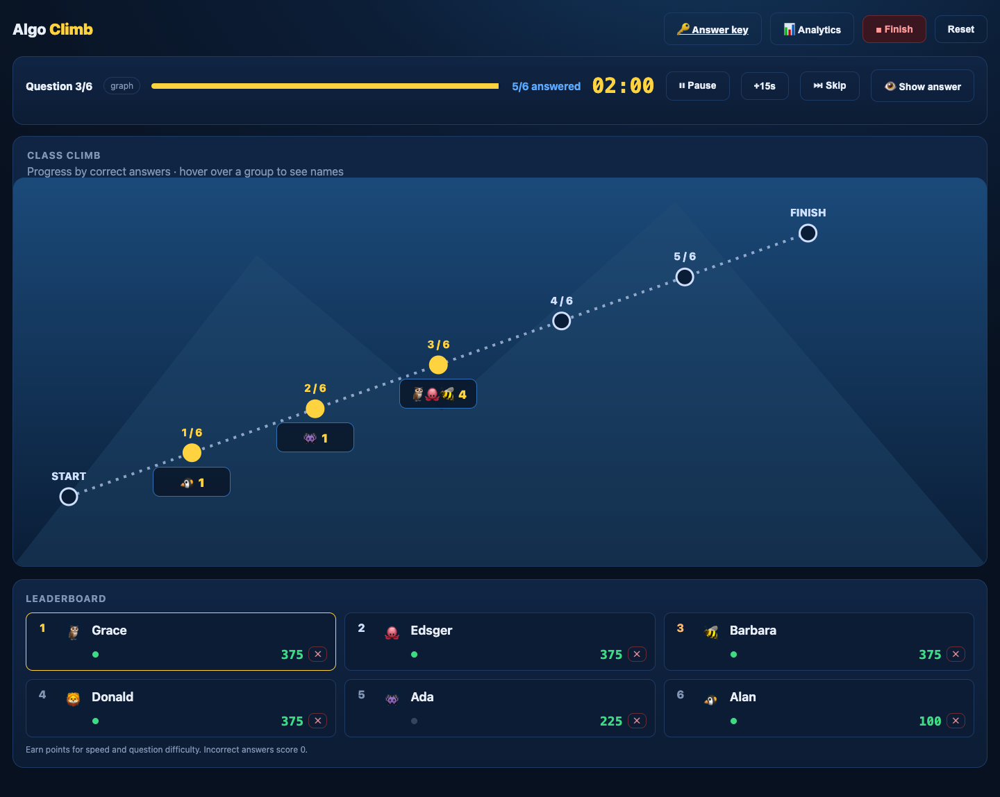
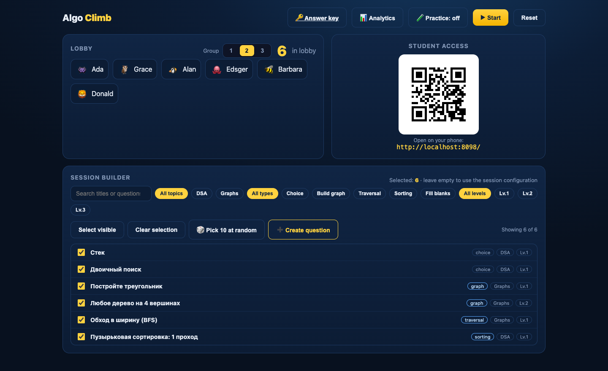
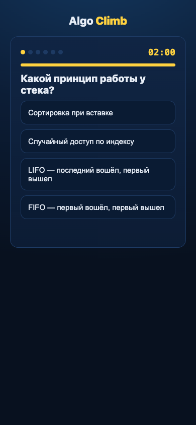
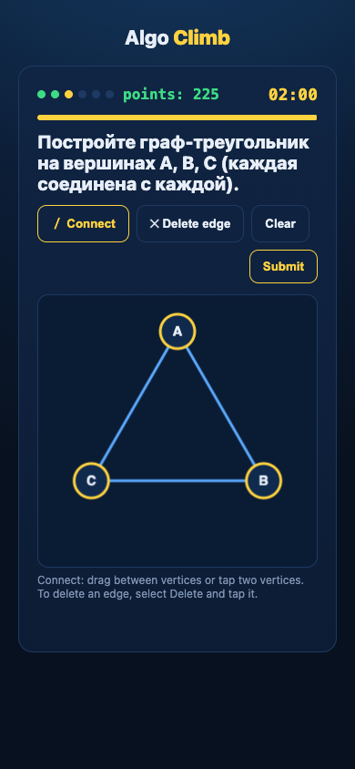
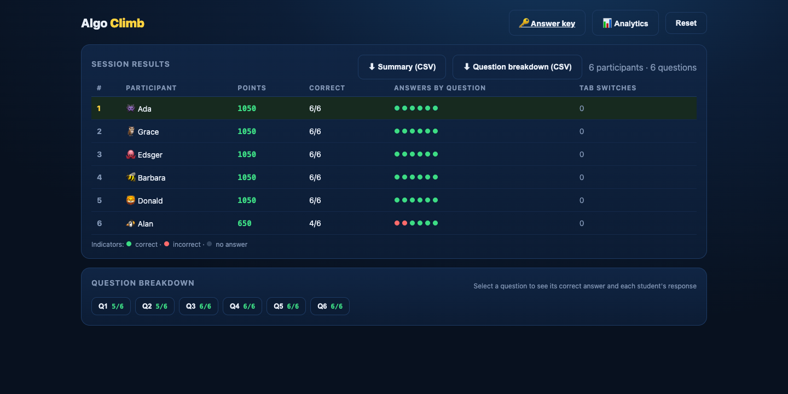
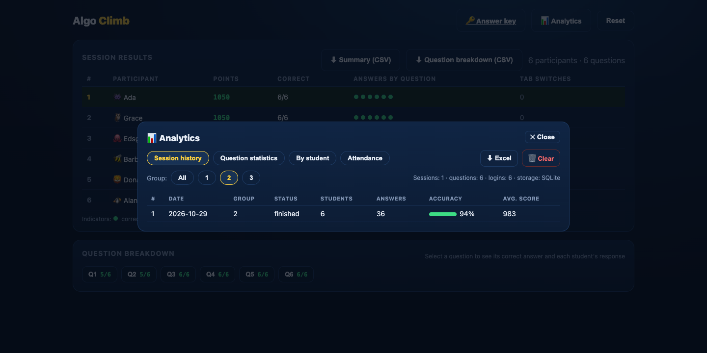
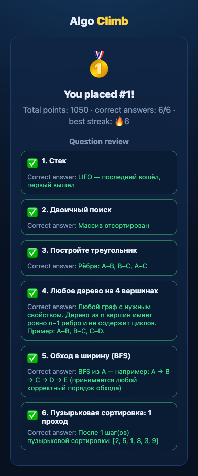
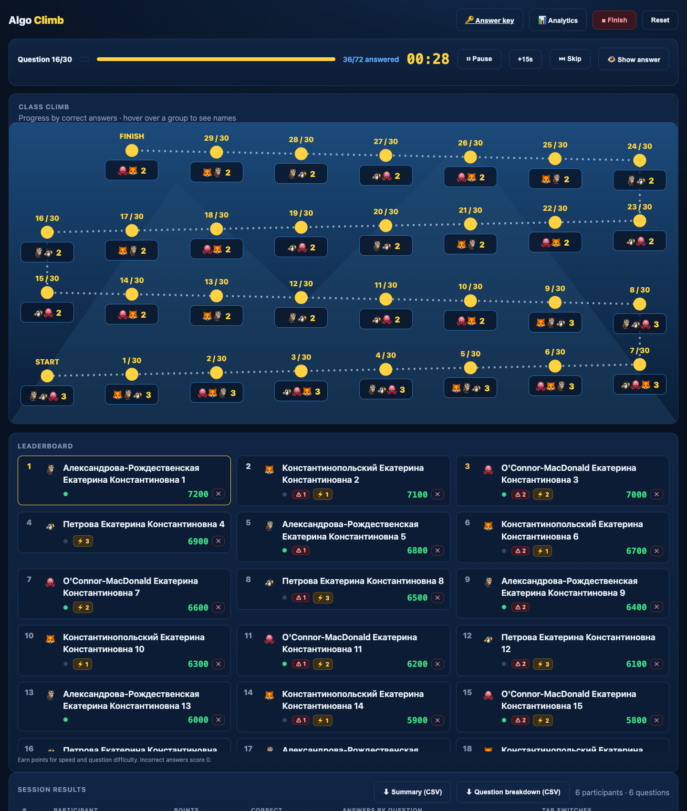

<div align="center">

# AlgoClimb

**Turn a classroom quiz into a shared climb.**

Students answer on their phones. You lead the session, follow progress live, and review the results.

[](https://github.com/21astroboy/Algoclimb/actions/workflows/ci.yml)
[](https://www.python.org/)
[](LICENSE)

[Get started](#quick-start) · [Run a class](#run-a-class) · [Write questions](docs/task-bank.md) · [Deploy](docs/deployment.md)

</div>



A self-hosted app for live classroom quizzes in algorithms, graph theory, combinatorics,
or any other subject. Everyone answers the same question at the same time. Students join
by QR code, and each correct answer moves them up the mountain.

The interface is **English**. Your questions, answer options and explanations can stay
**Russian** or use any other language. The public demo bank includes Russian questions.

## What you can do

- **Build a session:** filter your bank by topic, type and difficulty, or create questions in the UI.
- **Teach at your pace:** start, pause, resume, add time, or skip a question.
- **Use five question types:** multiple choice, graph construction, traversal, sorting and fill-in-the-blank.
- **Follow the class:** a full-width progress map and a leaderboard of all participants,
  with large, wrapping names, answer counts and tab-switch indicators.
- **Review the results:** per-student answers, response times, attendance, CSV and Excel exports.
- **Keep your own data:** SQLite history and private question banks on your server; optional Google Sheets export.

## Quick start

### With Docker

Install Docker with Compose, then:

```bash
git clone https://github.com/21astroboy/Algoclimb.git
cd Algoclimb
cp .env.example .env
./algoclimb up
```

Open **[localhost:3000/teacher](http://localhost:3000/teacher)** and sign in with the teacher
key printed in the terminal. Find it again with `./algoclimb key`.

The app works immediately with the public demo bank. To let phones join, set `PUBLIC_URL`
in `.env` to an address reachable from those phones, then run `./algoclimb up` again.
For example, use your computer's LAN address on the same Wi-Fi. `localhost` works only
on the device running the server.

### With Python

Use Python **3.11 or newer** (3.12 is used in CI):

```bash
python3.12 -m venv .venv
source .venv/bin/activate
pip install -r requirements.txt
python -m uvicorn main:app --app-dir backend --host 0.0.0.0 --port 3000 --ws wsproto
```

Run **one worker**: the live session is shared in that process's memory. The direct Python
command reads environment variables; it does not automatically load `.env`.

## Run a class

1. Open `/teacher` and enter your private teacher key.
2. Choose the class group and questions. Use **Practice** for a rehearsal without saving results.
3. Students scan the QR, enter their assigned nickname, and choose an avatar.
4. Select **Start**. Each question ends when everyone has answered or its timer expires.
5. Pause, resume or add time as needed. The server accepts one valid submission per question;
   answers during a pause or after the deadline are rejected. Invalid formats leave the attempt available.
6. Review the final leaderboard and question breakdown. Students receive their own answer review.

Keep `/answers` and its teacher key private. Select **Show answer** only when you intend
to reveal the answer on the projected screen.



## On students' phones

<table>
  <tr>
    <td align="center"><b>Choose an answer</b></td>
    <td align="center"><b>Build a graph</b></td>
  </tr>
  <tr>
    <td align="center"></td>
    <td align="center"></td>
  </tr>
</table>

## After the session

See who answered, which questions were difficult, and how long each response took.
Export the summary or inspect individual answers. Tab-switch and fast-answer flags
are activity indicators for the teacher to interpret.



<details>
<summary>More screenshots: analytics and student review</summary>





**Large-class layout: 72 fictional participants across 30 checkpoints.**



</details>

Screenshots use public demo questions and fictional participants. The large-class view
uses a deterministic layout fixture. [Reproduce them locally](docs/development.md#screenshots).

## Bring your own questions

Put your private bank in `secrets/task-bank.json`. Add optional post-session explanations
in `secrets/explanations.json`, keyed by question ID. Restart the app after changing them.
The files are mounted into Docker and excluded from Git and the image.

Start with the [question bank guide](docs/task-bank.md) and
[demo examples](backend/data/task-bank.example.json). The bank determines the subject;
the interface does not translate your content.

## Documentation

| Guide | What it covers |
| --- | --- |
| [Question banks](docs/task-bank.md) | JSON fields, answer formats and multilingual content |
| [Deployment](docs/deployment.md) | VPS setup, HTTPS, configuration, updates, backup and recovery |
| [Development](docs/development.md) | Architecture, checks, isolated E2E tests and screenshot capture |

Built with **FastAPI**, **WebSockets**, **SQLite** and static HTML/CSS/JavaScript.
No frontend build is needed to run the app.

Created by Kirill · [@21astroboy](https://github.com/21astroboy) · [AGPL-3.0](LICENSE)
