<div align="center">

# AlgoClimb

**Turn a classroom quiz into a shared climb.**

Students answer on their phones. You lead the session, follow progress live, and review the results.

[](https://github.com/21astroboy/Algoclimb/actions/workflows/ci.yml)
[](https://www.python.org/)
[](LICENSE)

[English](README.md) · [Русский](README.ru.md)

[Get started](#quick-start) · [Run a class](#run-a-class) · [Write questions](docs/task-bank.md) · [Deploy](docs/deployment.md)

</div>

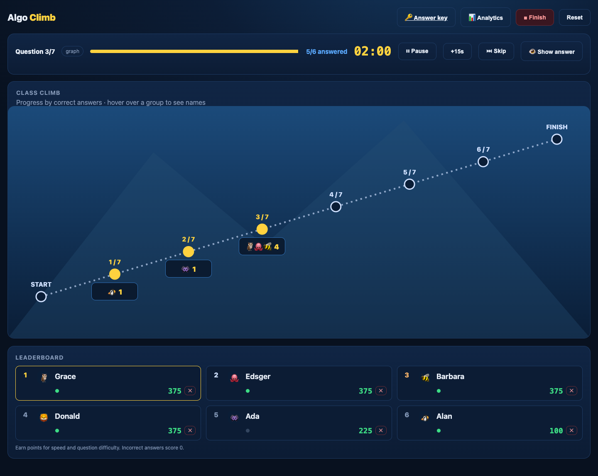

A self-hosted app for live classroom quizzes in algorithms, graph theory, combinatorics,
or any other subject. Everyone answers the same question at the same time. Students join
by QR code, and each correct answer moves them up the mountain.

The interface is **English**. Your questions, answer options and explanations can stay
**Russian** or use any other language. The default public demo bank includes Russian questions. The screenshots below use
an English demonstration bank; the [Russian page](README.ru.md) shows Russian tasks.

## What you can do

- **Build a session:** filter your bank by topic, type and difficulty, or create questions in the UI.
- **Teach at your pace:** start, pause, resume, add time, or skip a question.
- **Use five question types:** multiple choice, graph construction, traversal, sorting and fill-in-the-blank.
- **Follow the class:** a full-width progress map and a leaderboard of all participants,
  with large, wrapping names, answer counts and tab-switch indicators.
- **Review the results:** per-student answers, response times, attendance, CSV and Excel exports.
- **Keep your own data:** SQLite history and private question banks on your server; optional Google Sheets export.

## Quick start

### With Docker

Install Docker with Compose, then:

```bash
git clone https://github.com/21astroboy/Algoclimb.git
cd Algoclimb
cp .env.example .env
./algoclimb up
```

Open **[localhost:3000/teacher](http://localhost:3000/teacher)** and sign in with the teacher
key printed in the terminal. Find it again with `./algoclimb key`.

The app works immediately with the public demo bank. To let phones join, set `PUBLIC_URL`
in `.env` to an address reachable from those phones, then run `./algoclimb up` again.
For example, use your computer's LAN address on the same Wi-Fi. `localhost` works only
on the device running the server.

### With Python

Use Python **3.11 or newer** (3.12 is used in CI):

```bash
python3.12 -m venv .venv
source .venv/bin/activate
pip install -r requirements.txt
python -m uvicorn main:app --app-dir backend --host 0.0.0.0 --port 3000 --ws wsproto
```

Run **one worker**: the live session is shared in that process's memory. The direct Python
command reads environment variables; it does not automatically load `.env`.

## Run a class

1. Open `/teacher` and enter your private teacher key.
2. Choose the class group and questions. Use **Practice** for a rehearsal without saving results.
3. Students scan the QR, enter their assigned nickname, and choose an avatar.
4. Select **Start**. Each question ends when everyone has answered or its timer expires.
5. Pause, resume or add time as needed. The server accepts one valid submission per question;
   answers during a pause or after the deadline are rejected. Invalid formats leave the attempt available.
6. Review the final leaderboard and question breakdown. Students receive their own answer review.

Keep `/answers` and its teacher key private. Select **Show answer** only when you intend
to reveal the answer on the projected screen.

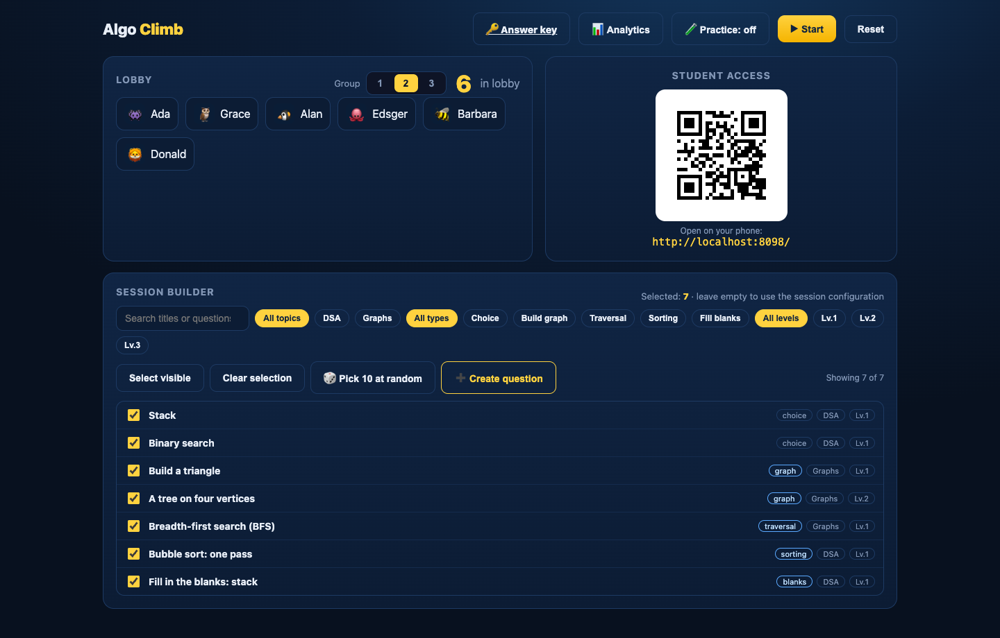

## Question types, with examples

| Type | What students do | Example | How it is checked |
| --- | --- | --- | --- |
| **Choice** (`choice`) | Select one shuffled option. | “Which rule does a stack follow?” → LIFO. | One reference answer, indexed from zero in the bank. |
| **Graph** (`graph`) | Draw edges or select edges in a weighted graph. | Build a triangle, construct any tree, or find an MST. | Exact edges, a graph property, or minimum spanning-tree weight. |
| **Traversal** (`order`) | Select vertices in their visit order. | BFS from A → A, B, C, D, E. | Valid BFS/DFS, with any valid neighbor order. |
| **Sorting** (`sort`) | Rearrange numbers after a specified number of steps. | One bubble pass: `[5, 2, 8, 1, 9, 3]` → `[2, 5, 1, 8, 3, 9]`. | Exact intermediate array, not necessarily a fully sorted array. |
| **Blanks** (`blank`) | Type text or select dropdown values. | “A stack follows ___; adding an item uses ___.” → LIFO, push. | Every blank must match an accepted answer. |

### Choice and blanks: quizzes in any subject

Use `choice` for definitions, asymptotic complexity, combinatorial counts or reading code.
It supports **one correct option**, not multiple selection. The server shuffles the options
per round while keeping grading consistent.

Use `blank` for a formula, a code fragment, terminology or a number. Mark each field with
`___` in the template. Mix text inputs and dropdowns in one question. Text inputs ignore
case and normalize whitespace; use `alts` for synonyms. All blanks must be correct for
credit. See [complete JSON examples](docs/task-bank.md#5-fill-in-the-blanks--blank).

### Graph construction: exact answers or multiple valid solutions

A triangle can require exactly A–B, B–C and A–C. A tree question can instead accept
**any** connected n−1-edge graph: both a path and a star may be correct.
The app also supports cycles, paths, forests, regular and Eulerian graphs, complete
and complete bipartite graphs. Weighted exercises ask students to select a minimum
spanning tree, accepting alternative trees with the same minimum weight.

Graphs are simple and undirected. Some template names describe approximate structural
checks; consult the [graph checker reference](docs/task-bank.md#2-build-or-select-a-graph--graph)
before writing a precise mathematical requirement.

### Traversal and sorting: assess the process

For `order`, supply a graph, starting vertex and BFS or DFS mode. The student selects
vertices instead of guessing from options. Several valid traversal orders can pass;
alphabetical tie-breaking is not enforced.

For `sort`, choose bubble or insertion sort and the number of passes/insertions.
One bubble pass moves the largest remaining value to the end. One insertion step
extends the sorted prefix by one value. The bank supplies the expected intermediate
array. Optional per-session randomization generates new arrays and matching answers.

[Read the full authoring guide: fields, seven JSON examples, accepted answers and common mistakes →](docs/task-bank.md)

## On students' phones

<table>
  <tr>
    <td align="center"><b>Choose an answer</b></td>
    <td align="center"><b>Build a graph</b></td>
  </tr>
  <tr>
    <td align="center">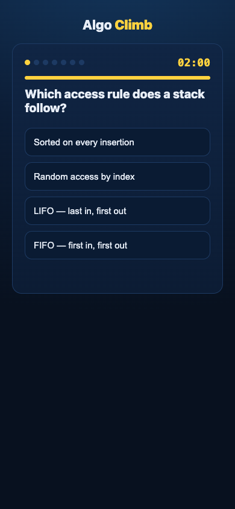</td>
    <td align="center">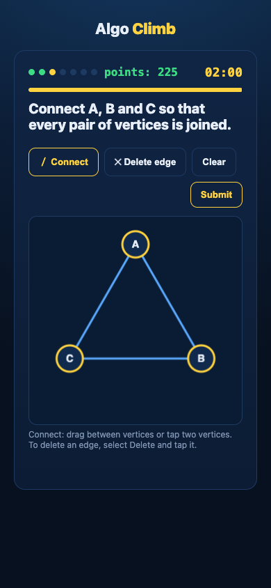</td>
  </tr>
</table>

<table>
  <tr>
    <td align="center"><b>Traverse a graph</b></td>
    <td align="center"><b>Apply a sorting step</b></td>
    <td align="center"><b>Fill in the blanks</b></td>
  </tr>
  <tr>
    <td>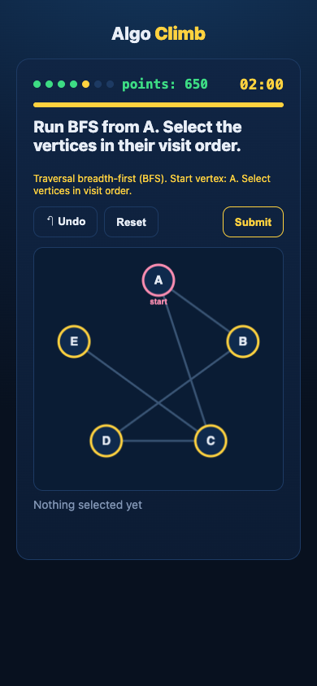</td>
    <td>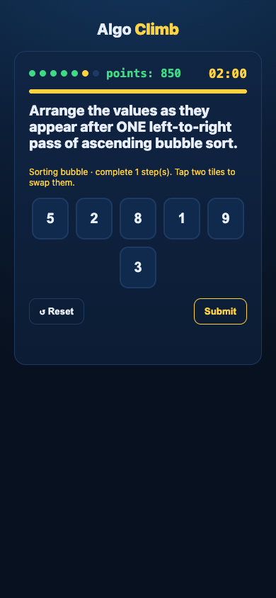</td>
    <td>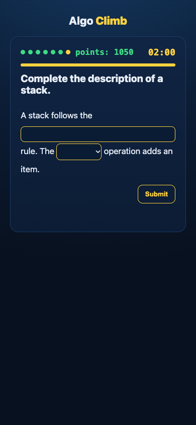</td>
  </tr>
</table>

## After the session

See who answered, which questions were difficult, and how long each response took.
Export the summary or inspect individual answers. Tab-switch and fast-answer flags
are activity indicators for the teacher to interpret.

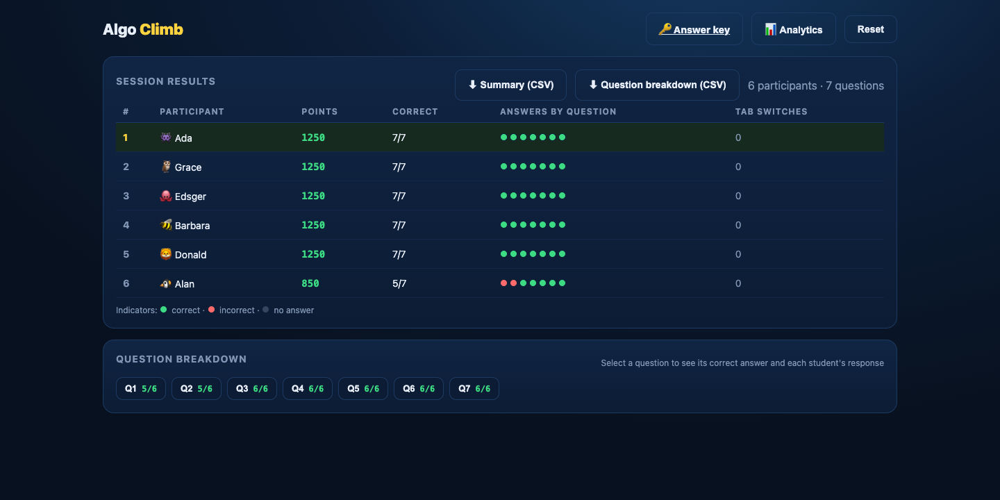

<details>
<summary>More screenshots: analytics and student review</summary>

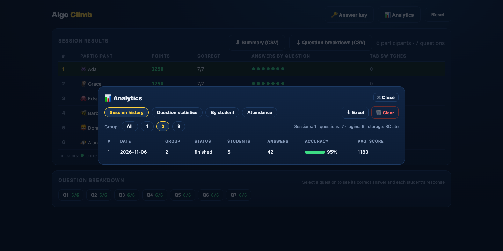

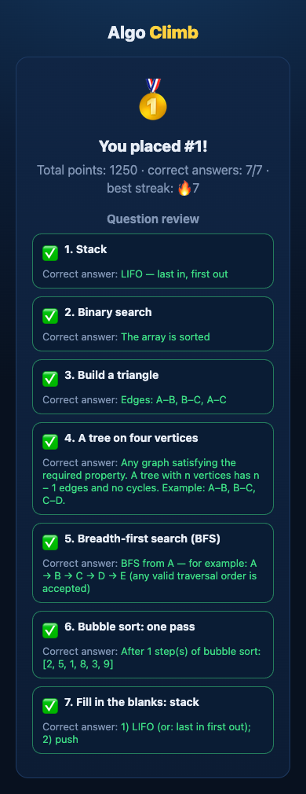

**Large-class layout: 72 fictional participants across 30 checkpoints.**

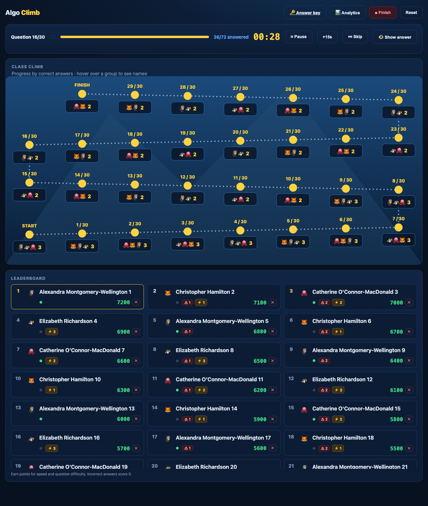

</details>

Screenshots use public demo questions and fictional participants. The large-class view
uses a deterministic layout fixture. [Reproduce them locally](docs/development.md#screenshots).

## Scoring, timing and reconnects

- A correct answer earns points based on task difficulty, time remaining and the current
  correct-answer streak. Wrong or missing answers earn zero and reset the streak.
- With the example configuration, base points are 100, the guaranteed fraction is 0.4,
  and streak bonuses grow by 25 up to 100. Scoring values and time limits are configurable.
- Choice and blank questions share the short time limit; graph, traversal and sort use
  the longer limit. A per-task `timeLimit` in seconds overrides either default. Pausing stops the question clock. **+15s** extends it.
- A phone reconnects automatically after a detected outage. Unconfirmed answers are queued
  and retried for the same current question; an outage does not extend the server deadline.
- Reloading can restore the student using a browser-stored reconnect secret. A shared QR
  does not grant ownership of a protected nickname. Keep the original browser/storage
  when reconnecting; compatibility for older pages is described in the reliability guide.
- Recent disconnects get a short grace window before an early “everyone answered” finish.
  A student who missed the final broadcast can reconnect to recover the score and review.

**Practice** runs without writing session history. Use it for rehearsals and checking a new
bank; turn it off when you need saved attendance and results.

The synthetic reliability check completed **100 students × 30 questions**, with all 3000
answers recorded and all 122 injected disconnects restored. This is a local test, not a
capacity guarantee for classroom Wi-Fi or every VPS. See [method and limits](docs/reliability.md).

## Bring your own questions

Put your private bank in `secrets/task-bank.json`. Add optional post-session explanations
in `secrets/explanations.json`, keyed by question ID. Restart the app after changing them.
The files are mounted into Docker and excluded from Git and the image.

Start with the [question bank guide](docs/task-bank.md) and
[demo examples](backend/data/task-bank.example.json). The bank determines the subject;
the interface does not translate your content.

## Question types

A bank is a JSON array of task objects. Every task shares a common core — `id`, `type`,
`topic`, `level` (`1`–`3`, affects scoring), `title` and `prompt` — plus these optional fields:

- `hint` — a short clue shown while the question is live.
- `block` — groups the task into a named set that the UI turns into a filter.
- `timeLimit` — per-question time in seconds, overriding the default for that type.
- `figure` — an inline `<svg>…</svg>` string rendered as a static picture under the prompt
  (useful for a diagram or a monospaced directory tree). Only strings beginning with `<svg`
  are rendered.

Five `type` values are available. `choice` and `blank` are subject-agnostic and enough for any
quiz; `order`, `sort` and `graph` are specialized for algorithms and graph theory.

| Type | What the student does | Type-specific fields |
| --- | --- | --- |
| `choice` | Picks one option | `options` (list of choices), `answer` (zero-based index of the correct one). Option order is reshuffled each round. |
| `blank` | Fills gaps in a template | `template` with each gap marked `___`; `blanks` — one entry per gap: `answer` + optional `alts` for free text, or `options` for a dropdown. |
| `order` | Reproduces a traversal order | `nodes`, `edges` (`[[a, b], …]`), `start`, `mode` (`bfs` or `dfs`). Any valid traversal from the start is accepted. |
| `sort` | Arranges an array into the target state | `array`, `algo`, `steps`, and `expected` (the accepted result array). |
| `graph` | Constructs a graph on given `nodes` | one of: `requiredEdges` (exact edge set); `weighted` + `refEdges` (a minimum spanning tree); or `graphKind` (+ `graphArg`) for "any graph with a property". |

For the property-based `graph` type, `graphKind` accepts `anyTree`, `anyForest`
(`graphArg` = number of components), `anyCycle`, `anyPath`, `anyComplete`,
`anyCompleteBipartite`, `anyStar`, `anyBinaryTree`, `anyCycleChord`, `anyEulerian`,
`anyRegular` (`graphArg` = degree) and `anyComponents` (`graphArg` = number of components).
The checker accepts any graph that satisfies the property, not one fixed answer.

The UI builds its topic, type, level and set filters from whatever is present in the bank, so
adding tasks with a new `topic` or `block` makes those appear automatically. See the
[question bank guide](docs/task-bank.md) for full field semantics and multilingual notes.

### A minimal question you can adapt

Save an array like this in `secrets/task-bank.json`:

```json
[
  {
    "id": "stack_rule",
    "type": "choice",
    "topic": "Data structures",
    "level": 1,
    "title": "Stack access rule",
    "prompt": "Which rule does a stack follow?",
    "options": ["FIFO", "LIFO", "Random access"],
    "answer": 1
  }
]
```

`answer: 1` means the second original option. Add more objects to the array for other tasks.
Use `block` to group tasks into reusable sets and `figure` for an optional SVG illustration.
Explanations are a separate object such as `{ "stack_rule": "The last item added is removed first." }`.
Try a new bank in Practice before using it for assessment.

## Hosting and routine operations

| Command / setting | Purpose |
| --- | --- |
| `./algoclimb up` | Build and start the app. |
| `./algoclimb status` | Inspect the container state. |
| `./algoclimb logs` | Follow application logs. |
| `./algoclimb key` | Show the teacher key locally. |
| `./algoclimb deploy` | Pull `origin/main`, rebuild and recreate the app; update between classes. |
| `./algoclimb restart` | Restart the existing image; does not rebuild changed code. |
| `PUBLIC_URL` | Address phones can reach, used in the QR. |
| `TEACHER_KEY` | Fixed private key for teacher controls and answer-key access. |
| `QR_ROTATION=1` | Rotate admission QR codes; use `QR_INTERVAL` for the interval. |

For public hosting, configure HTTPS and WebSocket forwarding in a reverse proxy. Back up
`backend/data/runtime/`, private bank files and configuration. History is stored in SQLite;
the runtime snapshot can restore a running session after restart, but phones still have
to reconnect and the question deadline continues to matter.

Use **one application worker**. Multiple independent replicas do not share live session state.
Updating recreates the container, so deploy between classes and reload browser pages afterward.
See the [deployment guide](docs/deployment.md) for configuration, backups and recovery.

## Documentation

| Guide | What it covers |
| --- | --- |
| [Question banks](docs/task-bank.md) · [Русский](docs/task-bank.ru.md) | All five types, JSON examples, graph checks, formulas and explanations |
| [Deployment](docs/deployment.md) | VPS setup, HTTPS, configuration, updates, backup and recovery |
| [Development](docs/development.md) | Architecture, checks, isolated E2E tests and screenshot capture |
| [Reliability](docs/reliability.md) | Full-session load tests, reconnect faults, score integrity and measured results |

Built with **FastAPI**, **WebSockets**, **SQLite** and static HTML/CSS/JavaScript.
No frontend build is needed to run the app.

## Contributing

Start with [development setup and checks](docs/development.md). Use public fixtures and
fictional participants in tests or screenshots. Include the relevant checks with a change;
do not commit private question banks, student data, teacher keys or `.env` files.

```text
backend/        FastAPI, grading, persistence and regression tests
frontend/       Teacher, student and answer-key pages
secrets/        Local private banks and credentials (ignored)
tools/          Local demos, screenshots and reliability checks
docs/           Guides, screenshots and benchmark reports
```

Created by Kirill · [@21astroboy](https://github.com/21astroboy) · [AGPL-3.0](LICENSE)
