<div align="center">

# AlgoClimb

**Превратите проверку знаний в совместное восхождение.**

Студенты отвечают с телефонов. Преподаватель управляет сессией, видит прогресс и разбирает результаты.

[](https://github.com/21astroboy/Algoclimb/actions/workflows/ci.yml)
[](https://www.python.org/)
[](LICENSE)

[Русский](README.ru.md) · [English](README.md)

[Быстрый запуск](#быстрый-запуск) · [Провести занятие](#провести-занятие) · [Типы задач](#пять-типов-задач) · [Создать банк](docs/task-bank.ru.md)

</div>

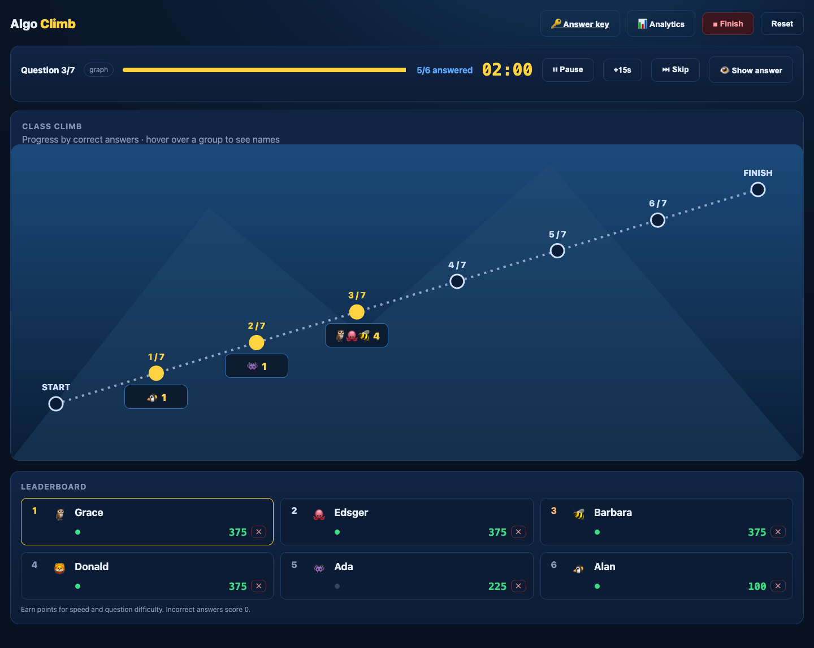

AlgoClimb — приложение для синхронных викторин на своём сервере. Подходит для курса
«Алгоритмы и структуры данных», комбинаторики, теории графов и других предметов.
Все участники получают один вопрос одновременно. Правильные ответы двигают их вверх по горе.

**Интерфейс приложения — английский.** Условия, варианты и разборы можно писать на русском,
английском или другом языке. Здесь показаны русские задачи; в [английском README](README.md)
используется английский демонстрационный банк. Это две версии документации, а не переключатель языка интерфейса.

## Возможности

- Конструктор сессии с фильтрами по темам, типам, сложности и готовым наборам.
- Создание задач из интерфейса и загрузка собственного JSON-банка.
- Пять типов: выбор ответа, построение графа, обход, сортировка и пропуски.
- Управление занятием: старт, пауза, продолжение, дополнительное время и пропуск вопроса.
- Широкая карта прогресса и таблица всех участников с переносом длинных имён.
- Финальный разбор по вопросам, ответы студентов, время ответа, посещаемость, CSV и Excel.
- SQLite на своём сервере, закрытый банк и необязательная выгрузка в Google Sheets.
- Восстановление связи и повторная отправка неподтверждённого ответа на текущий вопрос.

## Быстрый запуск

### Docker

Установите Docker с Compose и выполните:

```bash
git clone https://github.com/21astroboy/Algoclimb.git
cd Algoclimb
cp .env.example .env
./algoclimb up
```

Откройте [localhost:3000/teacher](http://localhost:3000/teacher) и введите ключ преподавателя
из терминала. Повторно посмотреть ключ: `./algoclimb key`.

На свежем клоне работает открытый демобанк. Чтобы подключались телефоны, задайте в `.env`
`PUBLIC_URL` — адрес, доступный студентам, — и снова запустите `./algoclimb up`.
Для общей Wi-Fi-сети подойдёт локальный IP компьютера. `localhost` на телефоне означает
сам телефон, а не ваш компьютер.

### Python

Нужен Python **3.11+**, в CI используется 3.12:

```bash
python3.12 -m venv .venv
source .venv/bin/activate
pip install -r requirements.txt
python -m uvicorn main:app --app-dir backend --host 0.0.0.0 --port 3000 --ws wsproto
```

Запускайте **один worker**: живая сессия хранится в памяти одного процесса.
Прямой запуск Python читает переменные окружения, но сам не загружает `.env`.

## Провести занятие

1. Откройте `/teacher` и введите закрытый ключ преподавателя.
2. Выберите поток, темы и задачи. Если ничего не выбрано, набор определяется конфигурацией.
3. Для репетиции включите **Practice**: история такой сессии не записывается.
4. Студенты сканируют QR, вводят выданные ники и выбирают аватары.
5. Нажмите **Start**. Вопрос закрывается по таймеру или после ответов всех подключённых,
   с коротким ожиданием недавно отключившихся участников.
6. Используйте **Pause**, продолжение, **+15s** и **Skip** по ходу занятия.
7. Посмотрите результаты и разбор. Студент получает собственные итоги и правильные ответы.

На вопрос принимается одна попытка корректного формата. Неверный ответ расходует попытку;
ошибочный формат — нет. Ответы на паузе и после серверного дедлайна отклоняются.
Не показывайте `/answers` и ключ преподавателя студентам. **Show answer** раскрывает ответ
на проецируемом экране — включайте его осознанно.

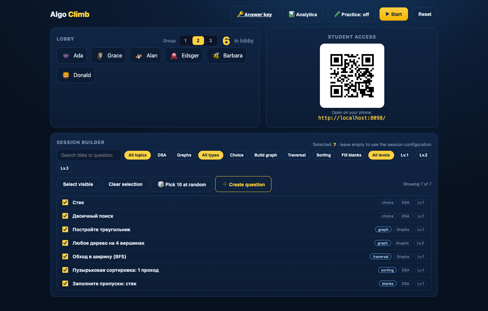

## Пять типов задач

| Тип | Действие студента | Пример | Как проверяется |
| --- | --- | --- | --- |
| **Выбор** (`choice`) | Нажать один из перемешанных вариантов. | Принцип работы стека → LIFO. | Совпадение с одним правильным вариантом. |
| **Граф** (`graph`) | Нарисовать рёбра или выбрать их в готовом графе. | Треугольник, любое дерево, минимальный остов. | Точные рёбра, свойство графа или минимальный вес остова. |
| **Обход** (`order`) | Выбрать вершины в порядке посещения. | BFS из A → A, B, C, D, E. | Корректный BFS/DFS; допустимы разные порядки соседей. |
| **Сортировка** (`sort`) | Переставить числа после заданного числа шагов. | Один проход: `[5, 2, 8, 1, 9, 3]` → `[2, 5, 1, 8, 3, 9]`. | Точное промежуточное состояние массива. |
| **Пропуски** (`blank`) | Ввести текст или выбрать значение из списка. | Принцип ___, операция добавления ___ → LIFO, push. | Верны все поля; для текста можно задать варианты ответа. |

### Выбор и пропуски: для любого предмета

`choice` подходит для определений, оценки сложности, подсчётов и вопросов по коду.
Правильный вариант один; индекс `answer` задаётся с нуля в исходном банке, до перемешивания.

`blank` подходит для формул, терминов, чисел и фрагментов кода. Каждый `___` создаёт поле.
В одном задании можно сочетать свободный ввод и списки. При свободном вводе регистр и лишние
пробелы нормализуются, `alts` задаёт дополнительные допустимые ответы. Частичных баллов
за отдельные пропуски нет.

### Построение графа: одна конструкция или множество решений

Можно потребовать ровно три ребра треугольника, а можно принять **любое дерево**:
и путь A–B–C–D, и звезду с центром A. Поддерживаются пути, циклы, леса, регулярные,
эйлеровы, полные и полные двудольные графы. Во взвешенном графе студент выбирает
минимальный остов; разные остовы минимального веса принимаются.

Графы простые, неориентированные. У некоторых шаблонов проверяется определённый набор
структурных условий: перед использованием смотрите [точные правила](docs/task-bank.ru.md#2-построение-или-выбор-рёбер-графа--graph).
Например, `anyBinaryTree` проверяет дерево со степенями не больше 3, а не дерево поиска с корнем.

### Обход и сортировка: проверка процесса

В `order` студент выбирает вершины, а не угадывает готовую последовательность.
Для BFS/DFS задаются граф и стартовая вершина. Допустимы разные корректные порядки
соседей: алфавитный порядок автоматически не требуется.

В `sort` важно число шагов: один проход пузырьковой сортировки переносит максимум
в конец, один шаг вставок расширяет отсортированный префикс. Полностью отсортированный
массив может оказаться неверным ответом. При включённой параметризации исходные массивы
и ожидаемые результаты пересчитываются для новой сессии.

[Полное руководство: поля, семь JSON-примеров, допустимые ответы и частые ошибки →](docs/task-bank.ru.md)

## На телефоне студента

<table>
  <tr><td align="center"><b>Выбор ответа</b></td><td align="center"><b>Построение графа</b></td></tr>
  <tr>
    <td>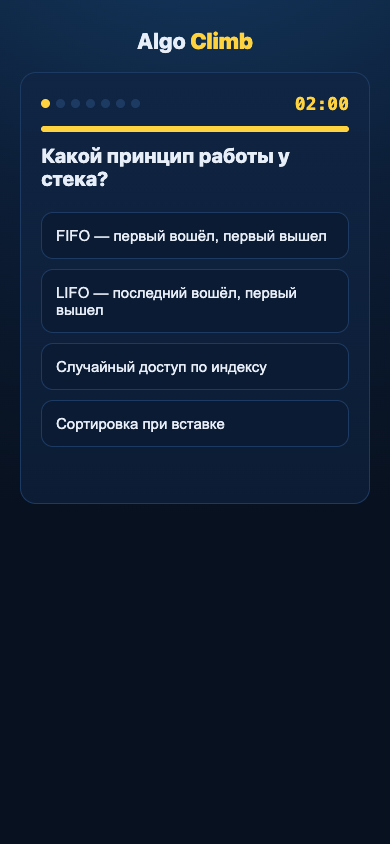</td>
    <td>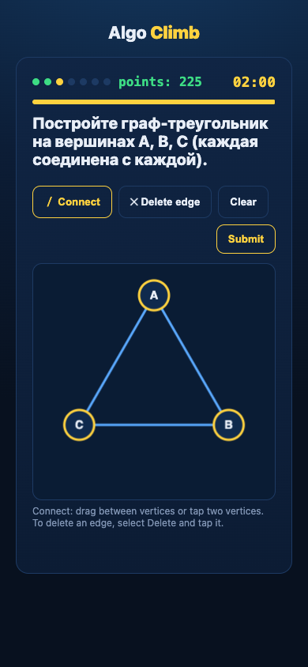</td>
  </tr>
</table>

<table>
  <tr><td align="center"><b>Обход графа</b></td><td align="center"><b>Шаг сортировки</b></td><td align="center"><b>Пропуски</b></td></tr>
  <tr>
    <td>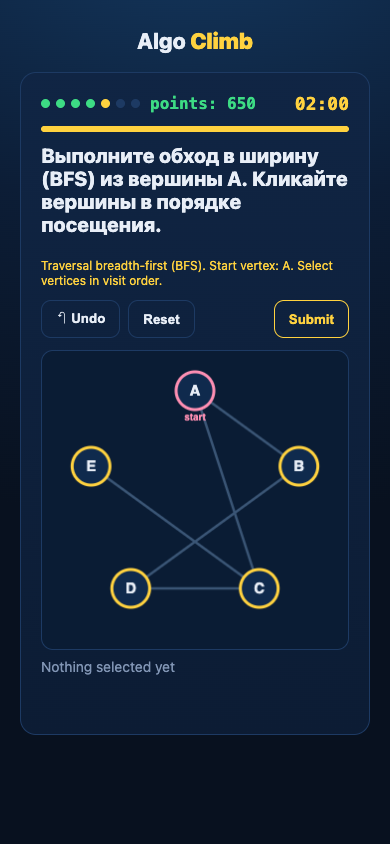</td>
    <td>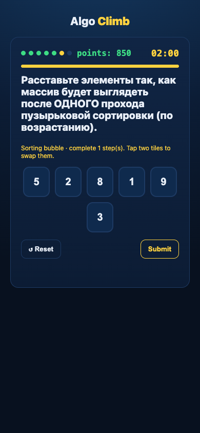</td>
    <td>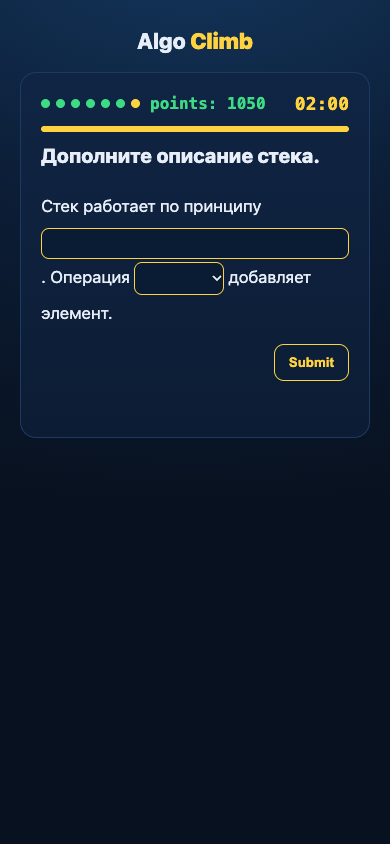</td>
  </tr>
</table>

## Баллы и устойчивость соединения

Верный ответ приносит баллы за сложность, оставшееся время и серию правильных ответов.
Неверный или отсутствующий ответ даёт ноль и сбрасывает серию. В примерной конфигурации:
база 100, гарантированная доля 0,4, прирост бонуса серии 25 с потолком 100.

Выбор и пропуски используют короткий лимит времени; граф, обход и сортировка — длинный.
Можно задать индивидуальный `timeLimit` в секундах. Пауза останавливает таймер,
добавление времени продлевает дедлайн.

Телефон проверяет связь и переподключается при обнаруженном разрыве. Неподтверждённый ответ
остаётся в очереди и повторяется для того же текущего вопроса. **Обрыв связи не продлевает
серверное время ответа.** После перезагрузки вход восстанавливается через секрет в браузере.
Общий QR не позволяет занять защищённый ник: для восстановления используйте исходный
браузер с сохранёнными данными. Для старых страниц действует совместимость в рамках сессии.

В локальном синтетическом тесте **100 участников × 30 вопросов** сохранились все 3000 ответов,
восстановились все 122 искусственных разрыва. Это не гарантия для любой Wi-Fi-сети или VPS.
[Методика и ограничения](docs/reliability.md).

## После занятия

Результаты показывают, кто ответил, какие задания оказались сложными и сколько времени
занял ответ. Есть итоговая таблица и индивидуальные ответы. Уходы со вкладки и быстрые
ответы — сигналы для интерпретации преподавателем, а не доказательство нарушения.

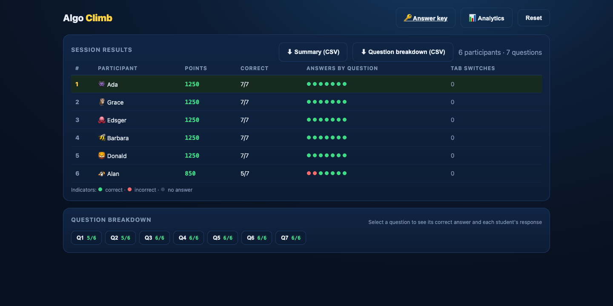

<details>
<summary>Ещё скриншоты: аналитика, личный разбор и большой поток</summary>

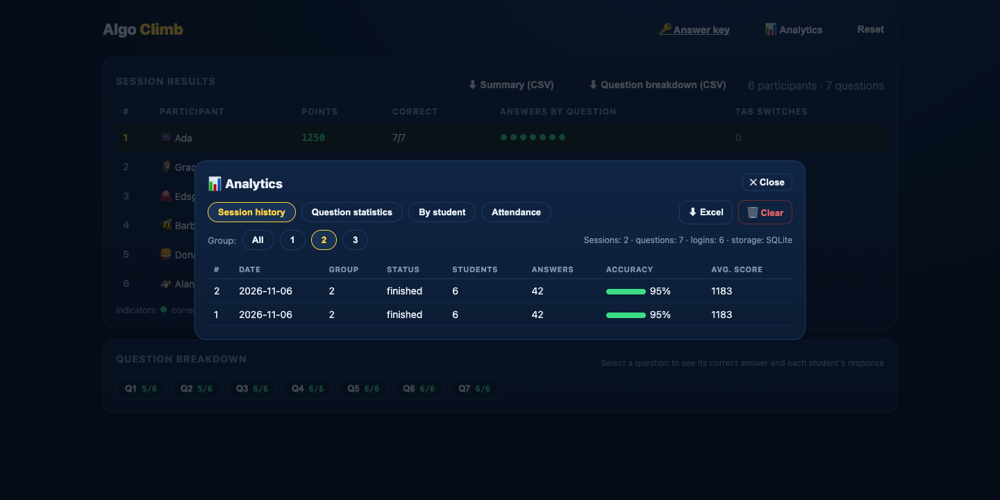

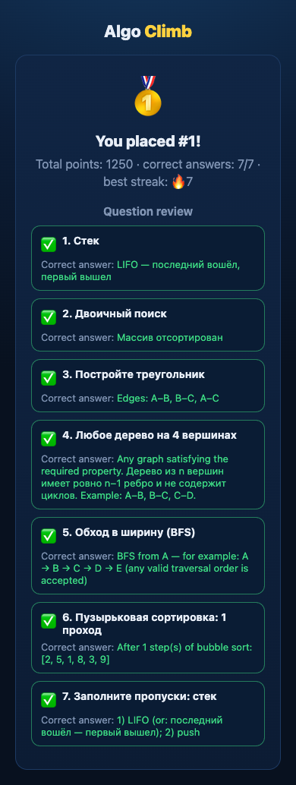

**Макет большого потока: 72 вымышленных участника, 30 вопросов.**

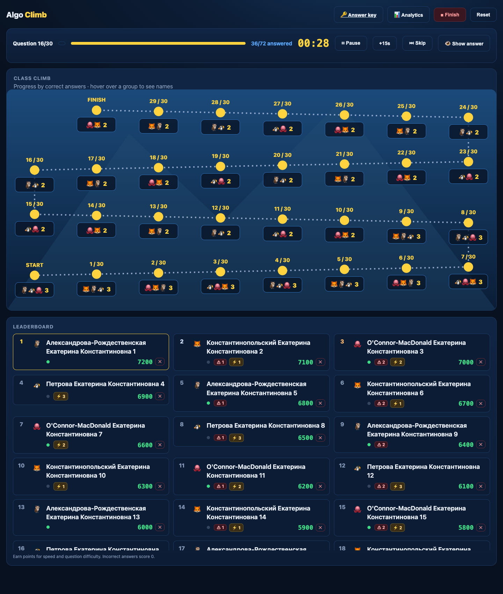

</details>

Скриншоты сняты локально с открытыми демонстрационными задачами и вымышленными участниками.
Большой поток — отдельный детерминированный макет для проверки расположения элементов.
[Как воспроизвести снимки](docs/development.md#screenshots).

## Свой банк задач

Сохраните банк в `secrets/task-bank.json`, разборы по ID — в `secrets/explanations.json`.
После изменения перезапустите приложение. В Docker эти файлы подключаются с диска и
не включаются в образ. Минимальный банк:

```json
[
  {
    "id": "stack_rule",
    "type": "choice",
    "topic": "Структуры данных",
    "level": 1,
    "title": "Принцип работы стека",
    "prompt": "По какому принципу работает стек?",
    "options": ["FIFO", "LIFO", "Произвольный доступ"],
    "answer": 1
  }
]
```

`answer: 1` означает второй исходный вариант. Добавляйте другие объекты в массив.
Поле `block` объединяет задачи в наборы, `figure` добавляет SVG-иллюстрацию.
Пример файла разборов: `{ "stack_rule": "Первым извлекается последний добавленный элемент." }`.
Полная схема и примеры всех типов — в [руководстве по банкам](docs/task-bank.ru.md).

## Управление сервером

| Команда / настройка | Назначение |
| --- | --- |
| `./algoclimb up` | Собрать и запустить приложение. |
| `./algoclimb status` | Посмотреть состояние контейнера. |
| `./algoclimb logs` | Следить за логами. |
| `./algoclimb key` | Посмотреть ключ преподавателя локально. |
| `./algoclimb deploy` | Получить `origin/main`, пересобрать и пересоздать контейнер. |
| `./algoclimb restart` | Перезапустить прежний образ, без пересборки кода. |
| `PUBLIC_URL` | Адрес для телефонов и QR. |
| `TEACHER_KEY` | Постоянный закрытый ключ преподавателя. |
| `QR_ROTATION=1` | Включить смену QR; период задаётся `QR_INTERVAL`. |

Для публичного VPS настройте HTTPS и передачу WebSocket через reverse proxy.
Сохраняйте резервные копии `backend/data/runtime/`, закрытого банка и конфигурации.
История хранится в SQLite; снимок позволяет восстановить живую сессию после перезапуска,
но телефоны должны переподключиться, а дедлайн вопроса продолжает иметь значение.

Используйте один worker: независимые копии не разделяют живое состояние.
Обновляйте сервер между занятиями и затем обновляйте открытые страницы.
[Подробное руководство по развёртыванию](docs/deployment.md) — на английском.

## Документация и разработка

| Руководство | Содержание |
| --- | --- |
| [Банки задач](docs/task-bank.ru.md) · [English](docs/task-bank.md) | Все типы, JSON, правила проверки, формулы и разборы. |
| [Развёртывание](docs/deployment.md) | VPS, HTTPS, конфигурация, обновление и резервные копии; английский. |
| [Разработка](docs/development.md) | Устройство проекта, проверки и воспроизводимые скриншоты; английский. |
| [Надёжность](docs/reliability.md) | Методика нагрузочных тестов, восстановление и ограничения; английский. |

Стек: **FastAPI**, **WebSocket**, **SQLite**, статические HTML/CSS/JavaScript.
Для запуска не нужна сборка frontend. Код сервера и тесты — в `backend/`, страницы —
в `frontend/`, локальные инструменты — в `tools/`, руководства — в `docs/`.

Для изменений используйте открытые фикстуры и вымышленных участников. Не коммитьте
закрытые банки, данные студентов, ключ преподавателя и `.env`.

Автор: Кирилл · [@21astroboy](https://github.com/21astroboy) · [AGPL-3.0](LICENSE)
