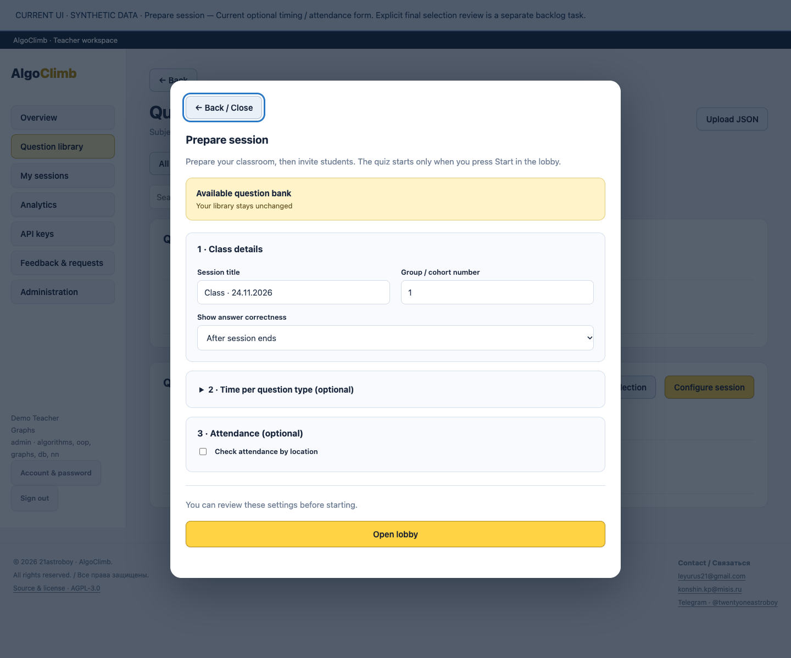

# Подготовка: исключить случайный запуск всего банка

## Какую проблему решаем

Преподаватель открыл Graphs и ожидает провести занятие по выбранному разделу, но фильтр библиотеки и фактический список запуска — разные вещи. При пустом выборе сейчас используется доступный банк, поэтому в занятие могут незаметно попасть другие наборы. Ошибка обнаруживается уже после подключения студентов.

## Что уже есть

Форма стала нагляднее, показывает источник и поддерживает время по типам. Это не заменяет серверную защиту пустого выбора: она остаётся предметом этой карточки.

## Где это находится

**Question library → Select set / Configure session → Prepare session → Open lobby.**

Скриншот текущего интерфейса на синтетических данных. Верхняя плашка поясняет контекст; она не часть продукта. Изображение показывает место доработки, а не готовность всей функции.

## Что нужно сделать

1. Перед созданием/стартом показывать итоговый состав: разделы, наборы и точное количество вопросов. Счётчик должен описывать то, что реально отправится на сервер, а не только текущую страницу фильтра.
2. Если вопросов не выбрано, предложить вернуться в библиотеку либо отдельным явным действием выбрать весь разрешённый банк. Обычная кнопка Start не должна молча соглашаться за преподавателя.
3. Сохранять накопленный выбор при переключении предметов, показывать его отдельно и давать очистить одной кнопкой. Перед стартом повторно проверить актуальные права.

## Пример поведения

До: открыт Graphs, выбрано 0, запускается общий банк. После: «Выберите набор» либо подтверждение «Использовать все N разрешённых вопросов» с составом.

## Что получим

Преподаватель заранее понимает, что увидят студенты; случайный запуск чужого по смыслу набора исключён.

## Критерии готовности

- [ ] Перед запуском видны точное число вопросов, разделы и названия наборов.
- [ ] При пустом выборе требуется выбрать набор либо явно подтвердить использование всего банка.
- [ ] Переход между разделами показывает накопленный выбор; его можно очистить одной кнопкой.
- [ ] Есть регрессии для пустого выбора, смешанных разделов и утраты прав перед стартом.
- [ ] Обход формы прямым HTTP/WS-запросом не снимает защиту пустого выбора.
- [ ] При отзыве доступа между подготовкой и Start запрещённые вопросы не запускаются и не удаляются из выбора без объяснения.

## Границы задачи

Не менять алгоритм оценивания и не внедрять случайную выборку: она выделена в отдельную карточку. Учесть, что статус этой карточки уже In progress.

## Где искать реализацию

- [frontend/workspace.js](https://github.com/21astroboy/Algoclimb/blob/main/frontend/workspace.js)
- [backend/workspace.py](https://github.com/21astroboy/Algoclimb/blob/main/backend/workspace.py)
- [backend/main.py](https://github.com/21astroboy/Algoclimb/blob/main/backend/main.py)
- [backend/accounts.py](https://github.com/21astroboy/Algoclimb/blob/main/backend/accounts.py)

## Зависимости и проверка

Базовая задача для улучшения черновиков и случайной выборки.

Проверить основной сценарий и перечисленные крайние случаи на отдельном runtime/демонстрационных данных. Для интерфейса — desktop и узкий экран; для доступа — владелец и другой преподаватель. Тесты не должны менять production-данные.

---
Описание уточнено 24.11.2026. Это план работ, а не отчёт о выполнении. Статус, приоритет, размер и итерация задаются полями доски; это обновление их не меняет. Первоначальные критерии карточки сохранены и дополнены.
