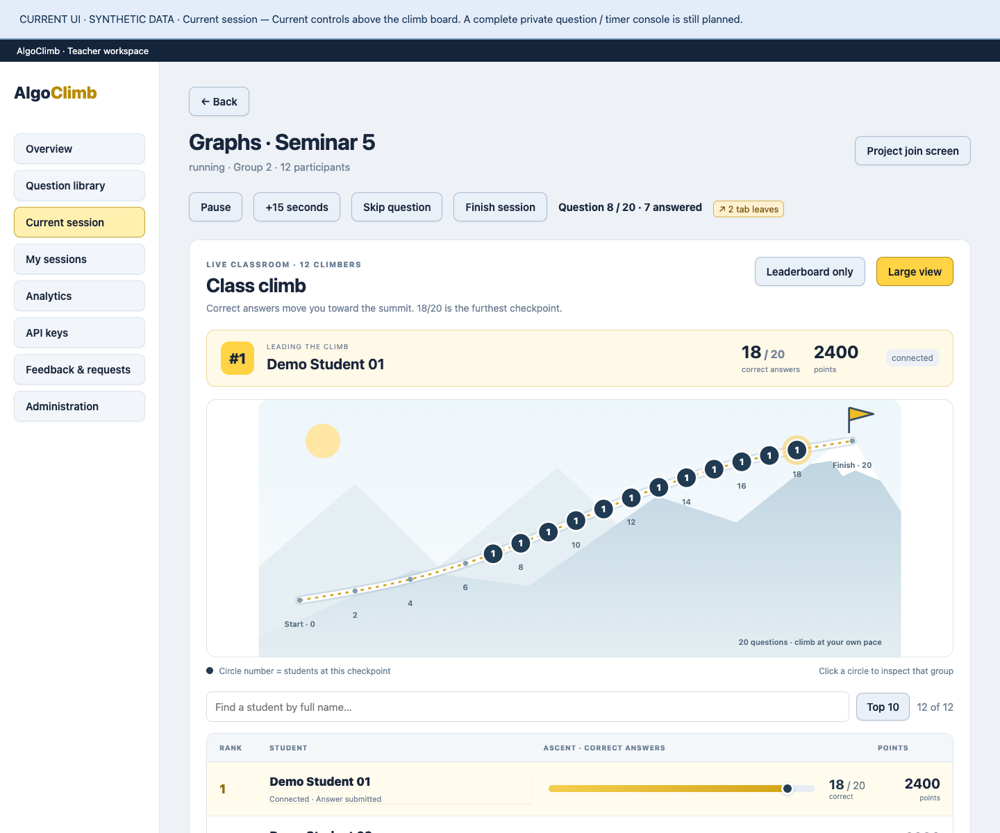

# Занятие: показать текущий вопрос, таймер и ответы преподавателю

## Какую проблему решаем

На занятии преподаватель видит номер вопроса и число ответивших, но для объяснения материала приходится искать условие и контролировать время отдельно. На проекторе нельзя раскрывать правильный ответ вместе с публичной доской.

## Что уже есть

Пауза, +15 seconds, Skip и Finish уже есть. Сервер передаёт currentTitle, currentAnswer, deadline, limit и serverTime; полноценный приватный пульт их пока не использует.

## Где это находится

**Current session → строка управления над Class climb.**

Скриншот текущего интерфейса на синтетических данных. Верхняя плашка поясняет контекст; она не часть продукта. Изображение показывает место доработки, а не готовность всей функции.

## Что нужно сделать

1. Добавить компактную карточку текущего вопроса: номер, название/условие, тип, таймер и «ответили X из Y». Для полного условия использовать разрешённый серверный источник, а не считать название достаточным.
2. Показать разные состояния: активный вопрос, пауза, межраундовое ожидание, завершение и переподключение. Отображаемое время синхронизировать с серверным deadline.
3. Правильный ответ скрывать до отдельного действия преподавателя. В отдельное окно проектора его не передавать. После обновления страницы восстанавливать текущий раунд.

## Пример поведения

После: «Q8 / 20 · Connected components · 00:24 · 37 / 60 answered», рядом Pause и скрытый блок Show answer.

## Что получим

Все нужные действия и контекст доступны рядом с доской; преподаватель ведёт обсуждение без переключения между страницами.

## Критерии готовности

- [ ] Видны условие/название текущего вопроса, оставшееся время и число ответивших из участников.
- [ ] Пауза, ожидание следующего вопроса и переподключение имеют разные состояния.
- [ ] Правильный ответ раскрывается отдельным действием только в приватном пульте.
- [ ] После обновления страницы пульт восстанавливает актуальное состояние; таймер не зависит от локальных часов.
- [ ] После +15 seconds, паузы/возобновления и восстановления сокета таймер отражает серверное состояние.
- [ ] Проверены длинное условие, 30 вопросов и пустая/частично отключившаяся группа.

## Границы задачи

Не заменять серверный таймер клиентским и не публиковать ответы на студенческом экране.

## Где искать реализацию

- [frontend/workspace.js](https://github.com/21astroboy/Algoclimb/blob/main/frontend/workspace.js)
- [frontend/workspace.css](https://github.com/21astroboy/Algoclimb/blob/main/frontend/workspace.css)
- [backend/main.py](https://github.com/21astroboy/Algoclimb/blob/main/backend/main.py)

## Зависимости и проверка

Связать с карточками диагностики отключений и отдельного окна проектора.

Проверить основной сценарий и перечисленные крайние случаи на отдельном runtime/демонстрационных данных. Для интерфейса — desktop и узкий экран; для доступа — владелец и другой преподаватель. Тесты не должны менять production-данные.

---
Описание уточнено 24.11.2026. Это план работ, а не отчёт о выполнении. Статус, приоритет, размер и итерация задаются полями доски; это обновление их не меняет. Первоначальные критерии карточки сохранены и дополнены.
