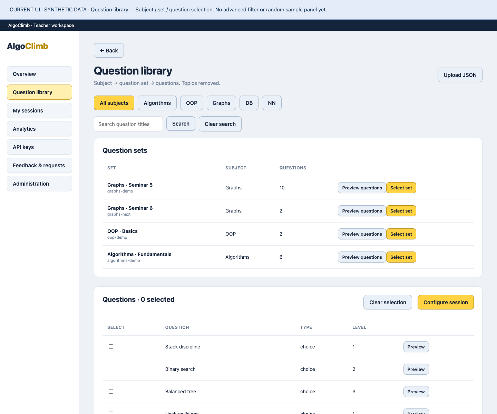

# Библиотека: редактор личных задач и версии наборов

## Какую проблему решаем

Для исправления опечатки или ответа преподавателю приходится править JSON и загружать набор заново. При перезаписи вопроса легко потерять связь между старым занятием и версией материала, которую действительно решали студенты.

## Что уже есть

Постоянный импорт личных наборов и проверка JSON уже работают. В текущем кабинете нет полноценного редактора личных вопросов пяти типов.

## Где это находится

**Question library → личный набор → будущие Create / Edit / Archive.**

Скриншот текущего интерфейса на синтетических данных. Верхняя плашка поясняет контекст; она не часть продукта. Изображение показывает место доработки, а не готовность всей функции.

## Что нужно сделать

1. Дать создать/редактировать вопрос с полями конкретного типа: варианты выбора, граф, обход, сортировка или пропуски. Показывать ошибки до сохранения.
2. Добавить ученический предпросмотр и проверку эталонного ответа. Сохранение создаёт новую версию; архивирование скрывает материал из нового выбора, но не удаляет историю.
3. Разделить личный черновик и публикацию для всех. Чужой или общий набор нельзя перезаписать через редактор личного набора.

## Пример поведения

Исправили ответ в вопросе после занятия: новая сессия использует v2, а отчёт прошлой сессии продолжает показывать v1.

## Что получим

Материалы поддерживаются в кабинете без ручной сборки JSON; проведённые занятия остаются воспроизводимыми.

## Критерии готовности

- [ ] Можно создать, редактировать и архивировать личные задачи пяти поддерживаемых типов.
- [ ] Есть предпросмотр условия и проверка правильного ответа до сохранения.
- [ ] Правки создают новую версию и не меняют снимки проведённых сессий.
- [ ] Чужие/общие материалы не перезаписываются; права публикации и видимость проверяются на сервере.
- [ ] Предпросмотр и серверный валидатор одинаково трактуют все пять форматов.
- [ ] Одновременное редактирование/архивирование не приводит к незаметной потере последней версии.

## Границы задачи

Не превращать первую версию в универсальный редактор программирования; использовать существующие форматы и импорт.

## Где искать реализацию

- [frontend/workspace.js](https://github.com/21astroboy/Algoclimb/blob/main/frontend/workspace.js)
- [backend/import_bank.py](https://github.com/21astroboy/Algoclimb/blob/main/backend/import_bank.py)
- [backend/accounts.py](https://github.com/21astroboy/Algoclimb/blob/main/backend/accounts.py)
- [backend/workspace.py](https://github.com/21astroboy/Algoclimb/blob/main/backend/workspace.py)
- [backend/catalog.py](https://github.com/21astroboy/Algoclimb/blob/main/backend/catalog.py)

## Зависимости и проверка

Версии понадобятся точному повтору сессий и сравнению занятий.

Проверить основной сценарий и перечисленные крайние случаи на отдельном runtime/демонстрационных данных. Для интерфейса — desktop и узкий экран; для доступа — владелец и другой преподаватель. Тесты не должны менять production-данные.

---
Описание уточнено 24.11.2026. Это план работ, а не отчёт о выполнении. Статус, приоритет, размер и итерация задаются полями доски; это обновление их не меняет. Первоначальные критерии карточки сохранены и дополнены.
