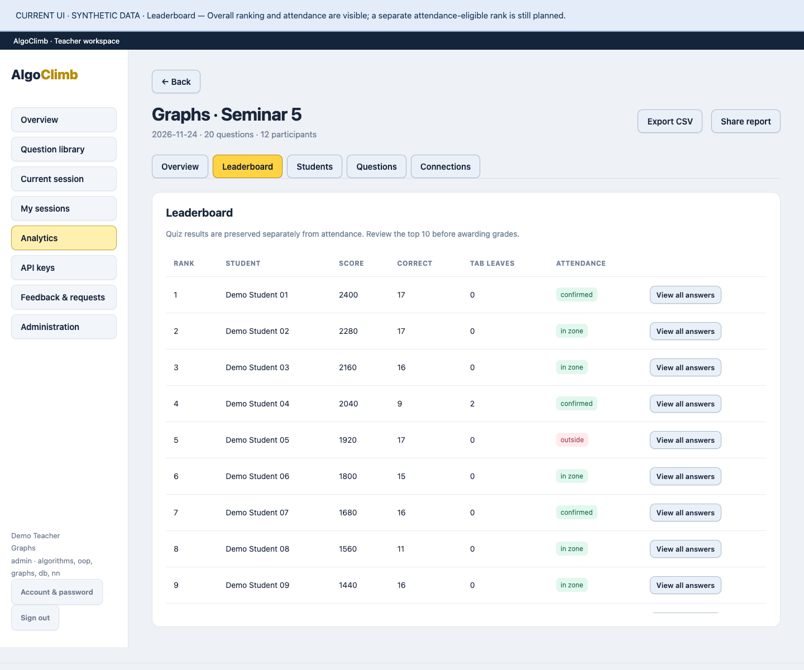

# Оценивание: отдельный рейтинг подтверждённо присутствующих

## Какую проблему решаем

В общем рейтинге могут быть подключившиеся из дома. Для оценивания топ-10 преподаватель должен вручную вычёркивать их и пересчитывать места. Просто изменить сохранённые баллы нельзя: игровой результат и подтверждение посещения имеют разный смысл.

## Что уже есть

Статусы посещения и общий рейтинг уже показаны, есть фильтрованный CSV. Отдельного ранга «среди допущенных» с явным правилом допуска нет.

## Где это находится

**Analytics → Leaderboard; далее Export CSV.**

Скриншот текущего интерфейса на синтетических данных. Верхняя плашка поясняет контекст; она не часть продукта. Изображение показывает место доработки, а не готовность всей функции.

## Что нужно сделать

1. Добавить переключение All participants / Eligible for grading. Рядом показывать выбранное правило допуска: только ручное подтверждение либо ручное подтверждение или уверенное попадание в геозону.
2. В отфильтрованном представлении показывать новое место для оценивания и исходное общее место. Очки и исходный результат сохранять.
3. Перед экспортом показывать спорные/непроверенные статусы и применять тот же фильтр, что виден на экране. Изменение подтверждения сразу пересчитывает допустимый список.

## Пример поведения

Студент №2 общего рейтинга не подтверждён. В игровом отчёте он остаётся №2, а список для оценок выдаёт места 1–10 только допущенным.

## Что получим

Преподаватель получает проверяемый топ-10 присутствующих без ручного пересчёта и без порчи исторических результатов.

## Критерии готовности

- [ ] В отчёте переключаются общий рейтинг и рейтинг допущенных по посещению.
- [ ] Преподаватель явно выбирает правило: только ручное подтверждение либо подтверждение/геозона.
- [ ] Исходные баллы и общий ранг сохраняются, а место для оценивания показано отдельно.
- [ ] Спорные статусы видны перед выгрузкой; экспорт соответствует выбранному правилу.
- [ ] При одинаковых баллах порядок совпадает с существующим правилом ранжирования.
- [ ] Вопросы без геопроверки не превращают всех участников в автоматически допущенных.

## Границы задачи

Не считать геолокацию доказательством личности; ручная проверка и исходный рейтинг остаются доступны.

## Где искать реализацию

- [frontend/workspace.js](https://github.com/21astroboy/Algoclimb/blob/main/frontend/workspace.js)
- [backend/workspace.py](https://github.com/21astroboy/Algoclimb/blob/main/backend/workspace.py)
- [backend/db.py](https://github.com/21astroboy/Algoclimb/blob/main/backend/db.py)

## Зависимости и проверка

Правило геодопуска уточнить по итогам полевого пилота; зависит от текущих attendance_checks.

Проверить основной сценарий и перечисленные крайние случаи на отдельном runtime/демонстрационных данных. Для интерфейса — desktop и узкий экран; для доступа — владелец и другой преподаватель. Тесты не должны менять production-данные.

---
Описание уточнено 24.11.2026. Это план работ, а не отчёт о выполнении. Статус, приоритет, размер и итерация задаются полями доски; это обновление их не меняет. Первоначальные критерии карточки сохранены и дополнены.
