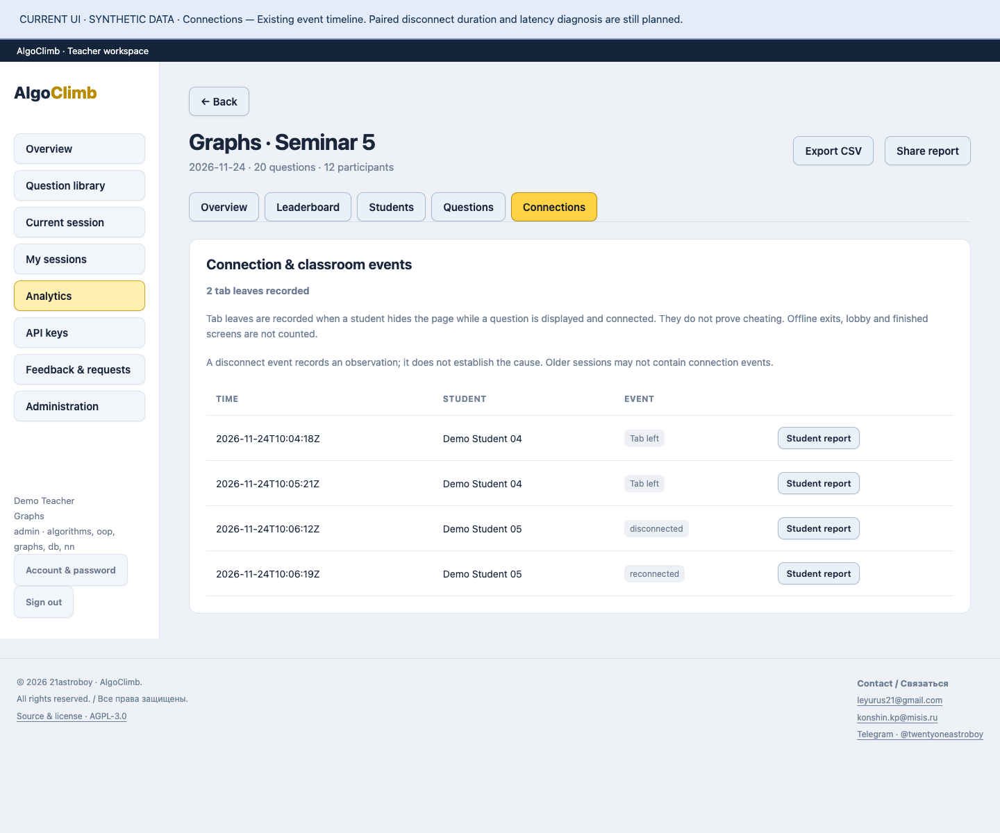

# Надёжность: диагностика отключений и показатели сессии

## Какую проблему решаем

Жалоба «меня выкинуло» сейчас не всегда объясняется сохранённой историей. Список joined/reconnected/tableave не показывает длительность потери связи, задержку подтверждения ответа и то, вернулся ли участник. Неотвечавший студент при этом мог всё время оставаться онлайн.

## Что уже есть

Есть JSON-логи восстановления, heartbeat, события соединения и тесты искусственных обрывов. Уходы с вкладки теперь видны в кабинете. Это исходная телеметрия, а не законченный диагностический отчёт.

## Где это находится

**Analytics → Connections и будущая сводка здоровья Current session.**

Скриншот текущего интерфейса на синтетических данных. Верхняя плашка поясняет контекст; она не часть продукта. Изображение показывает место доработки, а не готовность всей функции.

## Что нужно сделать

1. Связать события disconnect/reconnect в интервалы одной сессии и стабильной в её пределах идентичности. Отдельно считать вернувшихся, не вернувшихся и не отвечавших.
2. Собирать ограниченные показатели: время восстановления, задержку heartbeat/ACK, код наблюдаемого закрытия, версию приложения. Секреты и лишние персональные данные не сохранять.
3. Показать временную шкалу и короткое объяснение того, что известно. «Причина неизвестна» — нормальное состояние; отсутствие ответа не выдавать за сетевой сбой.

## Пример поведения

Вместо «5 reconnects» — «3 участника переподключались, 2 вернулись за 2–8 с, 1 не вернулся; причина последнего разрыва неизвестна».

## Что получим

Можно сопоставить жалобу с конкретным интервалом и проверить, помогло ли исправление восстановления.

## Критерии готовности

- [ ] Сохраняются начало/конец отключения, длительность восстановления и наблюдаемая причина, когда она известна.
- [ ] В отчёте отдельно показаны вернувшиеся, не вернувшиеся и просто не отвечавшие участники.
- [ ] Доступны задержки heartbeat/подтверждения ответов и версия приложения без секретов и лишних персональных данных.
- [ ] Проверено искусственными обрывами, сном вкладки и повторной доставкой ответа; неизвестная причина не выдаётся за установленную.
- [ ] Одно отключение с несколькими повторными попытками не превращается в несколько независимых пострадавших.
- [ ] Проверены сон вкладки, потеря сети, рестарт сервера и повторная доставка ответа.

## Границы задачи

Это диагностика, а не наказание за уход со вкладки и не сбор истории сторонних сайтов.

## Где искать реализацию

- [backend/main.py](https://github.com/21astroboy/Algoclimb/blob/main/backend/main.py)
- [backend/db.py](https://github.com/21astroboy/Algoclimb/blob/main/backend/db.py)
- [frontend/student.html](https://github.com/21astroboy/Algoclimb/blob/main/frontend/student.html)
- [frontend/workspace.js](https://github.com/21astroboy/Algoclimb/blob/main/frontend/workspace.js)
- [tools/reliability_test.py](https://github.com/21astroboy/Algoclimb/blob/main/tools/reliability_test.py)

## Зависимости и проверка

Данные полезны пульту занятия и безопасной выкатке; расширять текущую телеметрию совместимо со старыми отчётами.

Проверить основной сценарий и перечисленные крайние случаи на отдельном runtime/демонстрационных данных. Для интерфейса — desktop и узкий экран; для доступа — владелец и другой преподаватель. Тесты не должны менять production-данные.

---
Описание уточнено 24.11.2026. Это план работ, а не отчёт о выполнении. Статус, приоритет, размер и итерация задаются полями доски; это обновление их не меняет. Первоначальные критерии карточки сохранены и дополнены.
