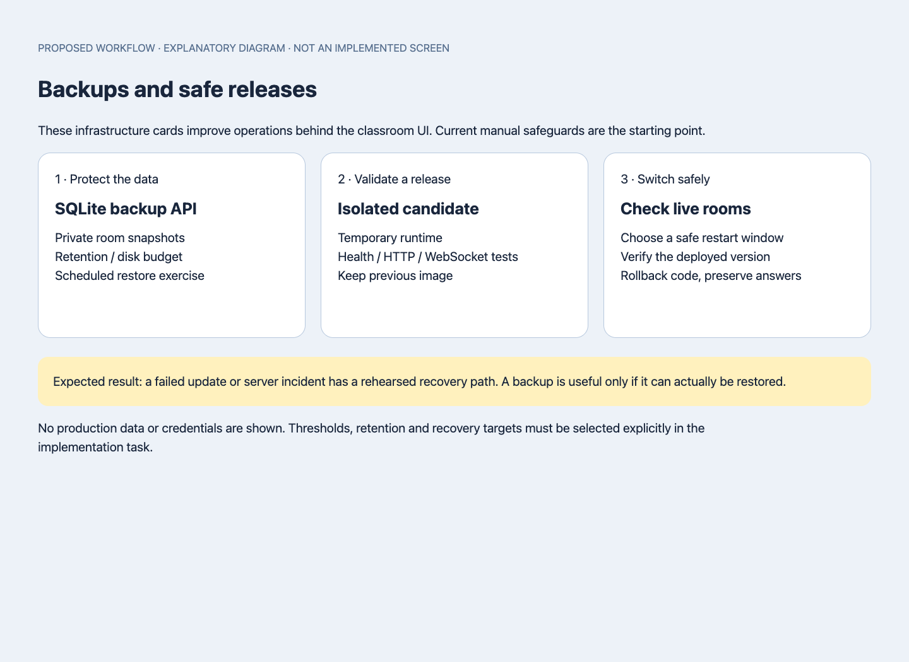

# Эксплуатация: автоматические резервные копии и проверка восстановления

## Какую проблему решаем

Ручная копия перед выкладкой защищает только от части ошибок. При потере VPS, повреждении диска или случайном удалении между выкладками можно потерять результаты и доступы. Наличие архива само по себе не доказывает, что его можно восстановить.

## Что уже есть

Перед обновлениями уже применяются SQLite backup API и закрытые резервные каталоги. Регулярного процесса с контролем срока хранения и проверкой восстановления ещё нет.

## Где это находится

**VPS / эксплуатация; в кабинете сейчас нет отдельной страницы резервных копий.**

Поясняющая схема предлагаемого процесса, не реализованный экран.

## Что нужно сделать

1. Сделать повторяемое резервирование SQLite через backup API плюс снимков комнат и необходимых параметров восстановления. Не копировать открытый WAL-базис обычным cp.
2. Задать расписание, лимит занимаемого места, срок хранения и права на архивы. Рассмотреть независимое от VPS хранилище; конкретные место/ключи/сроки выбрать при реализации.
3. Периодически разворачивать архив в изолированной среде и проверять вход, список отчётов и чтение ответов. Хранить время последнего успеха и понятный сигнал ошибки.

## Пример поведения

Ночью создан архив; тест восстановления открыл отчёты в отдельном runtime. При сбое оператор видит дату последней проверенной копии, а не только имя файла.

## Что получим

Есть измеримая потеря данных при аварии и проверенная процедура возврата приложения в рабочее состояние.

## Критерии готовности

- [ ] Копии SQLite делаются через backup API и согласованы со снимками комнат/конфигурацией.
- [ ] Заданы срок хранения, ограничение места и закрытый доступ к архивам.
- [ ] Восстановление периодически проверяется в отдельном окружении, не на production.
- [ ] Последняя успешная копия и ошибки видны оператору; процедура восстановления описана.
- [ ] Заполненный диск/недоступное хранилище не создают ложный статус успешной копии.
- [ ] Учебное восстановление не пишет в production и не раскрывает пароли/токены в логах.

## Границы задачи

Схема на иллюстрации — предложение, а не существующий экран. Не восстанавливать старую БД поверх текущих ответов автоматически.

## Где искать реализацию

- [backend/db.py](https://github.com/21astroboy/Algoclimb/blob/main/backend/db.py)
- [docker-compose.yml](https://github.com/21astroboy/Algoclimb/blob/main/docker-compose.yml)
- [docs/deployment.md](https://github.com/21astroboy/Algoclimb/blob/main/docs/deployment.md)
- [agents/operations.md](https://github.com/21astroboy/Algoclimb/blob/main/agents/operations.md)

## Зависимости и проверка

До автоматического отката/сложных миграций; согласовать целевые RPO/RTO и место хранения.

Проверить основной сценарий и перечисленные крайние случаи на отдельном runtime/демонстрационных данных. Для интерфейса — desktop и узкий экран; для доступа — владелец и другой преподаватель. Тесты не должны менять production-данные.

---
Описание уточнено 24.11.2026. Это план работ, а не отчёт о выполнении. Статус, приоритет, размер и итерация задаются полями доски; это обновление их не меняет. Первоначальные критерии карточки сохранены и дополнены.
