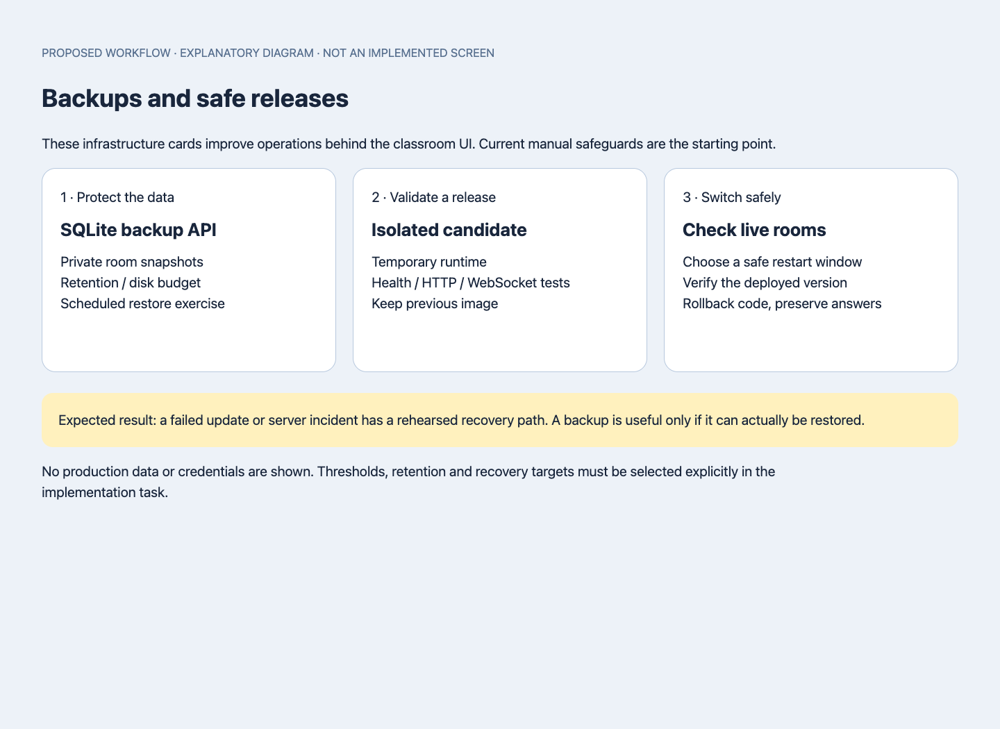

# Выкатка: защита активных занятий и быстрый откат

## Какую проблему решаем

Ручной перезапуск во время пары может оборвать соединения; неудачный образ оставит приложение недоступным. Даже зелёная сборка не доказывает, что на публичном URL заработали нужные файлы, HTTPS и WebSocket.

## Что уже есть

Есть CI, ручная проверка активных комнат, сохранение предыдущего образа и послерелизные проверки. Нужно оформить их в единый воспроизводимый механизм, а не считать уже готовой автоматизацией.

## Где это находится

**Процесс обновления VPS: от проверенного коммита до публичных health/WS-проверок.**

Поясняющая схема предлагаемого процесса, не реализованный экран.

## Что нужно сделать

1. Команда выкладки принимает точный проверенный коммит и до переключения проверяет рабочее дерево, CI и текущие running-комнаты. При активном занятии не перезапускает контейнер молча.
2. Новый образ запускается с отдельным временным runtime для smoke/HTTP/WS-проверок. Подготовить резервную копию и предыдущий образ; frontend-only обновления по возможности обходятся без рестарта.
3. После переключения проверить health, HTTPS, WS, версию/хеши ассетов и совместимость схемы. Откат кода сохраняет свежие ответы; восстановление БД — отдельная операция.

## Пример поведения

Появилась активная комната между началом сборки и переключением: выкладка останавливается перед рестартом, текущая пара продолжает работать.

## Что получим

Обновление выполняется одинаково разными операторами, с понятной точкой отмены и быстрым возвратом предыдущего кода.

## Критерии готовности

- [ ] Есть проверка активных комнат и явный выбор безопасного окна перезапуска.
- [ ] Новый образ проверяется на изолированном runtime до переключения; предыдущий образ сохранён.
- [ ] После выкатки проверяются HTTPS, WebSocket, вход, схема БД и номер версии.
- [ ] Есть понятная команда отката и правило работы с миграциями; проверен сценарий недоступности GitHub.
- [ ] Проверен сценарий недоступного GitHub с доставкой проверенного Git bundle.
- [ ] Неуспех публичной проверки не удаляет runtime и не затрагивает соседние VPS-приложения.

## Границы задачи

Не обещать настоящий zero-downtime одного процесса с WebSocket без отдельной архитектурной работы.

## Где искать реализацию

- [Dockerfile](https://github.com/21astroboy/Algoclimb/blob/main/Dockerfile)
- [docker-compose.yml](https://github.com/21astroboy/Algoclimb/blob/main/docker-compose.yml)
- [.github/workflows/ci.yml](https://github.com/21astroboy/Algoclimb/blob/main/.github/workflows/ci.yml)
- [agents/operations.md](https://github.com/21astroboy/Algoclimb/blob/main/agents/operations.md)
- [docs/deployment.md](https://github.com/21astroboy/Algoclimb/blob/main/docs/deployment.md)

## Зависимости и проверка

Опирается на проверенные резервные копии; требует правила совместимости миграций.

Проверить основной сценарий и перечисленные крайние случаи на отдельном runtime/демонстрационных данных. Для интерфейса — desktop и узкий экран; для доступа — владелец и другой преподаватель. Тесты не должны менять production-данные.

---
Описание уточнено 24.11.2026. Это план работ, а не отчёт о выполнении. Статус, приоритет, размер и итерация задаются полями доски; это обновление их не меняет. Первоначальные критерии карточки сохранены и дополнены.
