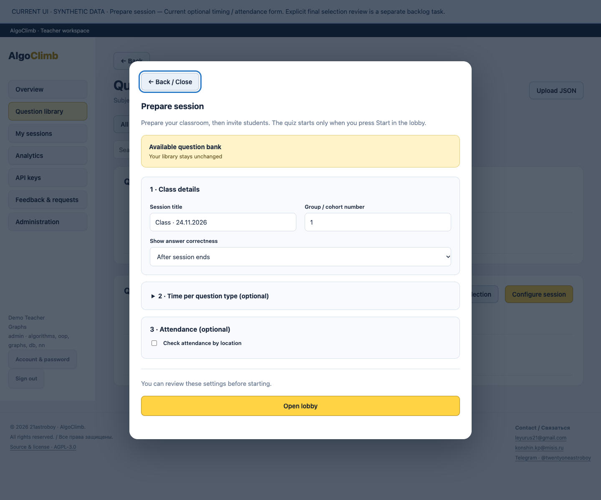

# Посещаемость: полевой пилот геопроверки в аудитории

## Какую проблему решаем

Синтетический тест может проверить расчёт расстояния, но не точность геолокации в аудитории. Внутри здания и на разных телефонах погрешность отличается; слишком маленький радиус ошибочно исключит присутствующего студента.

## Что уже есть

HTTPS, браузерный запрос позиции, радиус с учётом точности и ручное подтверждение уже есть. Нужен полевой пилот, прежде чем применять геостатус к оценкам.

## Где это находится

**Prepare session → Attendance; студент → запрос геолокации; Analytics → Attendance.**

Скриншот текущего интерфейса на синтетических данных. Верхняя плашка поясняет контекст; она не часть продукта. Изображение показывает место доработки, а не готовность всей функции.

## Что нужно сделать

1. Составить короткий протокол испытаний внутри корпуса: iPhone/Android, Wi-Fi/мобильная сеть, личный VPN и ноутбук преподавателя. Включить несколько точек рядом с границей предполагаемой зоны.
2. Согласованно проверить получение координат, время ожидания, reported accuracy, итоговый статус и ручную проверку. Отказ/таймаут не должны блокировать ответы на вопросы.
3. Свести обезличенные результаты: сколько присутствующих ошибочно отклонено, сколько проверок неопределённы и сколько времени заняли. Выбрать рабочий радиус на основании этих наблюдений.

## Пример поведения

Радиус 200 м даёт много неопределённых результатов в корпусе; вместо автоматического недопуска выбираем больший радиус или ручное подтверждение.

## Что получим

Преподаватель понимает реальные ограничения проверки и выбирает правило допуска по измерениям.

## Критерии готовности

- [ ] Проверены iPhone/Android, Wi-Fi/мобильная сеть, обычный VPN и ноутбук преподавателя.
- [ ] Подобран радиус по фактической погрешности; спорные результаты проходят ручную проверку.
- [ ] Отказ разрешения и таймаут не прерывают ответы или переподключение.
- [ ] Собрана обезличенная сводка ложных отказов и времени проверки; решение об использовании принимает преподаватель.
- [ ] Не требуется сохранять точные траектории или сырые координаты студентов для отчёта пилота.
- [ ] Обычный VPN оценивается через браузерную позицию, а не географию IP.

## Границы задачи

Это организационно-полевой эксперимент. Дистанционно подтвердить точность аудитории и завершить пилот силами агента нельзя.

## Где искать реализацию

- [frontend/attendance.js](https://github.com/21astroboy/Algoclimb/blob/main/frontend/attendance.js)
- [backend/workspace.py](https://github.com/21astroboy/Algoclimb/blob/main/backend/workspace.py)
- [docs/teacher-guide.ru.md](https://github.com/21astroboy/Algoclimb/blob/main/docs/teacher-guide.ru.md)

## Зависимости и проверка

Результаты нужны карточке рейтинга допущенных; выбор устройства/окна занятия согласовать с преподавателем.

Проверить основной сценарий и перечисленные крайние случаи на отдельном runtime/демонстрационных данных. Для интерфейса — desktop и узкий экран; для доступа — владелец и другой преподаватель. Тесты не должны менять production-данные.

---
Описание уточнено 24.11.2026. Это план работ, а не отчёт о выполнении. Статус, приоритет, размер и итерация задаются полями доски; это обновление их не меняет. Первоначальные критерии карточки сохранены и дополнены.
