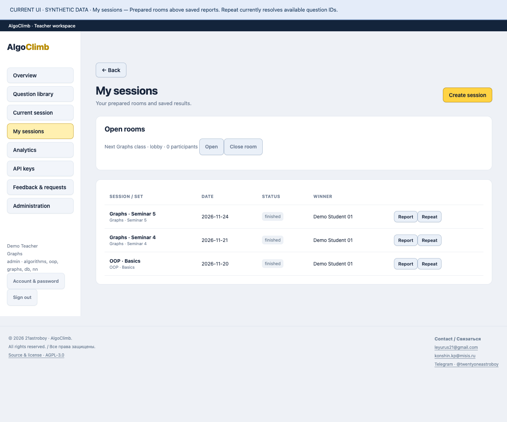

# Комнаты: удобные сохраняемые черновики подготовки

## Какую проблему решаем

Подготовка сохраняется, но преподавателю трудно отличить черновик от проведённой сессии, понять состав банка и продолжить её с другого устройства. Создание нового занятия и редактирование уже открытого лобби должны быть явно разными действиями.

## Что уже есть

На 24 ноября форма уже восстанавливает название, группу, таймеры, режим ответов и выбранные ID из подготовки. Служебная пустая комната скрыта. Карточка не должна повторно реализовывать эти исправления; остаются понятный обзор, копирование и полный сценарий между браузерами.

## Где это находится

**My sessions → Open rooms → Open / Close room; Current session → Session settings.**

Скриншот текущего интерфейса на синтетических данных. Верхняя плашка поясняет контекст; она не часть продукта. Изображение показывает место доработки, а не готовность всей функции.

## Что нужно сделать

1. Показывать у черновика название, группу, наборы, число вопросов, дату изменения и статус разового импорта. Разделить Edit draft / Create new / Duplicate.
2. Открывать сохранённые значения с сервера и проверять, что выбор соответствует текущим правам. При просроченном разовом банке предлагать загрузить его заново, а не подменять общим банком.
3. Копирование создаёт отдельную комнату; закрытие убирает только выбранный черновик. Идущая комната и старые отчёты остаются неизменны.

## Пример поведения

Преподаватель подготовил «Graphs, группа 2, 20 вопросов» дома; в аудитории с другого браузера видит тот же состав и продолжает подготовку.

## Что получим

Подготовку можно безопасно отложить и продолжить; меньше дубликатов и случайных перезаписей комнаты.

## Критерии готовности

- [ ] Черновик показывает название, группу, наборы, число вопросов и режим раскрытия ответов.
- [ ] Повторное открытие/редактирование заполняет форму сохранёнными значениями, включая другой браузер.
- [ ] Можно скопировать или закрыть черновик, не затрагивая идущую комнату.
- [ ] Разовый импорт сохраняет срок годности; просроченный банк не запускается молча.
- [ ] Редактирование черновика A при открытой комнате B не переносит настройки между ними.
- [ ] Просроченный импорт и отозванный предмет явно обозначены в черновике.

## Границы задачи

Уже сделанные функции отметить при реализации как исходное состояние; не считать всю карточку завершённой только из-за обновления формы.

## Где искать реализацию

- [frontend/workspace.js](https://github.com/21astroboy/Algoclimb/blob/main/frontend/workspace.js)
- [backend/workspace.py](https://github.com/21astroboy/Algoclimb/blob/main/backend/workspace.py)
- [backend/main.py](https://github.com/21astroboy/Algoclimb/blob/main/backend/main.py)

## Зависимости и проверка

После защиты пустого выбора; связано с точным повтором и ограничением числа незакрытых комнат.

Проверить основной сценарий и перечисленные крайние случаи на отдельном runtime/демонстрационных данных. Для интерфейса — desktop и узкий экран; для доступа — владелец и другой преподаватель. Тесты не должны менять production-данные.

---
Описание уточнено 24.11.2026. Это план работ, а не отчёт о выполнении. Статус, приоритет, размер и итерация задаются полями доски; это обновление их не меняет. Первоначальные критерии карточки сохранены и дополнены.
