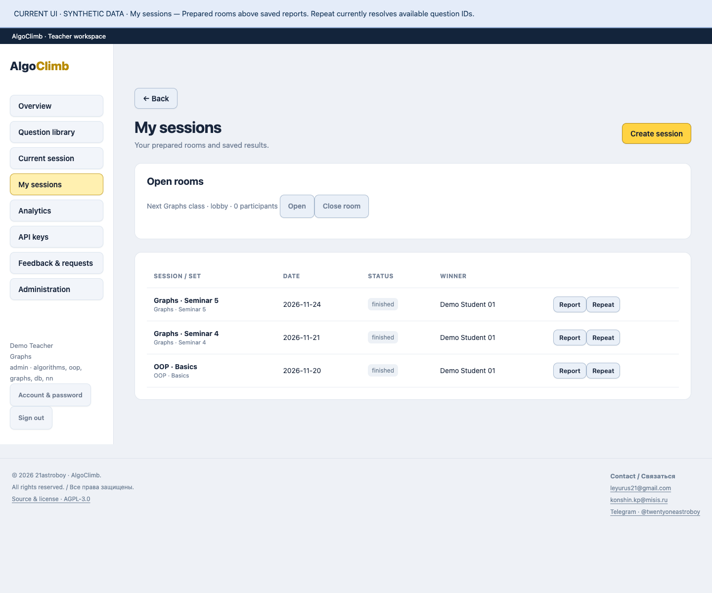

# Сессии: точное повторение по сохранённому снимку

## Какую проблему решаем

Повтор сейчас ищет вопросы по доступным ID текущей библиотеки. Если вопрос изменён, удалён или был из одноразового JSON, новый запуск может отличаться от исходного занятия либо стать невозможным без понятного объяснения.

## Что уже есть

В новых отчётах есть снимки вопросов и правильных ответов; legacy-сессии могут их не иметь. Снимок уже является источником исторического разбора, но не полноценным источником безопасного повторного запуска.

## Где это находится

**My sessions → строка сохранённой сессии → Repeat.**

Скриншот текущего интерфейса на синтетических данных. Верхняя плашка поясняет контекст; она не часть продукта. Изображение показывает место доработки, а не готовность всей функции.

## Что нужно сделать

1. Перед Repeat показать состав, источник и версию. Предложить точный повтор снимка; если доступна только актуальная версия, назвать это отдельным вариантом.
2. Создавать новую комнату/сессию с новым ID. Применять права владельца/разделов и допустимость повторного использования материала, не открывая чужой банк через read-only report.
3. Для одноразового банка использовать разрешённый исторический снимок без автоматической публикации. Если snapshot старый/неполный/неподдерживаемый, показать причину и альтернативу.

## Пример поведения

В библиотеке уже v2 вопроса. Repeat exact использует v1 из проведённого занятия; исходный отчёт не меняется, результаты нового запуска записываются отдельно.

## Что получим

Можно воспроизвести контрольную для другой группы и понимать, действительно ли условия одинаковы.

## Критерии готовности

- [ ] Перед повтором виден состав и версия вопросов; недоступные элементы не исчезают без объяснения.
- [ ] Повтор создаёт новую комнату и не изменяет исходный отчёт.
- [ ] Воспроизведение разового банка возможно из снимка при разрешённых правах, без публикации его в общую библиотеку.
- [ ] Если точный повтор невозможен для старой сессии, причина и дальнейшие действия показаны явно.
- [ ] Проверены одноразовый банк, удалённый ID, изменённый checker и legacy-сессия без snapshot.
- [ ] Доступ только на просмотр отчёта сам по себе не даёт права запускать его приватные материалы.

## Границы задачи

Не обходить актуальные subject/ownership-проверки; не обещать точный повтор при недостатке исторических данных.

## Где искать реализацию

- [frontend/workspace.js](https://github.com/21astroboy/Algoclimb/blob/main/frontend/workspace.js)
- [backend/main.py](https://github.com/21astroboy/Algoclimb/blob/main/backend/main.py)
- [backend/workspace.py](https://github.com/21astroboy/Algoclimb/blob/main/backend/workspace.py)
- [backend/catalog.py](https://github.com/21astroboy/Algoclimb/blob/main/backend/catalog.py)

## Зависимости и проверка

Связано с версиями редактора и сравнением занятий; может использовать существующие снимки без ожидания полного редактора.

Проверить основной сценарий и перечисленные крайние случаи на отдельном runtime/демонстрационных данных. Для интерфейса — desktop и узкий экран; для доступа — владелец и другой преподаватель. Тесты не должны менять production-данные.

---
Описание уточнено 24.11.2026. Это план работ, а не отчёт о выполнении. Статус, приоритет, размер и итерация задаются полями доски; это обновление их не меняет. Первоначальные критерии карточки сохранены и дополнены.
