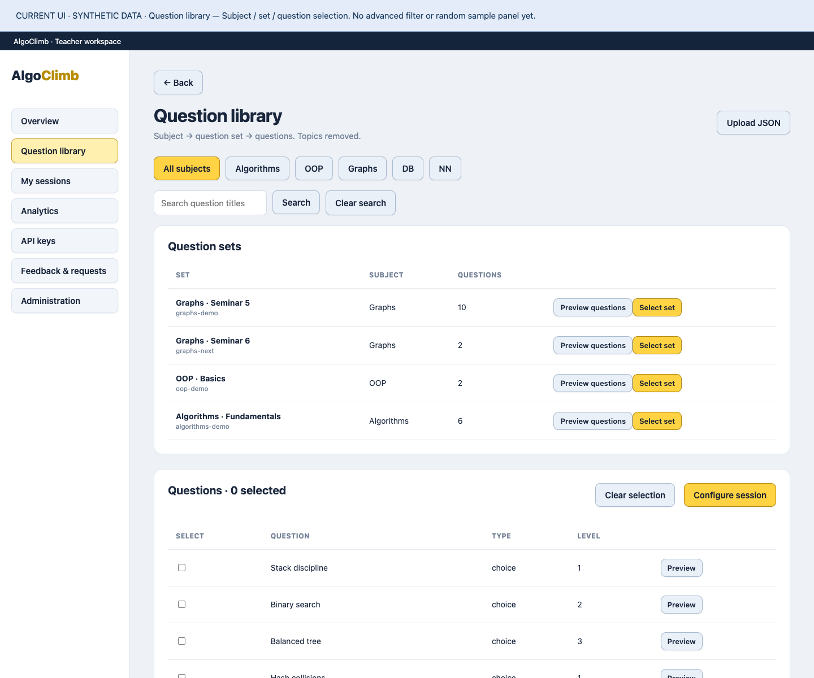

# Библиотека: свёрнутые фильтры и случайная выборка

## Какую проблему решаем

При большом банке преподавателю приходится вручную просматривать вопросы и собирать случайный набор. Возвращение всех фильтров в одну строку снова перегрузит экран, что уже мешало работе.

## Исходное состояние до реализации

Разделы, наборы, поиск и накопленный выбор есть; Topics намеренно удалён. Свёрнутого блока типа/сложности/источника и управляемой случайной выборки в новом кабинете нет.

## Где это находится

**Question library → строка поиска, выбор раздела/набора и будущие Advanced filters / Pick N.**

Скриншот текущего интерфейса на синтетических данных. Верхняя плашка поясняет контекст; она не часть продукта. Изображение показывает место доработки, а не готовность всей функции.

## Что нужно сделать

1. Оставить основные действия на виду, а дополнительные фильтры собрать в закрытый по умолчанию блок. Показать число найденных вопросов.
2. Разрешить ввести N и случайно выбрать только среди доступных вопросов текущей области. Если найдено меньше N, объяснить ситуацию; не добирать из другого раздела.
3. До добавления показать результат/предпросмотр. Явно различать «заменить текущий выбор» и «добавить к нему», не создавать дубликаты.

## Пример поведения

В Graphs выбран набор Seminar 5, сложность 2, найдено 18 вопросов. Pick 10 возвращает 10 уникальных вопросов только из этих 18.

## Что получим

Подготовка короткого занятия занимает меньше времени, а экран остаётся компактным.

## Критерии готовности

- [x] Дополнительные фильтры типа, сложности и источника скрыты до запроса.
- [x] Есть выбор N случайных вопросов только из текущей отфильтрованной области и предпросмотр результата.
- [x] Выбранные вопросы и счётчик остаются понятными при смене фильтра.
- [x] Поведение проверено на больших наборах; недоступные по правам задачи не попадают в выборку.
- [x] Смена фильтра не стирает накопленный выбор без предупреждения.
- [x] Проверены N=0, N больше доступного числа, пустая область и отозванные права.

## Границы задачи

Topics не возвращать; случайная выборка не должна менять банк и историю.

## Где искать реализацию

- [frontend/workspace.js](https://github.com/21astroboy/Algoclimb/blob/main/frontend/workspace.js)
- [frontend/workspace.css](https://github.com/21astroboy/Algoclimb/blob/main/frontend/workspace.css)
- [backend/accounts.py](https://github.com/21astroboy/Algoclimb/blob/main/backend/accounts.py)

## Зависимости и проверка

Использовать единую защиту итогового выбора из P1-карточки подготовки.

Проверить основной сценарий и перечисленные крайние случаи на отдельном runtime/демонстрационных данных. Для интерфейса — desktop и узкий экран; для доступа — владелец и другой преподаватель. Тесты не должны менять production-данные.

---
Исходное описание: 24.11.2026. Реализация проверена 28.11.2026; текущие назначение и статус ведутся на доске. Критерии приёмки сохранены и выполнены.

## Выполнено 28.11.2026

Фильтры типа/сложности/источника закрыты по умолчанию. Случайная выборка использует общий с таблицей
фильтр и выбранный набор, показывает предпросмотр, поддерживает добавление/замену без дубликатов.
Проверены пустая область, N=0, N больше пула, банк на 700 вопросов, смена каталога до применения,
сохранение выбора и немедленный счётчик. Повторная серверная проверка доступа при настройке/старте сохранена.
Регрессия: `tools/check_library_workflow.cjs`. Задача назначена на `21astroboy`; перевод в Done — после CI и выкладки.
