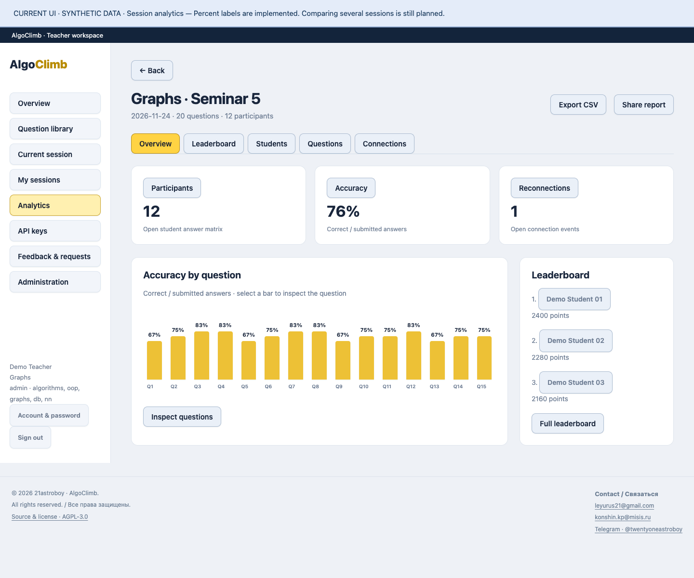

# Аналитика: сравнение занятий и динамика по вопросам

## Какую проблему решаем

Один отчёт показывает, как прошла конкретная пара, но не отвечает, улучшилось ли понимание темы между группами или после изменения вопроса. Сравнивать проценты без версий, состава и числа ответивших легко ошибочно.

## Что уже есть

Есть отдельные отчёты, снимки вопросов, подписи процентов и переход к вопросу. Мультисессионного сравнения пока нет. Одинаковое название не означает одинаковый вопрос.

## Где это находится

**Analytics → будущий выбор нескольких сессий рядом с существующим отчётом.**

Скриншот текущего интерфейса на синтетических данных. Верхняя плашка поясняет контекст; она не часть продукта. Изображение показывает место доработки, а не готовность всей функции.

## Что нужно сделать

1. Выбирать несколько разрешённых сессий и показывать даты, группы, число участников, состав наборов и версию/идентичность вопроса.
2. Сравнивать только сопоставимые вопросы, отделять изменённые версии и явно показывать знаменатель: число отправленных ответов либо все участники.
3. Дать таблицу/график динамики и переход к исходному вопросу/отчёту для проверки. Неполные legacy-данные обозначать отдельно, не заполнять нулями.

## Пример поведения

В одном и том же вопросе v1 точность выросла с 45% (20 ответов) до 70% (50 ответов). Вопрос v2 вынесен отдельно, а не склеен по названию.

## Что получим

Преподаватель видит проблемные вопросы и динамику обучения с понятными ограничениями сравнения.

## Критерии готовности

- [ ] Можно выбрать несколько доступных сессий и сравнить правильность, время и завершение.
- [ ] Разные версии вопросов и составы наборов помечаются; несопоставимые проценты не выдаются за прямое сравнение.
- [ ] Есть агрегаты по вопросу/набору и переход к исходному отчёту.
- [ ] Собственные и предоставленные отчёты проверяются по правам; старые неполные данные обозначены.
- [ ] Снятие доступа к одной из выбранных сессий убирает её данные и из графика, и из выгрузки.
- [ ] Отсутствие ответов отличается от 0% правильных; различный состав участников виден.

## Границы задачи

Не выдавать корреляцию за доказанный эффект преподавания и не объединять разные личности по одному нику.

## Где искать реализацию

- [frontend/workspace.js](https://github.com/21astroboy/Algoclimb/blob/main/frontend/workspace.js)
- [backend/workspace.py](https://github.com/21astroboy/Algoclimb/blob/main/backend/workspace.py)
- [backend/db.py](https://github.com/21astroboy/Algoclimb/blob/main/backend/db.py)
- [backend/catalog.py](https://github.com/21astroboy/Algoclimb/blob/main/backend/catalog.py)

## Зависимости и проверка

Надёжное сравнение версий связано с редактором/точным повтором; сравнение студентов — с постоянными ID.

Проверить основной сценарий и перечисленные крайние случаи на отдельном runtime/демонстрационных данных. Для интерфейса — desktop и узкий экран; для доступа — владелец и другой преподаватель. Тесты не должны менять production-данные.

---
Описание уточнено 24.11.2026. Это план работ, а не отчёт о выполнении. Статус, приоритет, размер и итерация задаются полями доски; это обновление их не меняет. Первоначальные критерии карточки сохранены и дополнены.
