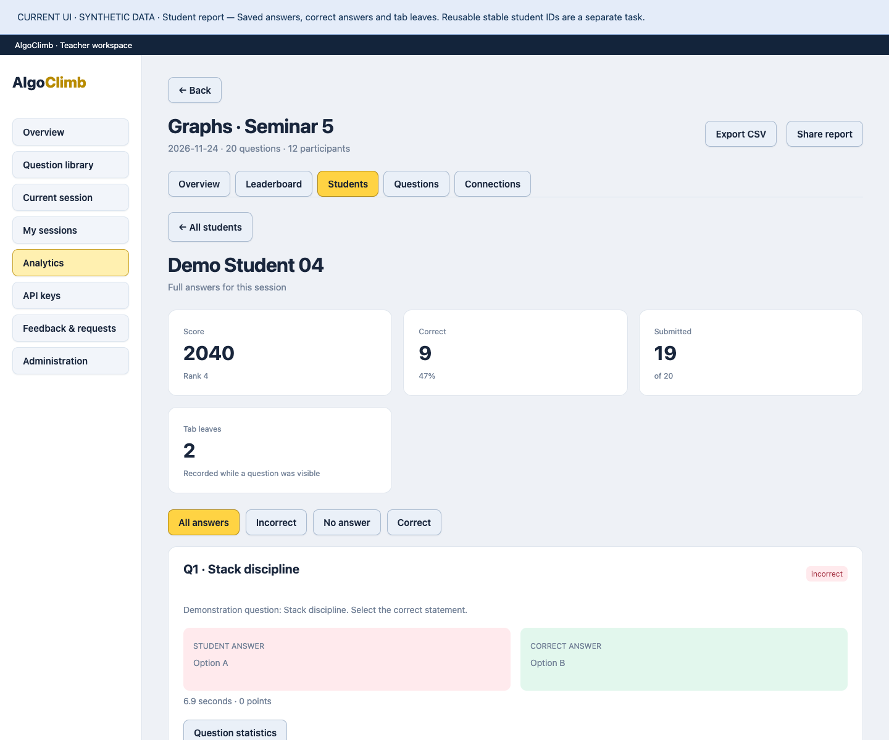

# Экспорт: ответы по вопросам и XLSX

## Какую проблему решаем

Итогового рейтинга недостаточно для ведомости и разбора ошибок вне сайта. Преподавателю нужны ответы, правильные варианты, время и посещаемость в открываемом Excel формате, а пользовательские строки могут случайно интерпретироваться как формулы.

## Что уже есть

Новый кабинет выгружает итоговый CSV. Внутри отчёта уже есть ответы и события; существующие legacy-экспорты нельзя автоматически считать полным экспортом персонального кабинета с его правами.

## Где это находится

**Analytics → Export CSV; Students / Questions / Connections как источники дополнительных листов.**

Скриншот текущего интерфейса на синтетических данных. Верхняя плашка поясняет контекст; она не часть продукта. Изображение показывает место доработки, а не готовность всей функции.

## Что нужно сделать

1. Добавить отдельные наборы данных: итоги, студент×вопрос, события и посещаемость; для XLSX разнести их по понятным листам и сохранить заголовки.
2. Включать исходный вопрос/версию, текст ответа, эталон, результат, длительность, баллы и статус посещения, когда они действительно записаны.
3. Соблюдать выбранный attendance-фильтр, права владения/чтения, корректную кириллицу и защиту строк от spreadsheet formula injection. Не включать секреты и сырые координаты.

## Пример поведения

Один XLSX содержит Results, Answers и Events; по строке можно проверить, почему у студента 0 баллов за Q5, не открывая сайт.

## Что получим

Отчёты пригодны для ведомостей, консультаций и дальнейшего анализа без ручного копирования таблиц.

## Критерии готовности

- [ ] Есть отдельные выгрузки итогов, ответов студент×вопрос и событий подключения.
- [ ] Выгружаются текст ответа, правильный ответ, результат, время, баллы и статус посещения, если они сохранены.
- [ ] CSV и XLSX корректно открываются с кириллицей и защищены от формул в пользовательских строках.
- [ ] Фильтры посещения/прав соблюдаются; неполные старые данные не подменяются выдуманными.
- [ ] Проверены строки с =, +, -, @, переносами и кавычками, а также длинные русские ФИО.
- [ ] Неполные legacy-ответы экспортируются как отсутствующие данные, а не как неверные ответы.

## Границы задачи

Не подменять существующий общий рейтинг пересчитанными баллами и не отдавать чужие сессии через старый маршрут экспорта.

## Где искать реализацию

- [frontend/workspace.js](https://github.com/21astroboy/Algoclimb/blob/main/frontend/workspace.js)
- [backend/workspace.py](https://github.com/21astroboy/Algoclimb/blob/main/backend/workspace.py)
- [backend/analytics.py](https://github.com/21astroboy/Algoclimb/blob/main/backend/analytics.py)
- [backend/developer_api.py](https://github.com/21astroboy/Algoclimb/blob/main/backend/developer_api.py)

## Зависимости и проверка

Согласовать имена полей с API и правилом рейтинга допущенных.

Проверить основной сценарий и перечисленные крайние случаи на отдельном runtime/демонстрационных данных. Для интерфейса — desktop и узкий экран; для доступа — владелец и другой преподаватель. Тесты не должны менять production-данные.

---
Описание уточнено 24.11.2026. Это план работ, а не отчёт о выполнении. Статус, приоритет, размер и итерация задаются полями доски; это обновление их не меняет. Первоначальные критерии карточки сохранены и дополнены.
