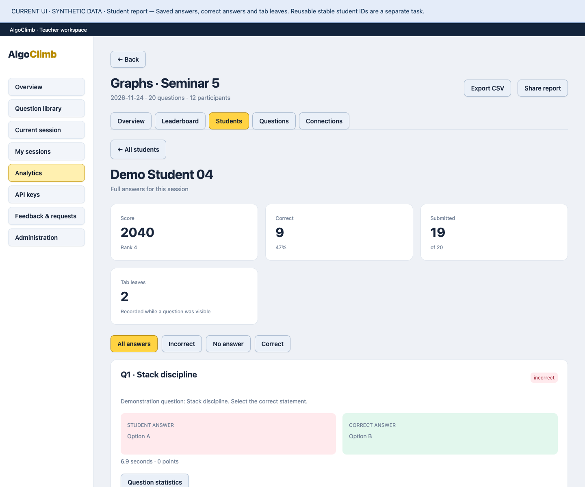

# Группы: постоянный список студентов и устойчивые идентификаторы

## Какую проблему решаем

Свободный ник подходит для одной игры, но не позволяет надёжно сопоставить одного студента между занятиями. Один человек может написать ФИО иначе, а два разных человека — использовать одинаковое имя.

## Что уже есть

Идентичность и приватный resume-секрет защищают восстановление внутри комнаты. Это не постоянный университетский ID и не достаточное основание для склейки нескольких сессий.

## Где это находится

**Будущий раздел Groups / roster import; текущий вход студентов и исторические имена в отчётах.**

Скриншот текущего интерфейса на синтетических данных. Верхняя плашка поясняет контекст; она не часть продукта. Изображение показывает место доработки, а не готовность всей функции.

## Что нужно сделать

1. Разрешить преподавателю импортировать группу с явными стабильными ID и ФИО, валидируя дубликаты и конфликты до сохранения.
2. Связать вход с назначенным идентификатором подходящим согласованным способом. Отображаемое имя хранить отдельно от идентичности; однофамильцы остаются разными людьми.
3. Добавить управление группой и ограничить доступ владельцем/разрешённым преподавателем. Исторические записи сохраняют имена на момент занятия и не переписываются при переименовании.

## Пример поведения

ID S-024 всегда один студент, даже если он ввёл «Иванов И.» и потом полное ФИО. Два «Иван Петров» с разными ID не объединяются.

## Что получим

Ведомости и динамика между занятиями становятся сопоставимыми, уменьшается ручное исправление имён.

## Критерии готовности

- [ ] Преподаватель может импортировать список группы с уникальными ID и ФИО.
- [ ] Вход связывается с назначенным идентификатором; однофамильцы и повторные имена различаются.
- [ ] Изменение отображаемого имени не объединяет разные личности и не меняет старые результаты.
- [ ] Доступ к спискам ограничен преподавателем/владельцем; согласован срок хранения персональных данных.
- [ ] Импорт с повторным ID и различными ФИО требует явного разрешения конфликта.
- [ ] Нельзя автоматически присвоить старые никнеймы людям без подтверждаемого соответствия.

## Границы задачи

Сначала согласовать способ выдачи/ввода ID и срок хранения персональных данных. Это не требование подключать университетский SSO в первой версии.

## Где искать реализацию

- [backend/accounts.py](https://github.com/21astroboy/Algoclimb/blob/main/backend/accounts.py)
- [backend/db.py](https://github.com/21astroboy/Algoclimb/blob/main/backend/db.py)
- [backend/workspace.py](https://github.com/21astroboy/Algoclimb/blob/main/backend/workspace.py)
- [frontend/student.html](https://github.com/21astroboy/Algoclimb/blob/main/frontend/student.html)
- [frontend/workspace.js](https://github.com/21astroboy/Algoclimb/blob/main/frontend/workspace.js)

## Зависимости и проверка

Нужно для достоверной межсессионной аналитики; сохранить совместимость анонимных разовых игр.

Проверить основной сценарий и перечисленные крайние случаи на отдельном runtime/демонстрационных данных. Для интерфейса — desktop и узкий экран; для доступа — владелец и другой преподаватель. Тесты не должны менять production-данные.

---
Описание уточнено 24.11.2026. Это план работ, а не отчёт о выполнении. Статус, приоритет, размер и итерация задаются полями доски; это обновление их не меняет. Первоначальные критерии карточки сохранены и дополнены.
