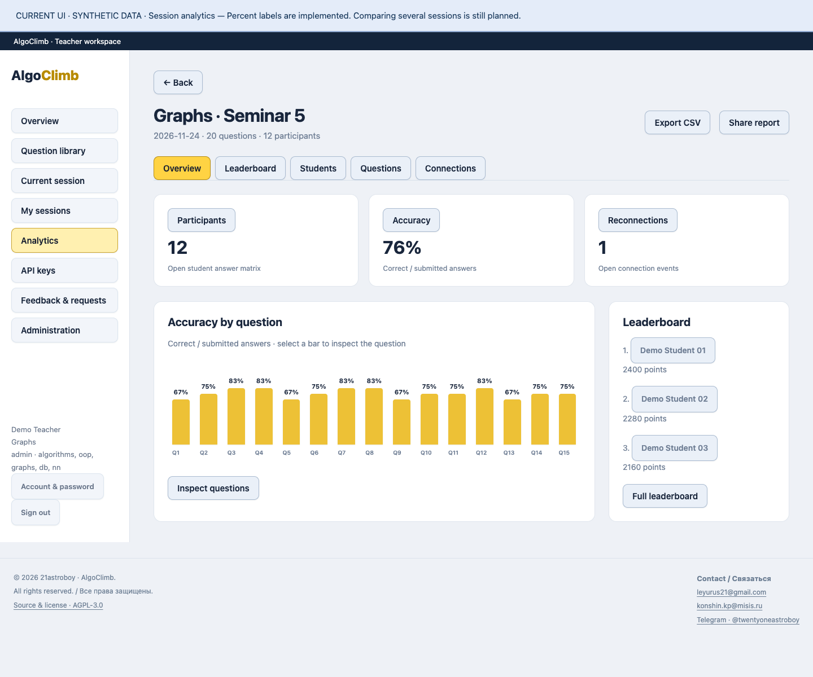

# Доступы: список получателей отчёта и срок чтения

## Какую проблему решаем

Сейчас доступ можно выдать или отозвать по email, но трудно увидеть полный список получателей и объяснить, почему коллега видит конкретный отчёт. Для временного сотрудничества нужен срок доступа, отличный от срока API-ключа.

## Что уже есть

Именная выдача чтения через Share report, ожидающие приглашения и проверка предметных прав уже реализованы. Список действующих выдач, прямое управление строкой и срок чтения требуют доработки.

## Где это находится

**Analytics → Share report; Administration → выдача/отзыв чтения.**

Скриншот текущего интерфейса на синтетических данных. Верхняя плашка поясняет контекст; она не часть продукта. Изображение показывает место доработки, а не готовность всей функции.

## Что нужно сделать

1. Показать разрешённому управляющему отчётом получателей: email/имя, кем и когда выдано, активировано ли приглашение, срок и состояние.
2. Добавить отзыв конкретной строки и необязательный срок. Рядом объяснить три разных права: доступ к предмету, чтение отчёта, управление комнатой.
3. Истечение/отзыв применять одинаково в кабинете и API при каждом запросе, сохраняя аудит без повторного раскрытия секретов.

## Пример поведения

Коллеге дали читать OOP-отчёт до конца недели. После срока он теряет только эту выдачу; владение своей комнатой и другие предметные права сохраняются.

## Что получим

Можно быстро проверить и ограничить распространение результатов без догадок и повторного ввода email.

## Критерии готовности

- [ ] Владелец отчёта видит, кому и когда выдано чтение, включая ожидающие приглашения.
- [ ] Можно снять конкретную выдачу без повторного ввода email; при необходимости задать срок.
- [ ] Показано отличие прав на предмет, чтения отчёта и управления комнатой.
- [ ] Снятие права/истечение срока применяется и в кабинете, и в API; история выдач остаётся в аудите.
- [ ] Предметный доступ, отозванный раньше срока выдачи отчёта, тоже закрывает чтение.
- [ ] Владелец/администратор управляет выдачей, но обычный получатель не делится ею дальше.

## Границы задачи

До реализации явно решить, какие действия доступны владельцу отчёта, а какие только администратору; текущий Share report ограничен администратором.

## Где искать реализацию

- [frontend/workspace.js](https://github.com/21astroboy/Algoclimb/blob/main/frontend/workspace.js)
- [backend/accounts.py](https://github.com/21astroboy/Algoclimb/blob/main/backend/accounts.py)
- [backend/workspace.py](https://github.com/21astroboy/Algoclimb/blob/main/backend/workspace.py)
- [backend/developer_api.py](https://github.com/21astroboy/Algoclimb/blob/main/backend/developer_api.py)

## Зависимости и проверка

Использовать существующие session_readers и аудит; не смешивать срок выдачи отчёта с 24-часовым API-токеном.

Проверить основной сценарий и перечисленные крайние случаи на отдельном runtime/демонстрационных данных. Для интерфейса — desktop и узкий экран; для доступа — владелец и другой преподаватель. Тесты не должны менять production-данные.

---
Описание уточнено 24.11.2026. Это план работ, а не отчёт о выполнении. Статус, приоритет, размер и итерация задаются полями доски; это обновление их не меняет. Первоначальные критерии карточки сохранены и дополнены.
