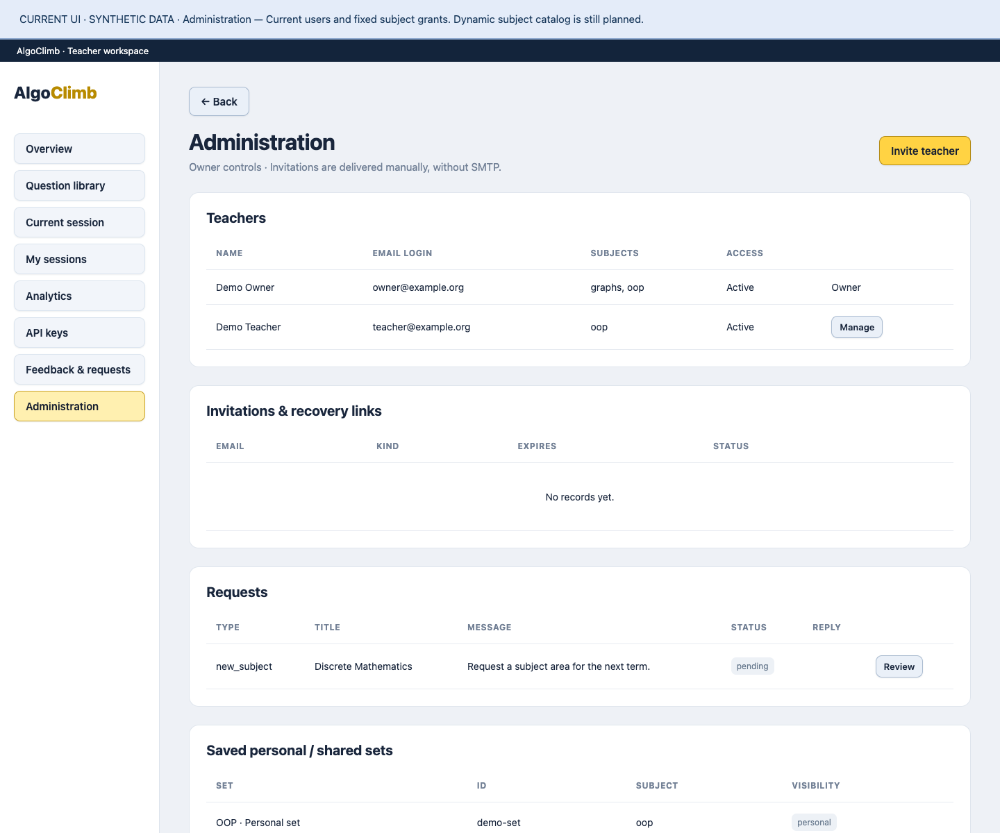

# Разделы: создание и архивирование через Administration

## Какую проблему решаем

Новый преподаватель может запросить дисциплину, но добавить её сейчас можно только изменением кода фиксированного каталога. Переименование/удаление без стабильного ID способно сломать права, наборы и старые отчёты.

## Что уже есть

Algorithms/OOP/Graphs/DB/NN определены в каталоге; приглашения и формы доступа используют тот же фиксированный список. Процесс заявок уже есть.

## Где это находится

**Administration → будущий Subjects; Feedback & requests → New subject proposal.**

Скриншот текущего интерфейса на синтетических данных. Верхняя плашка поясняет контекст; она не часть продукта. Изображение показывает место доработки, а не готовность всей функции.

## Что нужно сделать

1. Создавать предмет с неизменяемым системным ID и редактируемым отображаемым названием. Валидировать уникальность и разрешённый формат ID.
2. Архивирование запрещает новый выбор/выдачу согласно явному правилу, но сохраняет наборы, авторство и доступные исторические отчёты.
3. После одобрения заявки администратор отдельно подтверждает создание предмета и выдачу прав заявителю. Все формы и импорт читают единый серверный каталог.

## Пример поведения

Одобрена «Discrete Mathematics»: создаётся один предмет discrete-math, затем преподавателю назначается доступ; он появляется в библиотеке и импорте без новой сборки приложения.

## Что получим

Подключение новых дисциплин выполняется через кабинет и остаётся согласованным с правами.

## Критерии готовности

- [ ] Владелец создаёт раздел со стабильным ID и отображаемым названием.
- [ ] Можно архивировать раздел, сохранив старые отчёты и авторство.
- [ ] Выдача прав, импорт JSON и запросы доступа используют один каталог.
- [ ] Одобрение заявки на новый предмет связывается с созданием раздела и явной выдачей прав.
- [ ] Существующие ID и comb1 в Graphs не меняются при миграции каталога.
- [ ] Дублирующая заявка не создаёт второй предмет с тем же смыслом/ID автоматически.

## Границы задачи

Не выдавать право создания предметов всем преподавателям; одобрение заявки остаётся решением администратора.

## Где искать реализацию

- [backend/catalog.py](https://github.com/21astroboy/Algoclimb/blob/main/backend/catalog.py)
- [backend/accounts.py](https://github.com/21astroboy/Algoclimb/blob/main/backend/accounts.py)
- [backend/workspace.py](https://github.com/21astroboy/Algoclimb/blob/main/backend/workspace.py)
- [frontend/workspace.js](https://github.com/21astroboy/Algoclimb/blob/main/frontend/workspace.js)

## Зависимости и проверка

Связано с удобными заявками и стартовыми наборами DB/NN.

Проверить основной сценарий и перечисленные крайние случаи на отдельном runtime/демонстрационных данных. Для интерфейса — desktop и узкий экран; для доступа — владелец и другой преподаватель. Тесты не должны менять production-данные.

---
Описание уточнено 24.11.2026. Это план работ, а не отчёт о выполнении. Статус, приоритет, размер и итерация задаются полями доски; это обновление их не меняет. Первоначальные критерии карточки сохранены и дополнены.
