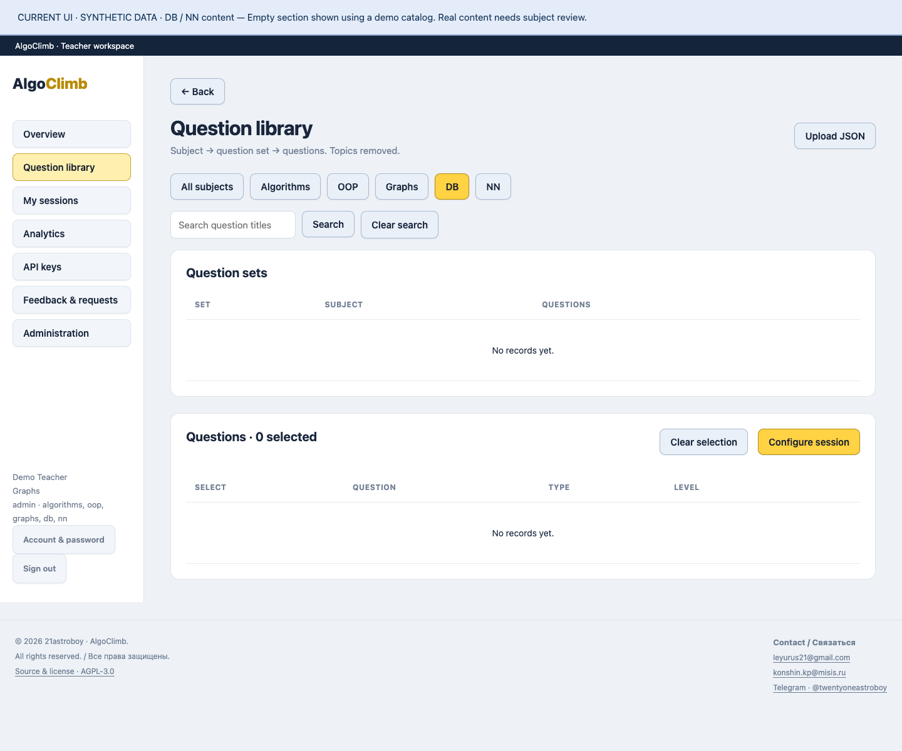

# Контент: стартовые согласованные наборы для DB и NN

## Какую проблему решаем

Пустые предметы видны в навигации, но коллеги не могут начать тестирование по своей дисциплине без готового материала. Случайно сгенерированный банк без предметной проверки может закрепить ошибки и снизить доверие к оценкам.

## Что уже есть

Сами разделы и механизм импорта/публикации есть. Наполнение требует преподавателей DB/NN и согласованных образовательных целей; не считать демонстрационную пустоту на скриншоте аудитом конкретного приватного банка.

## Где это находится

**Question library → DB / NN → наборы; импорт личного банка и публикация после проверки.**

Скриншот текущего интерфейса на синтетических данных. Верхняя плашка поясняет контекст; она не часть продукта. Изображение показывает место доработки, а не готовность всей функции.

## Что нужно сделать

1. С преподавателями определить темы и ожидаемые результаты обучения. Для первых небольших наборов зафиксировать размер, типы вопросов, сложность и язык.
2. Подготовить условия, правильные ответы и объяснения. Проверить неоднозначные варианты и достаточность времени для чтения; использовать пять существующих форматов.
3. Провести предметную рецензию и автоматическую валидацию JSON, затем опубликовать после одобрения. Указать автора и условия использования материала.

## Пример поведения

Первый DB-набор покрывает ключи/связи/нормализацию, NN — основы моделей и обучения; конкретный перечень утверждает предметный преподаватель до подготовки банка.

## Что получим

Коллега может провести первую учебную сессию по своему предмету с проверенными задачами и объяснениями.

## Критерии готовности

- [ ] Согласованы темы, результаты обучения и распределение сложности для каждого раздела.
- [ ] Подготовлены первые небольшие наборы с условиями, ответами и объяснениями на согласованном языке.
- [ ] Каждая задача проходит предметную проверку и автоматическую валидацию банка.
- [ ] Наборы опубликованы после одобрения; авторство и лицензия материалов обозначены.
- [ ] Все эталонные ответы проходят автоматическую проверку, а дистракторы проверены человеком.
- [ ] Пилот выявляет неоднозначные вопросы до массового использования для оценок.

## Границы задачи

Содержание на картинке демонстрационное. Не публиковать чужие задания или считать предложенные темы утверждённой программой.

## Где искать реализацию

- [backend/import_bank.py](https://github.com/21astroboy/Algoclimb/blob/main/backend/import_bank.py)
- [backend/catalog.py](https://github.com/21astroboy/Algoclimb/blob/main/backend/catalog.py)
- [docs/task-bank.md](https://github.com/21astroboy/Algoclimb/blob/main/docs/task-bank.md)
- [docs/task-bank.ru.md](https://github.com/21astroboy/Algoclimb/blob/main/docs/task-bank.ru.md)

## Зависимости и проверка

Зависит от предметной экспертизы и разрешения на публикацию; новый тип интерактива не входит в первый набор.

Проверить основной сценарий и перечисленные крайние случаи на отдельном runtime/демонстрационных данных. Для интерфейса — desktop и узкий экран; для доступа — владелец и другой преподаватель. Тесты не должны менять production-данные.

---
Описание уточнено 24.11.2026. Это план работ, а не отчёт о выполнении. Статус, приоритет, размер и итерация задаются полями доски; это обновление их не меняет. Первоначальные критерии карточки сохранены и дополнены.
