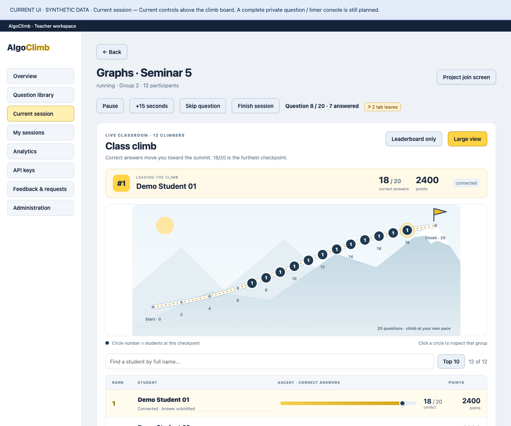

# Проектор: отдельное живое окно доски подъёма

## Какую проблему решаем

Large view увеличивает доску в той же вкладке, а окно Project join screen показывает вход. Преподавателю нужно отдельное живое окно с прогрессом для проектора, сохраняя приватный пульт на своём экране.

## Что уже есть

Большая доска и отдельное статическое окно входа уже есть. Полноценного синхронного projector-view с безопасной проекцией состояния нет.

## Где это находится

**Current session → Class climb → будущая кнопка Open projector; существующие Large view и Project join screen.**

Скриншот текущего интерфейса на синтетических данных. Верхняя плашка поясняет контекст; она не часть продукта. Изображение показывает место доработки, а не готовность всей функции.

## Что нужно сделать

1. Открывать отдельное окно текущей комнаты: гора, рейтинг/прогресс, номер вопроса и только разрешённая публичная информация.
2. Использовать специально ограниченный payload/канал: правильные ответы, API-ключи, управление пользователями, контакты доступа и приватные события в проектор не передавать.
3. Синхронизировать обновления и восстанавливать связь после обрыва; показывать reconnecting. Закрытие проектора не закрывает комнату и не завершает викторину.

## Пример поведения

На проекторе 120 участников поднимаются по горе; на ноутбуке преподавателя открыт скрытый правильный ответ и управление паузой.

## Что получим

Аудитория видит динамику игры, преподаватель продолжает управлять занятием конфиденциально.

## Критерии готовности

- [ ] Доска в отдельном окне обновляет прогресс без ручного обновления страницы.
- [ ] Студенты не видят правильные ответы, API-ключи, админские действия и приватные данные кабинета.
- [ ] После разрыва соединения показан статус и выполняется восстановление.
- [ ] Закрытие окна не завершает занятие; режим проверен на 60–120 участниках и проекторе.
- [ ] Проверены длинные ФИО, 30 вопросов, 60–120 участников и горизонтальный экран проектора.
- [ ] Открытие чужой комнаты/подбор ссылки не позволяет получить приватное teacher-state.

## Границы задачи

Не просто дублировать HTML кабинета или скрывать ответы CSS: секретных полей не должно быть в данных проектора.

## Где искать реализацию

- [frontend/workspace.js](https://github.com/21astroboy/Algoclimb/blob/main/frontend/workspace.js)
- [frontend/workspace.css](https://github.com/21astroboy/Algoclimb/blob/main/frontend/workspace.css)
- [backend/main.py](https://github.com/21astroboy/Algoclimb/blob/main/backend/main.py)

## Зависимости и проверка

Согласовать публичные поля с карточкой приватного пульта и поведением восстановления.

Проверить основной сценарий и перечисленные крайние случаи на отдельном runtime/демонстрационных данных. Для интерфейса — desktop и узкий экран; для доступа — владелец и другой преподаватель. Тесты не должны менять production-данные.

---
Описание уточнено 24.11.2026. Это план работ, а не отчёт о выполнении. Статус, приоритет, размер и итерация задаются полями доски; это обновление их не меняет. Первоначальные критерии карточки сохранены и дополнены.
