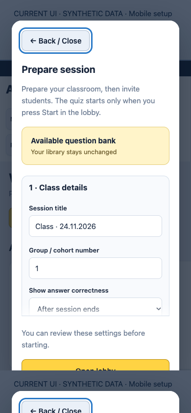

# Интерфейс: мобильный кабинет и доступность

## Какую проблему решаем

Исправление одной доски или формы не гарантирует, что весь сценарий можно пройти на планшете, с клавиатуры или увеличенным шрифтом. Таблицы и длинные имена могут перекрывать действия; ошибки фокуса особенно мешают без мыши.

## Что уже есть

На 24 ноября уже добавлены hover/pressed/focus/busy-состояния кнопок, стрелки назад, логотип Overview, Escape и удержание фокуса в диалоге, адаптивная форма. Это выполненная база; карточка теперь про полный аудит и оставшиеся сценарии, а не повтор этих работ.

## Где это находится

**Весь кабинет: Prepare session, import, Current session, Analytics и диалоги.**

Скриншот текущего интерфейса на синтетических данных. Верхняя плашка поясняет контекст; она не часть продукта. Изображение показывает место доработки, а не готовность всей функции.

## Что нужно сделать

1. Пройти подготовку, импорт, лобби, ручное подтверждение посещения, аналитику и экспорт на узком экране. Проверить большие таблицы и длинные условия.
2. Проверить Tab/Shift+Tab, возврат фокуса, экранные имена, размер целей нажатия, масштабирование и различимость статусов без опоры только на цвет.
3. Составить матрицу Safari/iOS, Chrome/Android, планшет/ноутбук. Добавлять регрессии для обнаруженных проблем, различая эмуляцию viewport и реальный браузер/устройство.

## Пример поведения

Преподаватель на планшете импортирует JSON, открывает лобби, подтверждает присутствие и смотрит ответ студента без горизонтальной прокрутки всей страницы.

## Что получим

Основной преподавательский сценарий доступен на разных устройствах и без мыши.

## Критерии готовности

- [ ] Подготовка, импорт, лобби, посещаемость и отчёты работают на планшете/телефоне.
- [ ] Диалоги управляют фокусом, элементы доступны с клавиатуры, статусы различаются не только цветом.
- [ ] Длинные имена, крупный шрифт и горизонтальные таблицы не перекрывают действия.
- [ ] Есть сценарии проверки Safari/iOS и Chrome/Android; регрессии добавлены в браузерные проверки.
- [ ] Проверены 200% масштаб, мобильная клавиатура, изменение ориентации и раскрытые дополнительные настройки.
- [ ] Возврат назад и обновления WebSocket не теряют введённые данные и фокус.

## Границы задачи

Новые функции из других карточек не реализуются под видом аудита; реальные iOS/Android-проверки не подменяются Chromium viewport.

## Где искать реализацию

- [frontend/workspace.js](https://github.com/21astroboy/Algoclimb/blob/main/frontend/workspace.js)
- [frontend/workspace.css](https://github.com/21astroboy/Algoclimb/blob/main/frontend/workspace.css)
- [frontend/interactions.css](https://github.com/21astroboy/Algoclimb/blob/main/frontend/interactions.css)
- [tools/check_workspace_ux.cjs](https://github.com/21astroboy/Algoclimb/blob/main/tools/check_workspace_ux.cjs)

## Зависимости и проверка

Использовать уже добавленные браузерные fixtures; последовательно покрыть остальные формы.

Проверить основной сценарий и перечисленные крайние случаи на отдельном runtime/демонстрационных данных. Для интерфейса — desktop и узкий экран; для доступа — владелец и другой преподаватель. Тесты не должны менять production-данные.

---
Описание уточнено 24.11.2026. Это план работ, а не отчёт о выполнении. Статус, приоритет, размер и итерация задаются полями доски; это обновление их не меняет. Первоначальные критерии карточки сохранены и дополнены.
