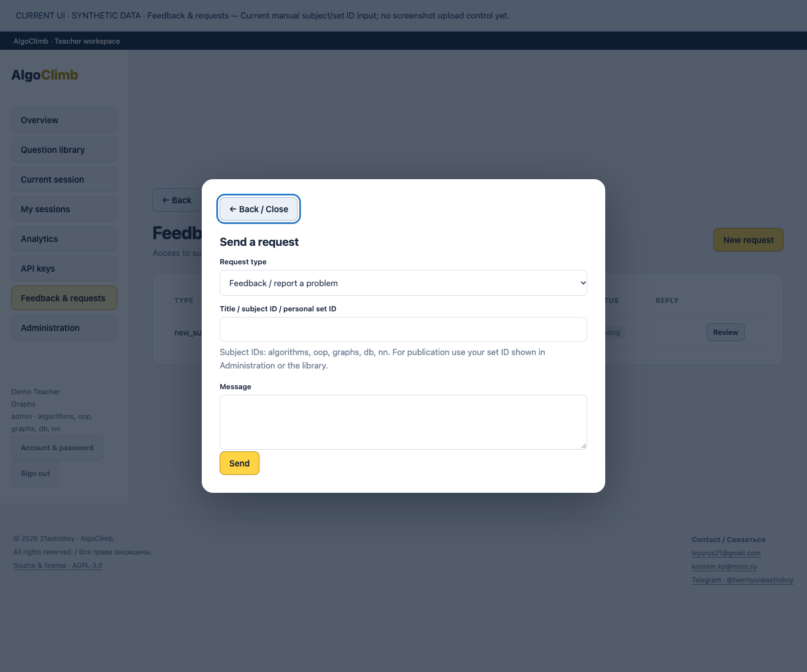

# Обратная связь: удобные заявки и безопасные вложения

## Какую проблему решаем

Для запроса доступа или публикации преподавателю нужно вручную знать ID предмета/личного набора. Описать визуальную проблему без вложения трудно, а автоматическая отправка всего содержимого заявки в публичный GitHub может раскрыть данные студентов.

## Что уже есть

Есть типы заявок, сообщение, статус и ответ администратора; SMTP не требуется. На форме пока одно ручное поле Title / subject ID / personal set ID, загрузки скриншота нет.

## Где это находится

**Feedback & requests → New request; Administration → Requests.**

Скриншот текущего интерфейса на синтетических данных. Верхняя плашка поясняет контекст; она не часть продукта. Изображение показывает место доработки, а не готовность всей функции.

## Что нужно сделать

1. Менять поля по типу заявки: выбор существующего предмета, выбор собственного набора для публикации, название нового предмета либо обычный заголовок проблемы.
2. Добавить безопасное вложение изображения с предпросмотром, ограничениями типа/размера и закрытым доступом. Предложить удалить ФИО, токены и личные сведения; техническая сводка должна быть минимальной и видимой отправителю.
3. Показывать переписку/историю статусов в кабинете. Если позже понадобится создать GitHub issue, делать отдельное явное подтверждение очищенного публичного текста и вложений.

## Пример поведения

Преподаватель выбирает Publish my set → «OOP · Week 2», а не копирует personal-… ID; администратор видит набор и понятное описание запроса.

## Что получим

Заявки содержат достаточно контекста для решения и не требуют знания внутренних идентификаторов.

## Критерии готовности

- [ ] Для доступа и публикации используются выбор раздела/своего набора вместо ручного ввода ID.
- [ ] К проблеме можно приложить скриншот и обезличенную диагностическую информацию с предпросмотром.
- [ ] Преподаватель видит ответ и понятную историю статусов без автоматических писем.
- [ ] Создание публичного GitHub issue из заявки требует отдельного подтверждения после удаления персональных данных и секретов.
- [ ] Нельзя прикрепить чужой набор по подставленному ID или открыть чужое приватное вложение.
- [ ] Просмотр изображения не выполняет HTML/скрипт; неподдерживаемые файлы и чрезмерный размер отклоняются сервером.

## Границы задачи

Не добавлять автоматическую отправку писем и не публиковать заявку/скриншот на GitHub без отдельного действия.

## Где искать реализацию

- [frontend/workspace.js](https://github.com/21astroboy/Algoclimb/blob/main/frontend/workspace.js)
- [backend/workspace.py](https://github.com/21astroboy/Algoclimb/blob/main/backend/workspace.py)
- [backend/accounts.py](https://github.com/21astroboy/Algoclimb/blob/main/backend/accounts.py)

## Зависимости и проверка

Справочники предметов/наборов брать из разрешённого каталога; согласовать хранение вложений с резервными копиями.

Проверить основной сценарий и перечисленные крайние случаи на отдельном runtime/демонстрационных данных. Для интерфейса — desktop и узкий экран; для доступа — владелец и другой преподаватель. Тесты не должны менять production-данные.

---
Описание уточнено 24.11.2026. Это план работ, а не отчёт о выполнении. Статус, приоритет, размер и итерация задаются полями доски; это обновление их не меняет. Первоначальные критерии карточки сохранены и дополнены.
