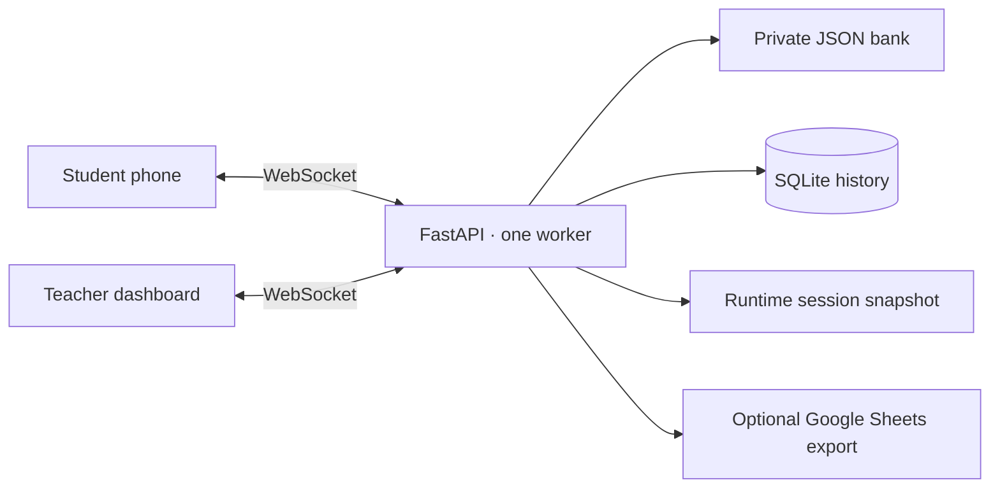

# Development

## Architecture



- `backend/main.py`: session lifecycle, HTTP and WebSocket handlers.
- `backend/validation.py`: answer shapes checked before grading or spending an attempt.
- `backend/bank.py`: bank loading, public projections and grading.
- `backend/db.py`: SQLite persistence; `RUNTIME_DIR` selects the runtime directory.
- `frontend/`: English UI; bank content is rendered in its original language.
- `secrets/`: private bank, explanations and optional service-account key.

Questions are timed on the server. At or after `round_deadline`, answers are rejected,
even before the timeout callback closes the round. Paused answers are rejected. Malformed
answer payloads do not spend an attempt. The student receives `answerRejected` with a
machine-readable `reason` and English `message`; a valid retry remains possible.

For valid submissions, the existing scoring and one-attempt rules apply. A structurally
valid but incorrect answer spends the attempt. Choice indices refer to shuffled public options.

Student joins/disconnects mark teacher state dirty and share the existing 300 ms update
window; each returning student still receives their own state immediately. During a live
session, teacher updates omit per-question answer arrays and the full breakdown. The final
state includes that history for results and CSV review. This avoids rebuilding unused
class-wide history for every returning phone. See [measured reliability](reliability.md).

## Checks

Use Python 3.11+ (CI uses 3.12) and Node 22+:

```bash
python3.12 -m venv .venv
source .venv/bin/activate
pip install -r requirements.txt ruff==0.16.8 mypy==1.18.2
npm ci
ruff check .
ruff format --check .
mypy
npm run lint
(cd backend && python -m smoke_test)
(cd backend && python -m unittest test_timers test_answers test_teacher_updates test_connection_recovery)
(cd backend && python -m e2e_test)
python -m unittest tools.test_reliability
python tools/reliability_test.py --students 12 --rounds 10 --disconnects --qr --idle 1
```

CI runs these checks and builds the Docker image. E2E starts its own server on an available
loopback port with a temporary runtime directory, a public demo bank and a test blank task.
It does not connect to the VPS or modify your application database.

Coverage includes teacher access checks, joins, all five question types, reconnect, pause/resume,
malformed JSON/payloads, retry, duplicate answers, deadline expiry, automatic completion and
SQLite persistence. Unit tests also check the exact deadline boundary and timer cancellation.

The HTML linter does not parse inline JavaScript. `npm run lint:scripts` checks its syntax
separately. No frontend bundler is required.

## Screenshots

Screenshots come from real local sessions with fictional participants. Nothing is
read from the VPS. The demo uses temporary data, a fixed local key, deterministic
sort arrays, and the public English/Russian fixtures in `tools/fixtures/`. Each
fixture includes all five task types; changing it does not change the production bank.

Install the browser dependencies once:

```bash
npm ci
npx playwright install chromium
```

Start the English demo in one terminal (with the Python environment active):

```bash
python tools/demo_server.py --language en
```

In another terminal, capture the English sessions and the separate layout fixture:

```bash
SCREENSHOT_LANGUAGE=en npm run screenshots
SCREENSHOT_LANGUAGE=en npm run test:layout
```

Stop the server with Ctrl+C, then repeat with the Russian bank:

```bash
# Terminal 1
python tools/demo_server.py --language ru

# Terminal 2
SCREENSHOT_LANGUAGE=ru npm run screenshots
SCREENSHOT_LANGUAGE=ru npm run test:layout
```

If Google Chrome is installed, prefix the capture commands with
`SCREENSHOT_BROWSER=chrome`. Server and capture languages must match. The default
for both is `ru`. Outputs are `docs/images/en/` and `docs/images/ru/`.

The capture script connects only to `127.0.0.1:8098`, joins six fictional students,
uses the actual teacher/student UI and WebSocket protocol, and draws a graph in the
mobile canvas. It captures the lobby, live map, final results, analytics, student
review, and one mobile screen for every task type. It also checks pause/resume,
rejected-answer recovery, answer-key access and browser errors. Demo bots send
heartbeats so the stale-socket cleanup does not remove them during capture.

The large-class image is an explicitly labeled deterministic display fixture:
72 fictional participants, 30 checkpoints, and long English or Russian names.
`test:layout` verifies widths from 390 to 1920 pixels, checks progress groups for
overlap, checks all participants are listed and long names wrap, then saves
`teacher-large-class.png` in the selected language directory. CI runs this layout
check in Chromium. Nicknames support up to 96 characters; longer values are rejected.
Stop the demo server after capture; its temporary runtime is deleted.

## Optional API docs

For a direct Python launch, set `DOCS=1`; with Compose, put `DOCS=1` in `.env` and run
`./algoclimb up`. HTTP docs are at `/docs`, `/redoc` and `/openapi.json`. WebSocket events are
described in the API introduction. Never share the teacher key or its authenticated URLs.
