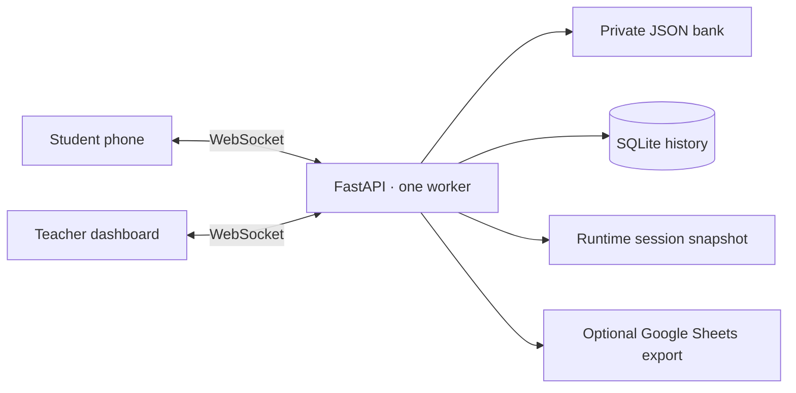

# Development

## Architecture



- `backend/main.py`: session lifecycle, HTTP and WebSocket handlers.
- `backend/validation.py`: answer shapes checked before grading or spending an attempt.
- `backend/bank.py`: bank loading, public projections and grading.
- `backend/db.py`: SQLite persistence; `RUNTIME_DIR` selects the runtime directory.
- `frontend/`: English UI; bank content is rendered in its original language.
- `secrets/`: private bank, explanations and optional service-account key.

Questions are timed on the server. At or after `round_deadline`, answers are rejected,
even before the timeout callback closes the round. Paused answers are rejected. Malformed
answer payloads do not spend an attempt. The student receives `answerRejected` with a
machine-readable `reason` and English `message`; a valid retry remains possible.

For valid submissions, the existing scoring and one-attempt rules apply. A structurally
valid but incorrect answer spends the attempt. Choice indices refer to shuffled public options.

Student joins/disconnects mark teacher state dirty and share the existing 300 ms update
window; each returning student still receives their own state immediately. During a live
session, teacher updates omit per-question answer arrays and the full breakdown. The final
state includes that history for results and CSV review. This avoids rebuilding unused
class-wide history for every returning phone. See [measured reliability](reliability.md).

## Checks

Use Python 3.11+ (CI uses 3.12) and Node 22+:

```bash
python3.12 -m venv .venv
source .venv/bin/activate
pip install -r requirements.txt ruff==0.16.8 mypy==1.18.2
npm ci
ruff check .
ruff format --check .
mypy
npm run lint
(cd backend && python -m smoke_test)
(cd backend && python -m unittest test_timers test_answers test_teacher_updates)
(cd backend && python -m e2e_test)
python -m unittest tools.test_reliability
python tools/reliability_test.py --students 12 --rounds 10 --disconnects --qr --idle 1
```

CI runs these checks and builds the Docker image. E2E starts its own server on an available
loopback port with a temporary runtime directory, a public demo bank and a test blank task.
It does not connect to the VPS or modify your application database.

Coverage includes teacher access checks, joins, all five question types, reconnect, pause/resume,
malformed JSON/payloads, retry, duplicate answers, deadline expiry, automatic completion and
SQLite persistence. Unit tests also check the exact deadline boundary and timer cancellation.

The HTML linter does not parse inline JavaScript. `npm run lint:scripts` checks its syntax
separately. No frontend bundler is required.

## Screenshots

Screenshots are captured from real local sessions with fictional participants and the public
Russian demo bank. Nothing is read from the deployed VPS. The demo uses temporary data,
fixed arrays and a local demo key; fast-answer flags are disabled for scripted participants.

In one terminal, activate the Python environment and start:

```bash
python tools/demo_server.py
```

In another terminal:

```bash
npm ci
npx playwright install chromium
npm run screenshots
```

If Google Chrome is installed, `SCREENSHOT_BROWSER=chrome npm run screenshots` can use it
instead. The script uses only `127.0.0.1:8098`, joins six fictional students, operates the real
UI and WebSocket protocol, draws a graph in the mobile canvas, and captures `docs/images/`.
It also checks pause/resume, rejected-answer recovery, answer-key access and browser errors.
Stop the demo server with Ctrl+C when finished; its runtime data is deleted.

With that demo server running, `npm run test:layout` checks the teacher screen with a
deterministic 72-person, 30-question fixture at widths from 390 to 1920 pixels. It verifies
that progress groups do not overlap, every participant is listed, and long names wrap
without clipping. It also captures `docs/images/teacher-large-class.png`. CI runs the same
check in Chromium. Nicknames support up to 96 characters; longer values are rejected
instead of silently truncated.

## Optional API docs

For a direct Python launch, set `DOCS=1`; with Compose, put `DOCS=1` in `.env` and run
`./algoclimb up`. HTTP docs are at `/docs`, `/redoc` and `/openapi.json`. WebSocket events are
described in the API introduction. Never share the teacher key or its authenticated URLs.
