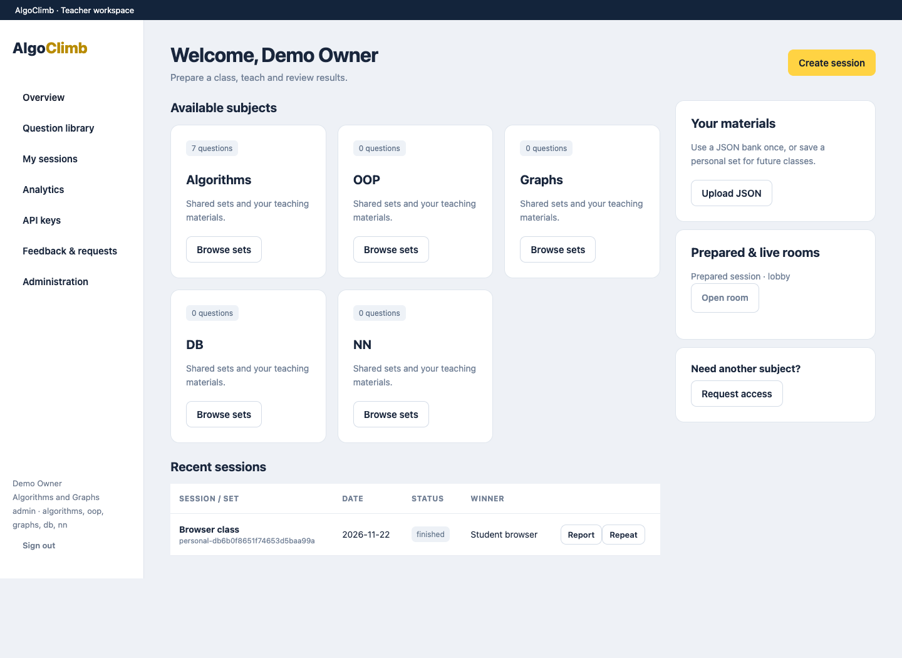
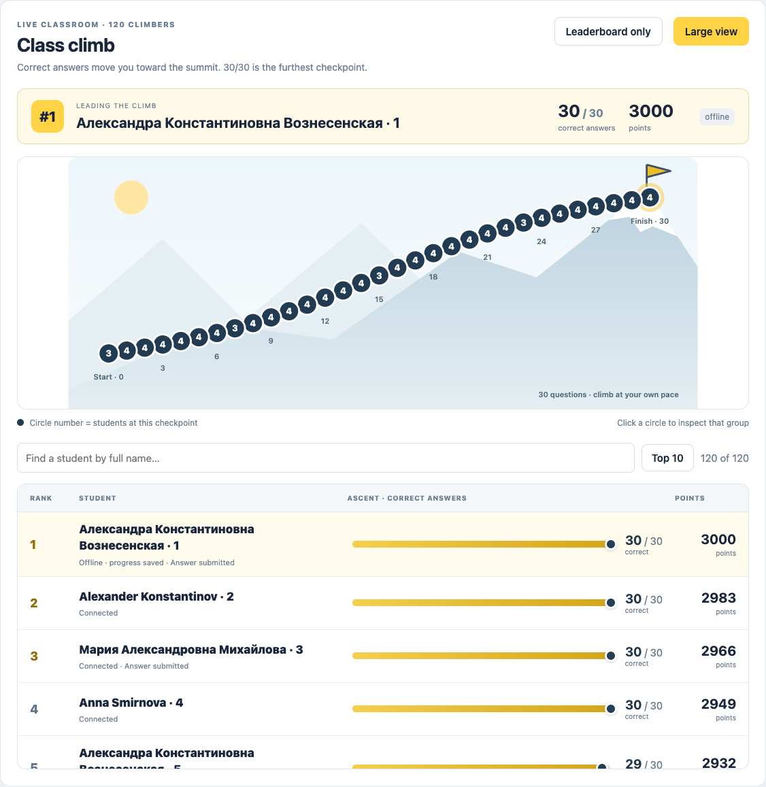
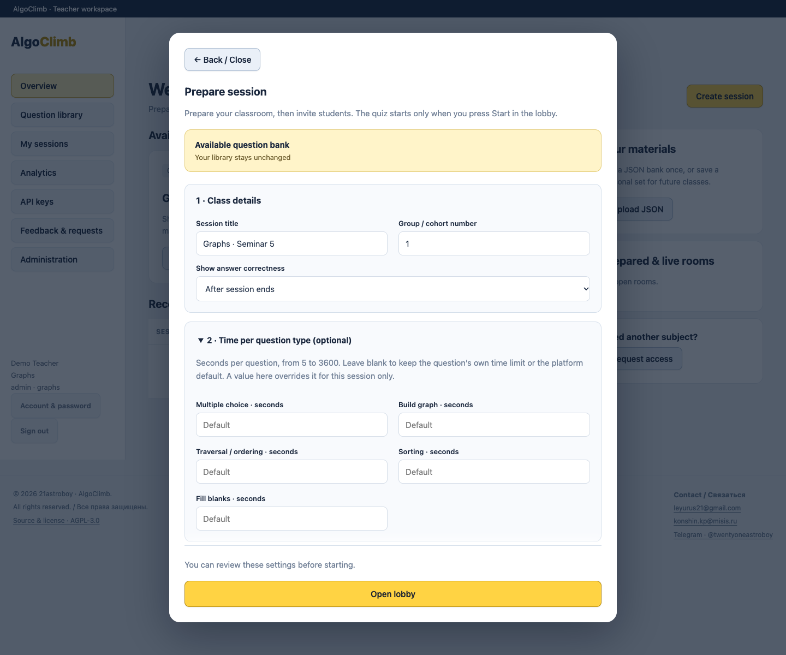

# Teacher workspace: running a class

[Русский](teacher-guide.ru.md) · [README](../README.md) · [Accounts, permissions and API](workspace.md)

The interface is English; questions, options and explanations may use Russian or any other language. Button names below match the current workspace.

## Your first class

1. Sign in at `/workspace` with your personal login and password.
2. Open **Question library**, select a subject, use **Clear selection**, then **Select set** for the intended question set.
3. Choose **Configure session**. Enter a title, group number, feedback policy and optional location attendance settings.
4. Select **Open lobby**. Show the room QR using **Project join screen** and wait for students to join.
5. Select **Start session**. Follow **Class climb** and use the session controls as needed.
6. Afterwards, open **My sessions → Report**, review scores and attendance, and select **Export CSV**.



## Signing in and managing your password

The platform owner issues a private, single-use invitation valid for **48 hours**. Open it, enter your full name and teaching subject/institution, and choose a password of **10–256 characters**. The invited email becomes your login; an owner may have a separate username without an email address.

For subsequent visits, use **Username or email** and your password. A login lasts 12 hours; sign in again when it expires.

**Account & password** changes your name, teaching subject and password. It requires your current password. Saving revokes previous logins and API keys, so create replacement keys for integrations.

For a forgotten password, contact the owner for a single-use recovery link valid for one hour. Invitations and recovery links are delivered privately through your agreed communication channel. The application does not send email automatically.

## Navigation

| Section | Purpose |
| --- | --- |
| **Overview** | Available subjects, recent reports and open rooms. |
| **Question library** | Subjects, sets, search, previews and question selection. |
| **Current session** | The connected room: lobby, participants, climb board and live controls. Appears after opening a room. |
| **My sessions** | Open rooms, saved results and reports explicitly shared with you. |
| **Analytics** | Choose a report and inspect its details. |
| **API keys** | Create/revoke 24-hour read-only integration keys. |
| **Feedback & requests** | Feedback, subject requests and shared-set publication requests. |
| **Administration** | Owner only: teachers, invitations, permissions and requests. |

Subject access does not automatically expose other teachers' classes in that subject. Teachers normally see their own reports; the owner can grant read-only access to a particular report without transferring room controls.

## Choosing questions

In **Question library**, choose Algorithms, OOP, Graphs, DB or NN. Only permitted subjects are visible. Subjects contain shared and personal sets; an empty subject has no questions yet.

| Action | Result |
| --- | --- |
| **Preview questions** | Show that set's questions in the table. |
| **Preview → Add to selection** | Read a question and add it to the selection. |
| **Select set** | Add all questions in that set. |
| Question checkboxes | Add/remove individual questions. |
| **Clear selection** | Remove all accumulated selections. |
| **Search / Clear search** | Search question titles/text or reset the search. |
| **Configure session** | Prepare the classroom using your selection. |

**Selection is cumulative.** Changing subjects or previewing a different set does not clear it. Before a new class, use **Clear selection** and verify the selected count. If you select nothing, the server uses the teacher's available bank, not just the subject currently displayed.

## Uploading a JSON bank

Choose **Upload JSON** from Overview or the library:

1. Enter **Set / session title** and select **Subject**.
2. Under **Keep this bank**, choose **One session only** or **Save to my personal library**.
3. Select a file of at most **2 MiB**, containing **1–500 questions** as an array or an object whose `tasks` field is that array.
4. Select **Validate & import**. If validation fails, fix the indicated question/field and retry. The app does not partially import an invalid bank.

| Mode | Behavior |
| --- | --- |
| **One session only** | Creates a room with a separate bank. Start the imported bank within one hour. It is not added to the reusable library; the conducted session retains report data. |
| **Save to my personal library** | Saves the set for future classes. It is personal by default; publishing for other teachers requires owner approval. |

Minimal OOP example:

```json
[
  {
    "id": "oop-encapsulation-01",
    "section": "oop",
    "type": "choice",
    "level": 1,
    "title": "Encapsulation",
    "prompt": "Which example demonstrates encapsulation?",
    "options": [
      "Changing a private field through an object's public method",
      "Directly changing all object fields from any part of the program"
    ],
    "answer": 0
  }
]
```

`answer` is a zero-based option index. For all five question types and richer examples, see [Question banks](task-bank.md).

## Preparing the room and admitting students

The **Prepare session** dialog contains:

| Field | Meaning |
| --- | --- |
| **Session title** | A recognizable title, such as “OOP · Group 2 · Seminar 3”. |
| **Group / cohort number** | A numeric group identifier from 1 to 99999. |
| **Show answer correctness** | **After session ends** (default), **After each answer**, or **Teacher only**, which withholds the student's final correct-answer review. |
| **Check attendance by location** | Optional presence check around the teacher's position. |
| **Attendance radius (meters)** | The radius used when location attendance is enabled. |

**Open lobby** admits students but does not start questions. **Start session** starts the class.

Use the QR/link in **Student access**. **Project join screen** opens a separate window with the join information; allow pop-ups for the site if necessary. This is the join display, not a broadcast of all private teacher controls. **Copy join link** copies the link for this particular room.

Ask students to use their assigned names/identifiers consistently. **Participants** shows full names and connection states observed by the server. The same name can appear in different rooms, but another browser cannot take over an occupied nickname without the original reconnect secret.

New participants currently need to join **before Start session**. Previously joined students can reconnect during the class using their retained browser secret. Switching browsers or clearing site data can prevent them from restoring the original identity.

## Live controls

Students in a room receive the same question simultaneously. A round normally ends when all available students have answered or its timer expires; recently disconnected students receive a short reconnect grace period.

| Control | Effect |
| --- | --- |
| **Pause / Resume** | Pause/resume the current question. Answers are not accepted while paused. |
| **+15 seconds** | Extend the current question. |
| **Skip question** | End the current question early; confirmation required. |
| **Finish session** | End the class early and save results; confirmation required. |

An invalid answer format can be corrected and resubmitted before the deadline. A valid-format but incorrect answer consumes the attempt. Redelivery of the same answer does not award duplicate points.

### Class climb



Mountain progress is based on **correct-answer count**; ranking is based on points. Students at the same mountain checkpoint may therefore have different scores.

- A circle's number is the number of students there, not an individual student's rank.
- Click a circle to filter its group; **clear filter** removes the checkpoint filter.
- **Find a student by full name…** searches names; **Clear search** resets it.
- **Top 10 / Show everyone** switches between the first ten places and the full list. Name/checkpoint filters remain active until cleared.
- Click a student's name to show their large summary and highlight their mountain checkpoint.
- **Leaderboard only / Show mountain** hides/restores the map.
- **Large view** expands the board. **Exit large view** or Escape returns to the workspace.

Long names wrap, the ranking scrolls, and live updates preserve search focus and scroll position. Longer sessions group neighboring checkpoints into ranges.

If the teacher status says **Reconnecting…**, wait for restoration before sending a control command: the class continues on the server. A disconnected student should return on the same device/browser with site data intact.

## Attendance and grades

Enable location attendance **before starting**, using HTTPS and browser location permission. The teacher supplies a center and a **50–5000 m** radius. For example, try 200 m on site first. If the teacher's location is too imprecise for that radius, retry or adjust the radius.

Students choose **Confirm attendance** after joining and permit a location reading. This is independent of the quiz: denied permission, VPN use or a location error should not interrupt answering.

| Status | Interpretation |
| --- | --- |
| **in zone** | The reported position, including reported uncertainty, fits within the chosen area. |
| **outside** | The reported position, including uncertainty, lies outside it. |
| **needs review** | Location is unavailable, imprecise or too close to the boundary for a clear decision. |
| **not checked** | No confirmation has been recorded. |
| **confirmed** | The teacher manually confirmed presence. |
| **rejected** | The teacher manually marked absence. |

Use **Current session → Participants → Confirm presence / Not present** to record a manual decision. A later location attempt cannot overwrite it. Check attendance before closing the room: finished live rooms remain available for about 24 hours, then only saved reports remain.

Location is supporting evidence, not proof: readings can be imprecise or spoofed. Ordinary VPN use does not necessarily change device GPS, but the device's positioning sources can affect the result. Personally verify disputed cases and top-ranked students when awarding grades.

**Quiz points and attendance are separate.** Marking absence does not delete answers, automatically change rank or zero the score. Use attendance review and the corresponding CSV filter for grading.

## Reports and export

Open **My sessions → Report**, or choose a report under **Analytics**. A finished current room also offers **Open saved report**, which takes you to the sessions list.

| Tab | Contents |
| --- | --- |
| **Overview** | Participants, overall accuracy, question chart and leading scores; cards/bars lead to details. |
| **Leaderboard** | Rank, score, correct answers and attendance. **View all answers** opens the student report. |
| **Students** | Student × question matrix: ✓ correct, ✕ incorrect, — no answer. Names/cells open the individual report. |
| **Questions** | Type, submissions, accuracy and **Inspect answers** for a question. |
| **Connections** | Timestamped connection and page-activity events. |

The student report compares submitted/correct answers, response time and points for each recorded question. Use **Incorrect**, **No answer** and **Correct** filters to review errors. **Question statistics** opens everyone's answers to that question.

In **Connections**, `tableave` records the page becoming hidden while a question was displayed. App switching or locking a phone can also cause it. An event may not arrive if the connection is lost; time spent away is not currently recorded. Treat it as an observation, not proof of cheating.

**Export CSV** offers:

- **All participants · CSV**: all final results.
- **Confirmed / in-zone only · CSV**: manually confirmed or in-zone participants only.

The filtered export excludes `needs review` until manually confirmed. Legacy sessions may lack complete question snapshots or answer text; reports only show data actually retained.

**Repeat** selects questions still available in your library and opens preparation for a new room. It does not resume the previous game. Check the selected count and composition before repeating: unavailable questions are omitted. Reupload temporary banks, or choose another set, if the original questions are missing or no longer permitted.

## API keys

Under **API keys → Create API key**, enter a name, choose **Generate**, and copy the secret: it is displayed once. Keys last **24 hours**; **Revoke** invalidates one sooner.

A key only reads your owned and explicitly shared reports in currently permitted subjects. It grants neither session control nor Administration access. Keep passwords, invitation links and API keys away from students and public repositories.

For endpoints/examples, see [the workspace and API guide](workspace.md#read-only-developer-access).

## Feedback and subject access

Open **Feedback & requests → New request**:

| Type | What to put in Title |
| --- | --- |
| **Feedback / report a problem** | A short summary; describe steps and approximate time in Message. |
| **Access to existing subject** | Exact subject ID: `algorithms`, `oop`, `graphs`, `db` or `nn`. |
| **Propose new subject** | The proposed discipline's name and why it is needed. |
| **Publish my set for everyone** | Your personal set ID shown in the library, such as `personal-…`, rather than its display title. |

The same section shows status and the owner's reply. Approving existing-subject access grants that subject. New subjects currently require a separate catalogue change by an administrator/developer; approving a proposal does not create one automatically.

## Common questions

| Situation | Action |
| --- | --- |
| Invitation does not work | Ask the owner to check expiry, cancellation and previous use, and issue a new link if needed. |
| A subject is missing | Request access; visibility depends on your account permissions. |
| Cannot create another room | Close unused unfinished rooms via **My sessions → Close room**. The limit is five; finish running classes first. |
| Projector window is blocked | Allow pop-ups or use **Copy join link**. Admission uses the particular room's link. |
| A new student cannot join after start | New participants currently join before start. Existing participants return with their original browser. |
| Cannot see a colleague's report in the same subject | Ask the owner to use **Share report**; subject access alone is insufficient. |
| Location is unavailable | Check HTTPS/permission or confirm presence manually. |
| API access stopped | Check key expiry/revocation, account password/suspension and subject permissions; generate a replacement if needed. |
| Updated climb board does not appear | Refresh the teacher page. |

**Close room** closes admission and removes the live room without deleting saved results. Review attendance first. Finished rooms automatically release their live state after 24 hours; reports remain.

## Owner-only actions

Under **Administration → Invite teacher**, the owner enters an email and subjects, creates a link and privately sends it to the colleague. No email is automatically sent. **Teachers → Manage** changes permissions, issues recovery, revokes credentials, suspends now/after class, or removes access and transfers personal sets to the owner.

For a particular report, choose **Report → Share report**, enter the teacher email and report subjects, then **Grant view access**. This also works with an invitation awaiting activation. **Revoke view access** removes the grant. Room control stays with the owner. Administration is hidden from teachers and protected by server-side role checks.

### Optional question timing

In **Prepare session → Time per question type (optional)**, set whole seconds (5–3600) separately for multiple choice, graph building, traversal/ordering, sorting and fill blanks. Leave any field blank to use that question’s `timeLimit` or the platform default. A session override takes priority over the JSON value, affects both the countdown and speed bonus, survives reconnection/server recovery, and cannot be changed after starting. Other sessions and the question bank stay unchanged.

### Navigation and controls

Click **AlgoClimb** to return to Overview. Each section has **← Back**; report detail returns to its student/question list, and the report overview returns to the report list. Going back does not stop the class. Dialogs close with **← Back / Close** or Escape. Keyboard focus stays inside the dialog and returns to its trigger when possible.

Buttons have distinct backgrounds, hover and pressed states, a keyboard focus outline and busy feedback. Session preparation groups class details, optional timing and optional attendance; location fields appear only when enabled. A summary shows the selected bank. **Open lobby** prepares the room; **Start** begins the quiz.

### Where to see tab leaves

The live participant cards show **tab leaves**. Saved **Leaderboard**, **Students**, individual student reports and **Connections** show the counts/events. A tab leave is recorded when a joined student hides the page while a question is displayed and their WebSocket is open. It also includes switching apps or minimizing the browser. It is not proof of cheating, does not measure absence duration and cannot reliably report an exit while offline. Practice sessions do not create ordinary saved history; legacy reports may have no events.


