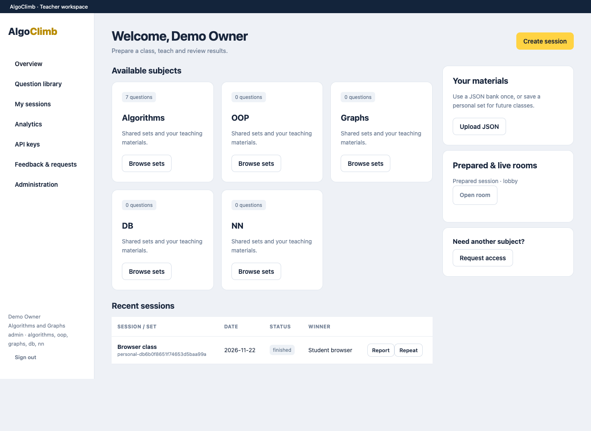
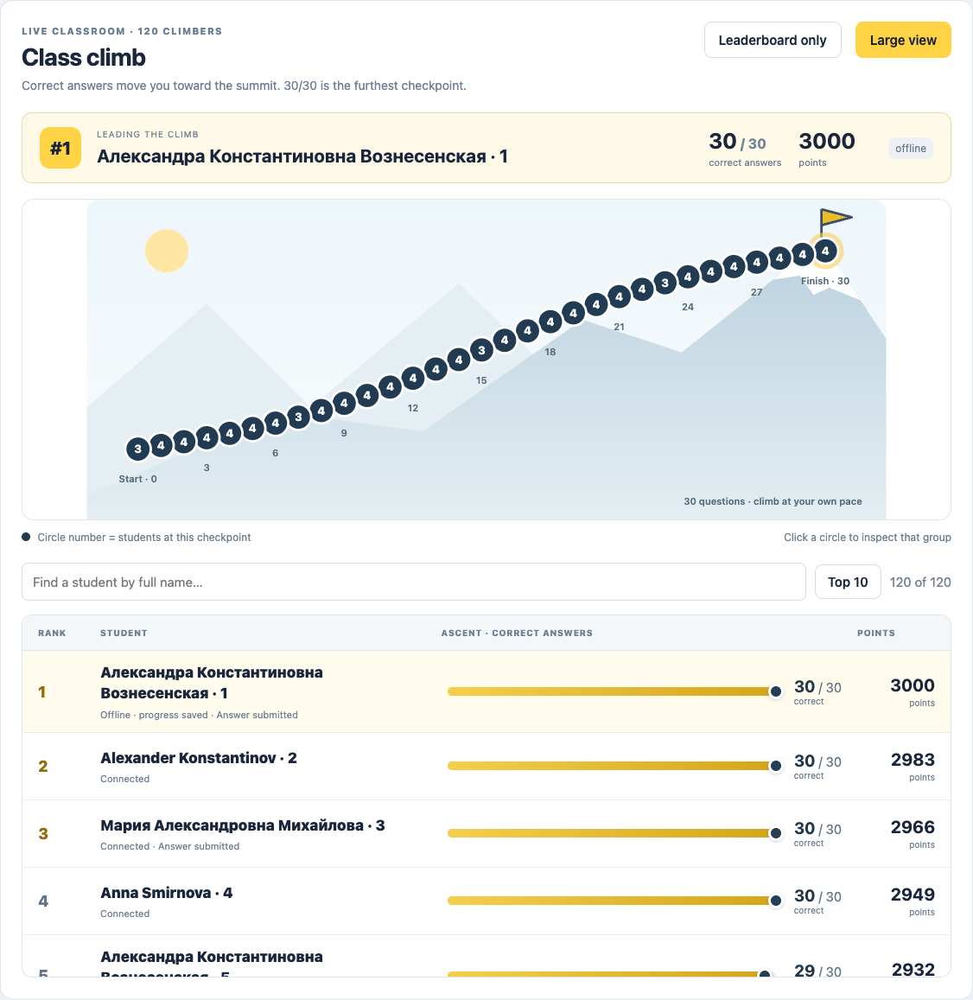

# Кабинет преподавателя: как провести занятие

[English](teacher-guide.md) · [README](../README.ru.md) · [Права, API и устройство кабинета](workspace.ru.md)

Интерфейс AlgoClimb — на английском. Ниже приведены точные названия кнопок; условия и ответы задач могут быть на русском или другом языке.

## Быстрый сценарий

1. Войдите в `/workspace` по персональному логину и паролю.
2. Откройте **Question library**, выберите раздел, нажмите **Clear selection**, затем **Select set** у нужного набора.
3. Нажмите **Configure session**. Укажите название, номер группы, режим раскрытия ответов и при необходимости геопроверку.
4. Нажмите **Open lobby**, покажите студентам QR через **Project join screen** и дождитесь участников.
5. Нажмите **Start session**. Следите за доской **Class climb**, при необходимости управляйте вопросами.
6. После занятия откройте **My sessions → Report**, проверьте рейтинг и посещение, выгрузите **Export CSV**.



## Первый вход и пароль

Преподавателю нужно приглашение от владельца платформы. Ссылка одноразовая, действует **48 часов**. Откройте её, укажите ФИО, предмет/организацию и задайте пароль длиной **10–256 символов**. Email из приглашения станет логином; у владельца может быть отдельный логин без email.

При последующих посещениях используйте **Username or email** и пароль. Вход действует 12 часов; если сессия входа истекла, войдите заново.

Через **Account & password** можно изменить ФИО, предмет и пароль. Понадобится текущий пароль. Сохранение отзывает предыдущие входы и API-ключи; для интеграций создайте новые ключи.

Если пароль потерян, обратитесь к владельцу: он выдаст одноразовую ссылку восстановления на один час. Приложение не отправляет письма автоматически. Приглашение и восстановление передаются лично или через согласованный канал связи.

## Где что находится

| Раздел | Для чего нужен |
| --- | --- |
| **Overview** | Доступные предметы, недавние результаты и открытые комнаты. |
| **Question library** | Разделы, наборы, поиск, просмотр и выбор вопросов. |
| **Current session** | Подключённая комната: лобби, студенты, доска и управление занятием. Появляется после открытия комнаты. |
| **My sessions** | Открытые комнаты, сохранённые результаты и отчёты, доступные вам для чтения. |
| **Analytics** | Выбор отчёта и подробный разбор результатов. |
| **API keys** | Ключи только для чтения сессий и результатов на 24 часа. |
| **Feedback & requests** | Обратная связь, запросы разделов и публикации своих наборов. |
| **Administration** | Только у владельца: преподаватели, приглашения, права и заявки. |

Доступ к разделу OOP не открывает автоматически все чужие OOP-сессии. По умолчанию преподаватель видит свои результаты; владелец может отдельно дать чтение конкретного отчёта. Такой доступ не передаёт управление исходной комнатой.

## Выбор вопросов

В **Question library** сначала выберите предмет: Algorithms, OOP, Graphs, DB или NN. Видны только разрешённые вам разделы. Внутри находятся готовые и личные наборы; пустой раздел ещё не содержит задач.

- **Preview questions** — показать вопросы набора в таблице.
- **Preview** — прочитать условие отдельного вопроса; **Add to selection** добавляет его к выбору.
- **Select set** — выбрать все вопросы этого набора.
- Флажки в таблице — добавить или убрать отдельные вопросы.
- **Clear selection** — очистить весь накопленный выбор.
- **Search** — искать по названию или тексту вопроса; **Clear search** сбрасывает поиск.
- **Configure session** — перейти к подготовке занятия.

**Выбор накапливается:** переключение раздела или просмотр другого набора его не очищает. Перед новым занятием используйте **Clear selection** и проверьте число выбранных вопросов. Если ничего не выбрать, сервер использует доступный преподавателю банк, а не только видимый на экране раздел.

## Загрузка своего JSON

Нажмите **Upload JSON** на главной странице или в библиотеке:

1. Введите **Set / session title** и выберите **Subject**.
2. В **Keep this bank** выберите **One session only** или **Save to my personal library**.
3. Выберите JSON-файл размером до **2 MiB**: массив из **1–500 вопросов** либо объект с полем `tasks`, содержащим такой массив.
4. Нажмите **Validate & import**. При ошибке исправьте указанный вопрос/поле и повторите загрузку; частично банк не импортируется.

| Режим | Что произойдёт |
| --- | --- |
| **One session only** | Создаётся отдельная комната с отдельным банком. Импорт нужно запустить в течение часа. В общую/личную библиотеку он не добавляется, но данные проведённой сессии сохраняются в отчёте. |
| **Save to my personal library** | Набор сохраняется для следующих занятий. По умолчанию его видите только вы; для общей публикации нужен запрос владельцу. |

Минимальный пример для раздела OOP:

```json
[
  {
    "id": "oop-encapsulation-01",
    "section": "oop",
    "type": "choice",
    "level": 1,
    "title": "Инкапсуляция",
    "prompt": "Что является примером инкапсуляции?",
    "options": [
      "Изменение закрытого поля через публичный метод объекта",
      "Прямое изменение всех полей объекта из любого участка программы"
    ],
    "answer": 0
  }
]
```

`answer` — индекс правильного варианта, начиная с нуля. Описание пяти типов и примеры сложных задач: [руководство по JSON-банкам](task-bank.ru.md).

## Подготовка и лобби

В **Prepare session** задайте:

| Поле | Значение |
| --- | --- |
| **Session title** | Понятное название, например «OOP · Группа 2 · Семинар 3». |
| **Group / cohort number** | Номер группы/потока от 1 до 99999. |
| **Show answer correctness** | **After session ends** — по умолчанию; **After each answer** — сразу; **Teacher only** — без показа студенту правильных ответов в итоговом разборе. |
| **Check attendance by location** | Необязательная проверка вокруг положения преподавателя. |
| **Attendance radius (meters)** | Радиус геопроверки, если она включена. |

**Open lobby** открывает вход в комнату, но ещё не запускает вопросы. **Start session** запускает занятие.

Покажите QR и ссылку из **Student access**. Через **Project join screen** откроется отдельное окно для аудитории; если браузер блокирует его, разрешите всплывающие окна для сайта. Это экран входа, а не трансляция всех приватных элементов кабинета. **Copy join link** копирует ссылку именно этой комнаты.

Попросите студентов вводить назначенные им имена/идентификаторы последовательно. В **Participants** видны полные имена и наблюдаемые сервером статусы **connected/offline**. Участники могут повторять имена в разных комнатах, но внутри комнаты чужой занятый ник нельзя восстановить без секрета исходного браузера.

В текущей версии новый участник должен присоединиться **до Start session**. Уже вошедший может вернуться во время игры с сохранённым секретом. Другой браузер или очистка данных сайта могут лишить его возможности восстановить прежний вход.

## Во время занятия: управление и доска

Все участники комнаты получают один вопрос одновременно. Обычно вопрос закрывается после ответов всех доступных участников или по таймеру; для недавно отключившихся есть короткое окно ожидания.

| Кнопка | Действие |
| --- | --- |
| **Pause / Resume** | Остановить/продолжить текущий вопрос. Во время паузы ответы не принимаются. |
| **+15 seconds** | Добавить время к текущему вопросу. |
| **Skip question** | Завершить текущий вопрос досрочно; действие требует подтверждения. |
| **Finish session** | Досрочно закончить занятие и сохранить результаты; действие требует подтверждения. |

Пустой или неверно оформленный ответ можно исправить и отправить заново, если время не истекло. Корректно оформленный, но неправильный ответ расходует попытку. Повторная доставка одного ответа не начисляет дополнительные баллы.

### Class climb



Положение на горе определяется **числом правильных ответов**, место в рейтинге — баллами. Поэтому одинаковое положение на горе не обязательно означает одинаковые баллы.

- Число в круге — количество студентов на этой отметке, а не место одного студента.
- Нажмите круг, чтобы оставить в рейтинге соответствующую группу; **clear filter** снимает этот фильтр.
- Поле **Find a student by full name…** ищет по имени; **Clear search** очищает поиск.
- **Top 10 / Show everyone** переключает первые десять мест и полный список. Поиск и фильтр отметки продолжают действовать, пока вы их не снимете.
- Нажмите имя в рейтинге: карточка сверху выделит этого студента, а его отметка на горе получит подсветку.
- **Leaderboard only / Show mountain** скрывает/возвращает карту.
- **Large view** разворачивает доску. **Exit large view** или Escape возвращает обычный кабинет.

Длинные ФИО переносятся, а список прокручивается. При обновлении ответов поиск и положение прокрутки сохраняются. В длинных сессиях соседние отметки объединяются в диапазоны.

Если преподаватель видит **Reconnecting…**, дождитесь восстановления перед отправкой управляющей команды: занятие продолжает идти на сервере. Студенту при обрыве лучше вернуться с того же устройства и браузера, сохранив данные сайта.

## Посещаемость и баллы

Геопроверка включается **до запуска** в подготовке комнаты и требует HTTPS и разрешения на определение положения. Преподаватель задаёт центр и радиус **50–5000 м**; например, 200 м можно взять для первого испытания в аудитории. Если положение преподавателя слишком неточное для выбранного радиуса, повторите определение или измените радиус.

После входа студент нажимает **Confirm attendance** и разрешает браузеру определить местоположение. Проверка отдельная: отказ, VPN или ошибка не должны прерывать выполнение вопросов.

| Статус | Как его понимать |
| --- | --- |
| **in zone** | Показание с учётом заявленной погрешности помещается в выбранную зону. |
| **outside** | Показание с учётом погрешности находится вне зоны. |
| **needs review** | Положение недоступно, неточно или слишком близко к границе для уверенного решения. |
| **not checked** | Подтверждение ещё не записано. |
| **confirmed** | Преподаватель подтвердил посещение вручную. |
| **rejected** | Преподаватель вручную отметил отсутствие. |

В **Current session → Participants** используйте **Confirm presence** или **Not present**. Ручное решение не перезаписывается последующей геопроверкой. Сделайте проверку до закрытия комнаты: завершённая комната доступна около 24 часов, а затем остаётся только сохранённый отчёт.

Геолокация не гарантирует присутствие: координаты могут быть неточными или подменёнными. Обычный VPN сам по себе не обязан менять GPS, но используемые устройством источники координат могут влиять на результат. При начислении оценок разумно лично проверить спорные случаи и верхнюю часть рейтинга.

**Баллы и посещение разделены.** Отметка отсутствия не удаляет ответы, не меняет автоматически место в рейтинге и не обнуляет баллы. Для выдачи оценок используйте проверку посещения и соответствующий CSV-фильтр.

## Отчёты и экспорт

Откройте **My sessions → Report**. Также можно выбрать отчёт через **Analytics**; после завершения текущего занятия доступна кнопка **Open saved report**.

| Вкладка | Что смотреть |
| --- | --- |
| **Overview** | Участники, общая правильность, график вопросов и первые места. Карточки и столбцы ведут к деталям. |
| **Leaderboard** | Места, баллы, правильные ответы и статус посещения; **View all answers** открывает студента. |
| **Students** | Матрица «студент × вопрос»: ✓ — правильно, ✕ — неправильно, — — нет ответа. Имя/ячейка ведут к индивидуальному разбору. |
| **Questions** | Тип, число ответивших, правильность и **Inspect answers** для конкретного вопроса. |
| **Connections** | Времена событий подключения и работы со страницей. |

В карточке студента сравниваются его ответ и правильный ответ по каждому сохранённому вопросу, время и баллы. Фильтры **Incorrect**, **No answer**, **Correct** помогают разобрать ошибки. Через **Question statistics** можно перейти к ответам всех участников на тот же вопрос.

В **Connections** событие `tableave` означает скрытие вкладки во время отображения вопроса. Переключение приложения или блокировка телефона тоже могут его вызвать. Если связь оборвалась, событие может не дойти; длительность отсутствия сейчас не записывается. Это наблюдение, а не доказательство списывания.

Через **Export CSV** выберите:

- **All participants · CSV** — все итоговые результаты;
- **Confirmed / in-zone only · CSV** — только вручную подтверждённые или попавшие в геозону участники.

При включённом фильтре участник с `needs review` не попадёт в выгрузку, пока его не подтвердят вручную. Старые сессии могут не содержать полных условий и текста ответов: приложение показывает только реально сохранённые сведения.

**Repeat** повторно выбирает доступные в библиотеке вопросы и открывает подготовку новой комнаты. Оно не возобновляет старую игру. Перед повтором проверьте состав и число: недоступные вопросы не попадут в выбор. Если вопросы были только в разовом банке, удалены или недоступны, загрузите их заново либо выберите другой набор.

## Ключи API

В **API keys → Create API key** задайте название, нажмите **Generate** и скопируйте секрет: он показывается один раз. Ключ живёт **24 часа**; **Revoke** отзывает его раньше.

Ключ разрешает только чтение собственных и явно предоставленных вам отчётов в доступных разделах. Он не даёт управления занятиями или доступа к Administration. Пароль аккаунта, ссылку приглашения и API-ключ не передавайте студентам и не вставляйте в публичные репозитории.

Список маршрутов и примеры: [руководство по кабинету и API](workspace.ru.md#api).

## Обратная связь и доступ к разделам

Откройте **Feedback & requests → New request** и выберите тип:

| Тип | Что писать в поле Title |
| --- | --- |
| **Feedback / report a problem** | Краткое описание проблемы; в Message — шаги и примерное время. |
| **Access to existing subject** | Точный ID раздела: `algorithms`, `oop`, `graphs`, `db` или `nn`. |
| **Propose new subject** | Название новой дисциплины и зачем она нужна. |
| **Publish my set for everyone** | ID личного набора из библиотеки, например `personal-…`, а не его отображаемое название. |

Ответ и статус заявки видны в том же разделе. Одобрение доступа к существующему предмету выдаёт право его использовать. Новые предметы пока добавляются отдельно администратором/разработчиком; одобрение предложения не создаёт раздел автоматически.

## Если что-то не получается

| Ситуация | Действие |
| --- | --- |
| Ссылка приглашения не работает | Попросите владельца проверить срок, отмену и использование ссылки и при необходимости выдать новую. |
| Нужного раздела нет | Отправьте запрос доступа; его видимость определяется правами аккаунта. |
| Не получается создать комнату | Закройте ненужные незавершённые комнаты в **My sessions → Close room**. Лимит — пять. Идущую сначала завершите. |
| QR/окно проектора не открывается | Разрешите всплывающие окна, используйте **Copy join link**. Вход — по ссылке конкретной комнаты. |
| Студент не может впервые войти после старта | В текущей версии новые участники входят до старта. Возврат ранее вошедших — с исходного браузера. |
| Не виден чужой отчёт того же предмета | Попросите владельца выдать чтение через **Share report**. Одного права на предмет недостаточно. |
| Геолокация не определяется | Проверьте HTTPS и разрешение браузера либо подтвердите посещение вручную. |
| API перестал отвечать | Проверьте срок ключа, отзыв, пароль/блокировку аккаунта и права на раздел; при необходимости создайте новый ключ. |
| Обновлённая доска не появилась | Обновите страницу преподавателя. |

**Close room** закрывает вход и убирает комнату, но не удаляет сохранённые результаты. Перед закрытием проверьте посещение. Старые завершённые игровые комнаты автоматически освобождаются через 24 часа, отчёты остаются.

## Только для владельца

В **Administration → Invite teacher** владелец указывает email и разделы, создаёт ссылку и передаёт её коллеге; письма автоматически не отправляются. В **Teachers → Manage** можно изменить доступ, выдать восстановление, отозвать ключи, заблокировать сейчас/после занятия либо убрать аккаунт с передачей личных наборов владельцу.

Для отдельного отчёта откройте **Report → Share report**, укажите email, разделы отчёта и **Grant view access**. Приглашение ещё может ожидать активации. **Revoke view access** снимает это право. Управление комнатой при этом не передаётся. Раздел Administration скрыт у преподавателей и защищён проверкой роли на сервере.

### Необязательная настройка времени

В **Prepare session → Time per question type (optional)** можно задать время в целых секундах (5–3600) отдельно для выбора ответа, построения графа, обхода/упорядочивания, сортировки и пропусков. Пустое поле сохраняет `timeLimit` конкретного вопроса или стандартное время платформы. Настройка сессии имеет приоритет над JSON, применяется к таймеру и бонусу за скорость, сохраняется при переподключении и восстановлении сервера. После старта изменить её нельзя. Другие сессии и банк задач не меняются.
