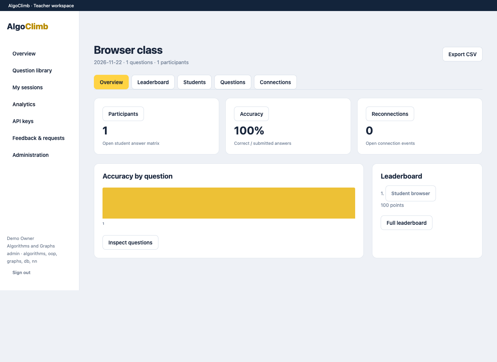
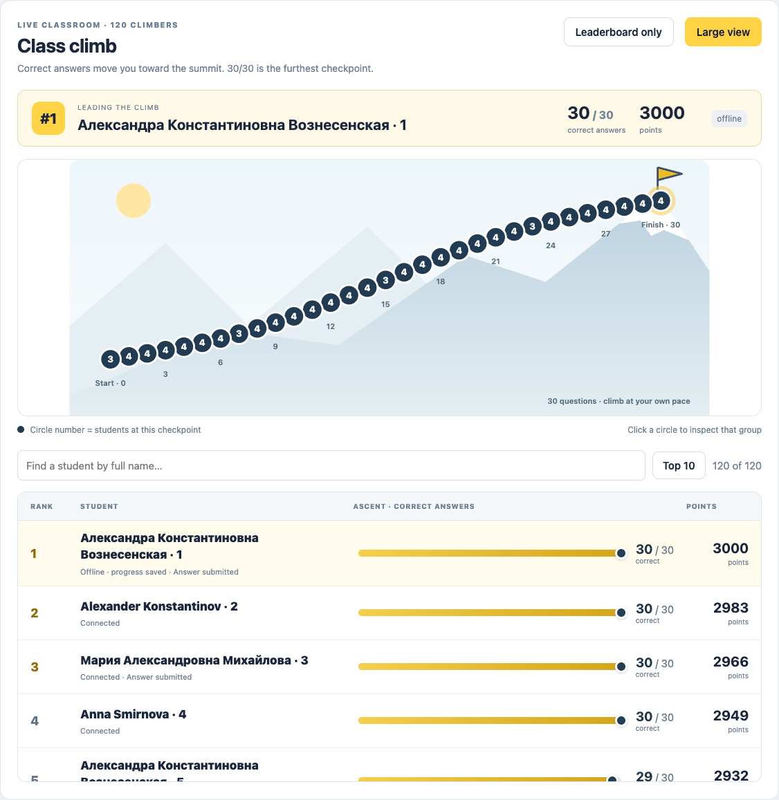

# Personal teacher workspace

[Русский](workspace.ru.md) · [README](../README.md)

## Accounts without SMTP

1. The owner creates an invitation under **Administration → Invite teacher**, assigns subjects and sends the link privately through an existing communication channel.
2. The link is single-use and expires in 48 hours. The teacher enters their name, teaching subject/institution and a password (10–256 characters). The invitation binds the email login; email is not verified by an email provider.
3. Teachers subsequently sign in with their personal login/password. Sessions use HttpOnly, SameSite cookies (Secure under HTTPS), with a 12-hour lifetime. Passwords are salted PBKDF2-HMAC-SHA256 hashes; invitation, login and API secrets are stored as hashes.
4. For a forgotten password, the owner checks the colleague's identity out of band and generates a **one-hour recovery link**. Consuming it changes the password, revokes previous logins/API keys and invalidates the link. Reissuing recovery invalidates the previous link. Cancel unused invitations in Administration.
5. The owner can revoke credentials, edit subject access, suspend now or after current running classes, and remove access while retaining attribution. Removed teachers' personal sets transfer to the owner. The owner account cannot be removed through this screen.

No SMTP server, port 25, KYC or mail delivery service is required. Keep the owner password and server access separately. Server operators can use `python tools/provision_owner.py --email admin@example.org --name 'Owner' --subject 'Teaching' --output /private/path/credentials.json` in the application environment for initial provisioning. This command refuses to replace an existing owner. Keep its output file private and outside Git. Owner recovery requires trusted server access and a database-backed one-use recovery token; never publish credentials in a GitHub issue.

## Subjects and reusable material

Algorithms, OOP, Graphs, DB and NN are the initial section catalogue. Existing `comb1` stays wholly in Graphs. The catalogue is fixed in this release; new-subject requests collect proposals for an administrator/developer to add later. Approving an existing-subject request grants the corresponding subject ID. A proposal's approval alone does not create a new subject.

Permanent JSON imports are personal to their owner and placed in an allowed section. Each import gets namespaced question IDs, so two teachers' files cannot collide. A **publish** request uses the personal set ID shown below its name in the library; owner approval makes that set available to teachers permitted to use its subject. Imported banks support all five existing task types, with size/schema validation and no partial import on failure.

A one-session import creates a separate bank for that room, with a one-hour start window. It does not change the shared library. Session snapshots preserve question conditions and correct answers for later reporting. Repeating a session currently requires its question IDs to remain in the permitted library; reupload temporary banks to repeat those workshops.



## Live rooms and analytics

Finished live rooms expire after 24 hours to release memory; saved reports and attendance remain in SQLite.

Each room has an unguessable join URL and isolated roster, timers, imports and reconnect storage. Up to five unfinished rooms per teacher are permitted; close unused rooms in My sessions. One Uvicorn worker is required. SQLite and per-room snapshots live under the persistent runtime volume. Snapshots are written approximately every two seconds and on graceful shutdown; a crash can lose the most recent unsaved progress.

The teacher workspace has Overview, Question library, My sessions, Analytics, API keys and Feedback & requests. Owner-only Administration contains users, invitations, recovery, keys, publication requests and an audit log.

Reports have real navigation: Overview, Leaderboard, Students, Questions and Connections. A student's page compares their answer with the correct answer for every recorded question. A question page lists all participants' answers. Connection events identify reconnects/disconnects, not their root cause. New sessions save detailed text, timing and points; old sessions cannot reconstruct answers or question versions that were never saved. Legacy sessions remain visible to the owner.

### Classroom climb display

The Class climb board combines a mountain route with a readable ranked list. Correct answers determine checkpoint progress; points remain a separate ranking value. Students at the same checkpoint share a numbered marker rather than overlapping name labels. Click a marker to filter that group, search by full name, focus a student, show the top ten, or switch to the leaderboard alone. Large view expands the board; Escape exits it. Search focus and scroll position are retained during live updates. Longer sessions group nearby checkpoints to keep the map readable.



## Optional attendance by location

Enable attendance while preparing the room, request the teacher's position and choose a 50–5000 m radius. Start with a site-tested radius, for example 200 m. A center whose reported uncertainty exceeds that radius is rejected; retry with a better reading. No maps, paid geocoding service or continuous tracking are used.

Students explicitly request a fresh location reading. The server checks distance, both devices' reported accuracy and freshness. Results are **in zone**, **outside**, or **needs review**. Unavailable/denied location permission does not stop joining, answering or reconnecting. The teacher can mark **confirmed** or **rejected** independently; later location attempts cannot overwrite that manual decision. The server stores distance, accuracy, status, reviewer and time, not the student's raw latitude/longitude. The teacher's center is retained in the private room snapshot.

Browser geolocation requires HTTPS (localhost is a development exception). A normal VPN does not necessarily change device positioning, but fallback providers and location-spoofing tools can affect it. Coordinates are client-provided and cannot establish presence conclusively. Review top-ranking participants personally when awarding grades. Quiz score is not changed by attendance; CSV exports can include everyone or only manually confirmed/in-zone students.

## Read-only developer access

Create a named key under API keys. Copy it once, keep it server-side and send `Authorization: Bearer <key>`. It expires after exactly 24 hours and can be revoked earlier. Authentication is checked against the current owner account, session ownership and subject permissions on each request. A teacher cannot access another teacher's report by guessing a session ID. The owner may explicitly grant read-only access to selected reports with **Share report**; grants also work for pending invitations and never transfer room controls. Current subject permissions still apply.

```sh
curl -H "Authorization: Bearer $ALGOCLIMB_API_KEY" https://your-host/api/v1/sessions
curl -H "Authorization: Bearer $ALGOCLIMB_API_KEY" https://your-host/api/v1/sessions/42/results
```

Other subresources: `answers`, `attendance`, `events`. Pagination uses `limit` and `offset`; no write/session-control access is granted. Administrator keys have owner-wide history access. The old shared-key developer portal is disabled after initial owner setup.

## Deployment and validation

Back up SQLite with its backup API and copy runtime snapshots before migration; do not simply copy a live WAL database file. Build and test a candidate image using a separate runtime volume before replacing production. Use HTTPS reverse proxying with WebSocket support. Set PUBLIC_URL to the public HTTPS host. Keep a rollback image and backup: the schema additions are additive, but a rollback will not expose new account features.

Validation includes backend authorization tests, real-browser invitation/session/report flows and an isolated synthetic-client reconnect benchmark. These checks do not guarantee classroom Wi-Fi, mobile OS background behavior or location accuracy; test the attendance radius on site before using it for grading.

When using Docker behind a host-side proxy, set `BIND_IP=127.0.0.1` and set `FORWARDED_ALLOW_IPS` to the actual local proxy/Docker gateway IP plus `127.0.0.1`. This lets Uvicorn recognize the original HTTPS scheme and issue Secure cookies. Do not trust arbitrary forwarded headers on a publicly exposed application port.
