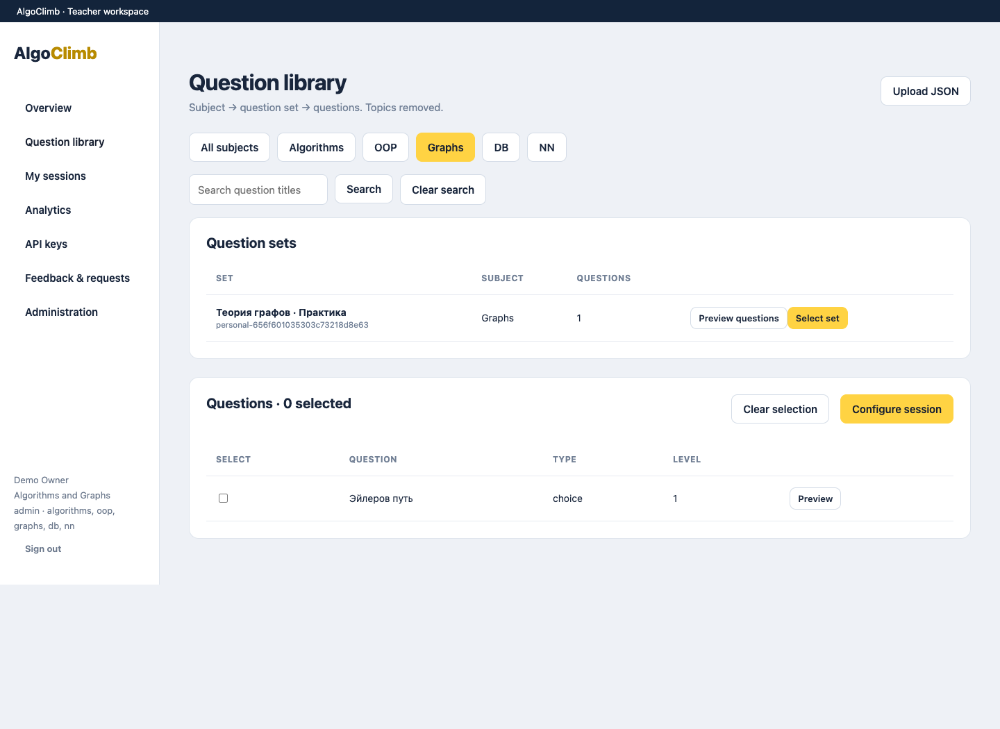

# Персональный кабинет преподавателя

[English](workspace.md) · [README](../README.ru.md)

## Доступ без SMTP

1. Владелец открывает **Administration → Invite teacher**, выбирает разделы и передаёт ссылку коллеге лично или через привычный канал связи.
2. Приглашение одноразовое, действует 48 часов. Преподаватель вводит ФИО, предмет/организацию и пароль длиной 10–256 символов. Email привязан к приглашению и служит логином; проверка через почтовый сервис не выполняется.
3. Далее вход — по персональному логину и паролю. HttpOnly/SameSite cookie действует 12 часов, через HTTPS имеет флаг Secure. Пароли хранятся как солёные PBKDF2-HMAC-SHA256 хеши, секреты приглашений, входа и API — в виде хешей.
4. При потере пароля владелец лично проверяет, кто обращается, и создаёт **ссылку восстановления на один час**. Использование меняет пароль, отзывает старые входы/API-ключи и погашает ссылку. Повторная выдача отменяет предыдущую ссылку. Неиспользованные приглашения можно отменить.
5. Владелец меняет разделы, отзывает ключи и входы, блокирует сразу либо после текущих занятий. При удалении доступа история сохраняет авторство, личные наборы передаются владельцу. Самого владельца через этот интерфейс удалить нельзя.

SMTP, порт 25 и регистрация в почтовом сервисе не нужны. Храните пароль владельца отдельно от доступа к VPS. Для первоначального создания на сервере есть `python tools/provision_owner.py --email admin@example.org --name 'Владелец' --subject 'Преподавание' --output /закрытый/путь/credentials.json`. Команда не заменяет существующего владельца. Файл с реквизитами нельзя добавлять в Git. Восстановление владельца выполняется через доверенный доступ к серверу и одноразовую ссылку из БД; реквизиты нельзя публиковать в GitHub.

## Разделы и наборы

Начальный каталог: Algorithms, OOP, Graphs, DB и NN. Старый `comb1` целиком остаётся в Graphs. В этом выпуске список разделов фиксированный: заявки на новые дисциплины собирают предложения для последующего добавления администратором/разработчиком. Одобрение заявки на существующий раздел выдаёт доступ к его ID; одобрение предложения само по себе новый раздел не создаёт.

Постоянный JSON становится личным набором в разрешённом разделе. Импорт получает уникальные ID задач, поэтому файлы разных преподавателей не конфликтуют. Для публикации отправьте запрос **publish** с ID набора, который показан под названием в библиотеке. После одобрения владельцем набор доступен преподавателям с правами на соответствующий раздел. Поддерживаются пять типов задач, проверка структуры/размера и отсутствие частичного импорта при ошибке.

Разовый импорт создаёт отдельный банк комнаты с часовым окном для запуска и не меняет библиотеку. Условия и правильные ответы сохраняются в снимке проведённой сессии. Повтор через Repeat сейчас требует наличия прежних ID в разрешённой библиотеке; разовый банк для нового занятия загрузите повторно.



## Комнаты и аналитика

Завершённые игровые комнаты удаляются из памяти через 24 часа; отчёты и посещаемость сохраняются в SQLite.

У каждой комнаты своя ссылка входа, участники, таймеры, импорт и секреты восстановления. Допускается до пяти незавершённых комнат преподавателя; ненужные закрываются в My sessions. Нужен один Uvicorn worker. SQLite и отдельные снимки комнат хранятся в постоянном runtime-томе. Снимок обновляется примерно раз в две секунды и при штатной остановке; при аварии возможна потеря последних несохранённых изменений.

В кабинете: Overview, Question library, My sessions, Analytics, API keys, Feedback & requests. Только у владельца есть Administration с пользователями, приглашениями, восстановлением, ключами, заявками публикации и журналом действий.

В отчёте отдельные вкладки Overview, Leaderboard, Students, Questions, Connections. Карточка студента показывает его ответ рядом с правильным по каждому сохранённому вопросу. Карточка вопроса — ответы всех участников. События подключения показывают наблюдаемый обрыв/возврат, но не доказывают причину. Новые сессии сохраняют текст ответа, время и баллы. Для старых нельзя восстановить то, чего не было в БД; их существующие результаты доступны владельцу.

## Геопроверка посещения

При подготовке комнаты включите проверку, определите положение преподавателя и выберите радиус 50–5000 м. Например, начните с 200 м и проверьте на месте. Если погрешность центра больше радиуса, определение нужно повторить. Карты, платные геосервисы и постоянное отслеживание не используются.

Студент сам разрешает определение свежего положения. Сервер проверяет расстояние, погрешности обоих устройств и свежесть показания. Статусы: **in zone**, **outside**, **needs review**. Отказ/ошибка геолокации не мешает входу, ответам и переподключению. Преподаватель может выставить **confirmed** или **rejected** вручную; последующие попытки геопроверки это решение не перезаписывают. Для студента сохраняются расстояние, погрешность, статус, проверивший и время, без исходных широты/долготы. Центр преподавателя остаётся в закрытом снимке комнаты.

Нужен HTTPS; localhost — исключение для разработки. Обычный VPN не обязательно меняет GPS, однако источники координат и инструменты подмены влияют на результат. Координаты поступают с устройства и не дают гарантированного доказательства присутствия. При выставлении оценок проверяйте топ рейтинга лично. Баллы викторины не меняются от посещения; CSV можно выгрузить для всех или только вручную подтверждённых/попавших в зону.

## API

В API keys создайте именованный ключ и скопируйте один раз. Он действует ровно 24 часа и передаётся в заголовке `Authorization: Bearer <key>`. В каждом запросе проверяются активность владельца ключа, принадлежность сессии и текущие права по разделам. Подбор ID чужой сессии не даёт доступа к её отчёту.

```sh
curl -H "Authorization: Bearer $ALGOCLIMB_API_KEY" https://ваш-домен/api/v1/sessions
curl -H "Authorization: Bearer $ALGOCLIMB_API_KEY" https://ваш-домен/api/v1/sessions/42/results
```

Подресурсы: `answers`, `attendance`, `events`; пагинация `limit` и `offset`. Запись и управление занятиями API-ключ не разрешает. Ключ владельца имеет доступ ко всей истории. Старый способ выдачи по общему ключу после создания владельца отключён.

## Выкатка и проверка

Перед миграцией сохраните SQLite через backup API и снимки runtime; копирование одного файла живой WAL-БД недостаточно. Сначала собирайте и проверяйте кандидат с отдельным томом, затем заменяйте production. HTTPS-прокси должен поддерживать WebSocket; PUBLIC_URL содержит публичный HTTPS-адрес. Сохраняйте предыдущий образ и резервную копию для отката.

Проверки включают авторизацию, браузерные сценарии приглашения/сессии/аналитики и изолированный тест синтетических студентов с обрывами. Они не гарантируют качество Wi-Fi, поведение телефона в фоне и точность координат. Перед начислением оценок проверьте георадиус в аудитории.
